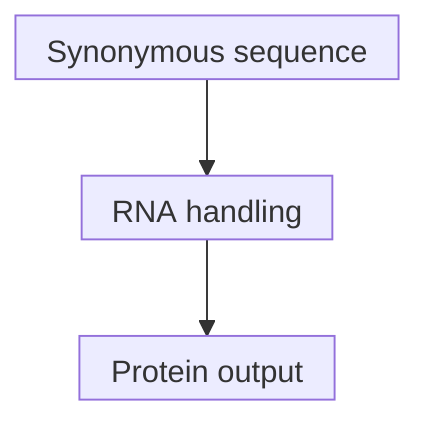

# Codon optimization

## In one sentence

Codon optimization changes synonymous codons in a coding sequence to influence RNA behavior and protein production while preserving the intended amino-acid sequence.

## The intuition

You can reword a direction without changing its destination. Similarly, several codons can specify the same amino acid. Rewording [RNA](/wiki/education/concepts/biology-basics/molecules/rna-and-mrna) may affect how the cell handles it. The analogy has limits: there is no universally best wording, and changing sequence can change RNA structure and translation even when the intended [protein](/wiki/education/concepts/biology-basics/molecules/protein-and-peptide) stays the same.

## How it works

A **codon** is a three-base coding unit. GCU and GCC both specify alanine. Replacing one with the other is a synonymous change: the intended amino acid remains alanine. This differs from an amino-acid-changing substitution or a change to the reading frame.

Transfer RNAs (tRNAs) bring amino acids to translating ribosomes. Their abundance and availability depend on the cell and its state. Codon frequency alone is therefore an incomplete guide to expression. Wu and colleagues measured codon-dependent RNA decay in human cell lines, connecting translation, codon composition and RNA stability.

RNA also folds through pairing within the strand. **Location matters.** Structure near translation initiation can interfere with access, while structure elsewhere can have different effects. In engineered reporter experiments, Mauger and colleagues separated codon usage from coding-region structure; more structured coding regions could prolong the period during which messages actively produced protein. Removing all structure or maximizing one codon-frequency score is not a universal optimum.

The phrase “optimized” should name an objective and tested context: protein output over time, RNA persistence, manufacturing behavior or another defined outcome. Prediction remains a design proposal until measured. [Nucleoside chemistry](/wiki/education/concepts/engineering-and-manufacturing/nucleic-acid-design/modified-nucleosides), cap, untranslated regions (UTRs) and delivery can also affect the result.

*The protein plan is retained; the RNA's measured behavior may change. “Optimized” does not predict the direction in every cell.*

## Why it matters in cancer

A synonymous redesign of antigen-encoding RNA does not fix the tumor mutation or turn one antigen into another. Greater protein output may help a design goal, but it cannot establish correct [antigen processing](/wiki/education/concepts/immunology/antigen-presentation/antigen-processing-machinery), display or T-cell recognition. With a [multi-epitope construct](/wiki/education/concepts/engineering-and-manufacturing/nucleic-acid-design/multi-epitope-constructs), changes to amino-acid spacers are a separate design change, not synonymous codon optimization.

## How it is measured

| Assay question | What to record |
|---|---|
| **Measures / how** | Sequence/identity checks, an RNA time course and protein quantity/identity or activity in a defined cell system. |
| **Input / consumption** | Consumed aliquots and cells; compare matched RNA amount, chemistry, cap, UTRs, purity, delivery and sampling times. |
| **Output / units** | RNA abundance or measured decay time; protein concentration or reporter units. State whether functional lifetime is inferred from an expression model. |
| **Thresholds** | Predefined assay limits and comparison criteria. No codon-usage cutoff establishes a clinical optimum. |
| **Failure modes** | Unequal uptake, toxicity, protein persistence masking RNA loss, or changing several design variables together. |
| **Cannot tell** | A reporter signal alone cannot establish RNA half-life, translation fidelity, antigen presentation or benefit. |
| **Validation context** | Reporter and cell-line results support those constructs and systems; transfer to a new cell, formulation or antigen needs testing. |

## Common confusions

- **Same intended amino acids versus identical RNA:** a synonymous redesign preserves one layer, not every property.
- **RNA persistence versus functional lifetime:** detectable RNA need not still be actively translated.
- **Codon-frequency score versus evidence:** a score is a model output, not a measured improvement.
- **More protein versus a better [neoantigen](/wiki/education/concepts/immunology/antigen-presentation/neoantigen):** downstream display and recognition are separate questions.

## Try it

A fictional comparison uses matched cells and purified RNA. Two synonymous versions encode the same antigen. At the stated time, B gives 200 reporter units and A gives 100. May the team claim “twice the RNA lifetime” or “a better neoantigen”?

**Answer:** B gives twice the reporter signal at that time. The experiment does not separate translation rate, RNA lifetime and protein persistence. It also has not measured antigen display or recognition. Confirm the intended protein, inspect a time course and choose the next assay for the next claim.

## Explain it back

“Synonymous changes retain ___ but can alter ___; an optimization claim needs ___.”

One answer: “the intended amino acids; RNA structure and use; a defined objective and relevant comparison.”

## Takeaway

**Treat codon optimization as a testable sequence redesign, with its objective and biological context stated.**

## Related concepts

- [Construct anatomy](/wiki/education/concepts/engineering-and-manufacturing/nucleic-acid-design/mrna-construct-anatomy)
- [Modified nucleosides](/wiki/education/concepts/engineering-and-manufacturing/nucleic-acid-design/modified-nucleosides)

## Sources and scope

Source check: October 10, 2026. The arithmetic is fictional. These primary cell/reporter studies do not prescribe a clinical sequence; expert and learner review remain pending.

- [Wu et al., 2019: translation and codon-dependent RNA stability in human cells](https://elifesciences.org/articles/45396).
- [Mauger et al., 2019: RNA structure and functional message lifetime](https://pubmed.ncbi.nlm.nih.gov/31712433/).

<!-- BEGIN GENERATED USED IN -->
## Used in

- [Turn selected targets into an mRNA message](/wiki/education/guides/personalized-cancer-vaccine/06-writing-the-message)
- [How a personalized cancer vaccine is designed](/wiki/education/guides/personalized-cancer-vaccine/index)
<!-- END GENERATED USED IN -->
