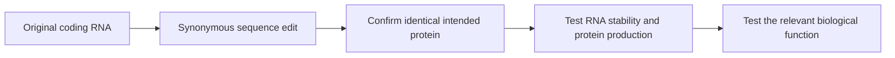

# Codon optimization

## In one sentence

Codon optimization changes synonymous codons in a coding sequence to influence RNA behavior and protein production while preserving the intended amino-acid sequence.

## The intuition

Imagine giving the same directions with different familiar words. The destination stays the same, but the reader may move through the instructions differently. Cells have their own reading machinery, and the RNA itself can fold or decay differently after an edit. There is no single wording that is best for every cell and purpose.

**Before you start:** [DNA → RNA → protein](/wiki/education/concepts/biology-basics/genetics/central-dogma) explains how RNA specifies amino acids; [mRNA construct anatomy](/wiki/education/concepts/engineering-and-manufacturing/nucleic-acid-design/mrna-construct-anatomy) separates coding and supporting regions.

## How it works

A **codon** is a three-letter RNA sequence that specifies an amino acid or a stop signal during translation. Many amino acids have more than one codon. For example, GCU and GCC both specify alanine. These are **synonymous** codons: an exchange can change the RNA sequence without changing that amino acid in the protein.

Designers may adjust synonymous choices to change translation, RNA stability or unwanted sequence features. **Codon usage** describes how frequently particular codons occur in a setting. Transfer RNAs bring amino acids to the ribosome, but their availability and the rest of the cell's translation machinery depend on cell state. A score based on codon frequency is one input, not a complete measurement of expression.

*Sequence equivalence and functional equivalence are different checks.*

Synonymous changes can also change **RNA secondary structure**: parts of the strand pair with one another. Location matters. A structure that interferes with translation initiation is different from a structure elsewhere that may support a longer useful RNA lifetime. “Remove every RNA structure” and “maximize every preferred codon” are poor universal rules. Primary human-cell experiments show that codon choices and RNA structure can affect message lifetime and output.

## Why it matters in cancer

For a vaccine, preserving the selected mutant amino-acid sequence is essential. A synonymous edit does not repair a tumor mutation or select a new target. It changes the message encoding the selected target. More protein still does not prove that the desired fragment is processed, displayed by [human leukocyte antigen (HLA)](/wiki/education/concepts/immunology/antigen-presentation/hla) or recognized on a tumor.

## Try it

Two fictional messages use different alanine codons but encode the same target windows. Version B makes more protein in a reporter assay. A reviewer calls it a “better [neoantigen](/wiki/education/concepts/immunology/antigen-presentation/neoantigen).” What should be corrected?

**Answer:** It is a candidate expression improvement. The antigen sequence has not changed. The team should confirm the full encoded protein and test relevant processing and recognition before claiming a better vaccine.

## Common confusions

- **Optimization versus guarantee:** The word describes a design objective, not proof that an algorithm found a universal optimum.
- **Synonymous versus biologically identical:** The protein sequence can match while RNA behavior differs.
- **Codon choice versus [modified nucleosides](/wiki/education/concepts/engineering-and-manufacturing/nucleic-acid-design/modified-nucleosides):** Sequence and chemical substitutions are separate design axes.
- **Reporter expression versus antigen display:** A bright reporter is not a tumor-recognition assay.

## Related concepts

- [Multi-epitope constructs](/wiki/education/concepts/engineering-and-manufacturing/nucleic-acid-design/multi-epitope-constructs) join target windows into a product.
- [Antigen-processing machinery](/wiki/education/concepts/immunology/antigen-presentation/antigen-processing-machinery) explains the next biological gate.

## Sources and scope

Source check: October 9, 2026; expert and learner review pending. These primary studies concern RNA behavior in experimental systems, not a clinical construct-design prescription.

- [Wu et al., 2019: codon-dependent mRNA stability in human cells](https://elifesciences.org/articles/45396).
- [Mauger et al., 2019: RNA structure and functional message lifetime](https://pubmed.ncbi.nlm.nih.gov/31712433/).

<!-- BEGIN GENERATED USED IN -->
## Used in

- [Turn selected targets into an mRNA message](/wiki/education/guides/personalized-cancer-vaccine/06-writing-the-message)
- [How a personalized cancer vaccine is designed](/wiki/education/guides/personalized-cancer-vaccine/index)
<!-- END GENERATED USED IN -->
