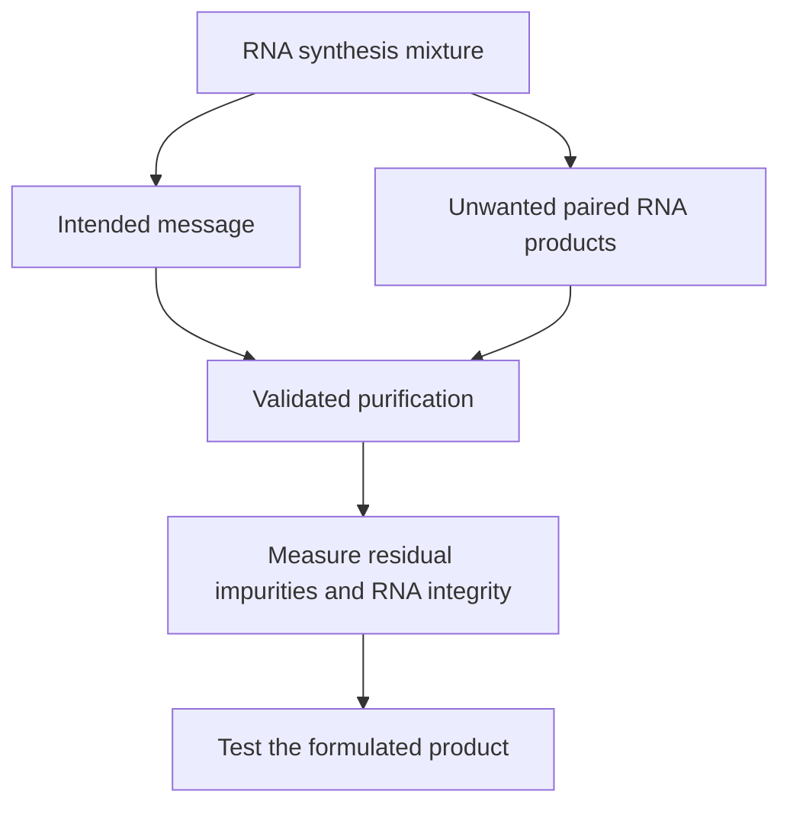

# Double-stranded RNA impurities and purification

## In one sentence

Double-stranded RNA impurities are unwanted paired RNA products that can arise during RNA manufacture and alter sensing or translation, so their removal and measurement are product-quality questions.

## The intuition

A copied message can come with extra material that the reader notices before reading the instructions. In an RNA preparation, an unwanted double-stranded product can activate cellular sensors even when the intended coding sequence is correct. Purification is therefore about the material accompanying the message as well as the message itself.

**Before you start:** [mRNA construct anatomy](/wiki/education/concepts/engineering-and-manufacturing/nucleic-acid-design/mrna-construct-anatomy) identifies the desired RNA; [in vitro transcription](/wiki/education/concepts/engineering-and-manufacturing/nucleic-acid-design/in-vitro-transcription) explains how it is synthesized.

## How it works

**Double-stranded RNA (dsRNA)** contains paired complementary RNA regions. During manufacturing, enzymes can make unintended transcripts that pair with the intended RNA or other products. In a primary study of T7 transcription, copying from a DNA end generated complementary RNA that could form long duplexes. That is one demonstrated mechanism, not the only possible source of paired RNA.

Cells have innate sensors that respond to RNA structures. Unwanted duplexes can stimulate inflammatory signaling and cellular programs that inhibit translation or accelerate RNA breakdown. The exact effect depends on the material, its length and structure, the cell and how it is delivered. Ordinary folding within a useful single RNA strand should not be equated with every long dsRNA contaminant.

*Purification must reduce relevant impurities while preserving a usable message.*

Methods such as chromatography or selective binding can separate material according to its properties. Primary studies have tested high-performance liquid chromatography and cellulose-based purification. Their results do not supply a universal process or threshold for every clinical product. A process also has to control other impurities, including residual template DNA and proteins.

## Why it matters in cancer

A vaccine needs an appropriate immune response, but uncontrolled manufacturing contaminants are not interchangeable with a specified adjuvant. Removing an impurity can improve expression without proving stronger tumor-specific immunity. [Modified nucleosides](/wiki/education/concepts/engineering-and-manufacturing/nucleic-acid-design/modified-nucleosides) do not guarantee that dsRNA is absent.

## How it is measured

An assay may use a dsRNA-binding antibody or another analytical method to detect paired RNA. Ask which structures it detects, its sensitivity, the sample preparation and whether formulation interferes. A report saying “not detected” means below that method's detection limit under the tested conditions, not proven absolute absence. Identity, integrity, impurity content, sterility and potency require different tests.

## Try it

A fictional batch passes its dsRNA assay but fails the full-length RNA test. Can it be called purified and ready for use?

**Answer:** It passed one impurity test. That result cannot establish intact RNA or override another quality failure. Review all predefined product criteria and the assay limits.

## Common confusions

- **RNA folding versus contamination:** Location, structure and assay definition matter.
- **Purity versus sterility:** Removing unwanted RNA does not establish absence of microorganisms.
- **Not detected versus zero:** Keep the detection limit attached to the statement.
- **More innate activation versus better vaccine:** Antigen-specific priming and clinical benefit need separate evidence.

## Related concepts

- [In vitro transcription](/wiki/education/concepts/engineering-and-manufacturing/nucleic-acid-design/in-vitro-transcription) is an upstream process.
- [Good manufacturing practice (GMP) and batch release](/wiki/education/concepts/engineering-and-manufacturing/cmc-and-quality/gmp-and-batch-release) explains how multiple quality questions fit together.

## Sources and scope

Source check: October 9, 2026; expert and learner review pending. These primary manufacturing experiments do not define an acceptable clinical impurity limit.

- [Mu et al., 2018: an origin of IVT-RNA immunogenicity](https://doi.org/10.1093/nar/gky177).
- [Karikó et al., 2011: HPLC purification and translation of modified mRNA](https://pubmed.ncbi.nlm.nih.gov/21890902/).
- [Baiersdörfer et al., 2019: cellulose-based removal of dsRNA contaminants](https://pubmed.ncbi.nlm.nih.gov/30933724/).

<!-- BEGIN GENERATED USED IN -->
## Used in

- [How a personalized vaccine is manufactured](/wiki/education/designing-a-vaccine/05-how-vaccines-are-manufactured)
- [How a personalized cancer vaccine is designed](/wiki/education/guides/personalized-cancer-vaccine/index)
<!-- END GENERATED USED IN -->
