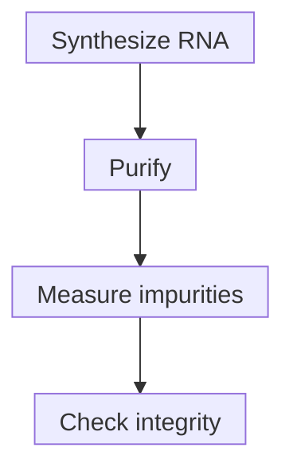

# Double-stranded RNA impurities and purification

## In one sentence

Double-stranded RNA impurities are unwanted paired RNA products that can arise during RNA manufacture and alter sensing or translation, so their removal and measurement are product-quality questions.

## The intuition

A manufacturing process can leave extra material that behaves differently from the intended message. Cells may respond to that extra material even when the main message has the right design. The analogy has a limit: there are several impurity types and sensing pathways, so one cleanup step or one measurement cannot describe them all.

## How it works

**Double-stranded RNA (dsRNA)** has paired complementary RNA regions. During [in vitro transcription](/wiki/education/concepts/engineering-and-manufacturing/nucleic-acid-design/in-vitro-transcription), T7 polymerase can make an unintended antisense strand that pairs with the intended strand. Mu and colleagues demonstrated promoter-independent initiation at a DNA end and activation of a long-dsRNA sensor in their experiments. This is one documented origin, not the only possible impurity mechanism.

A **truncated transcript** is shorter than intended; it is not synonymous with dsRNA. Short single-stranded fragments and paired products pose different analytical questions. Likewise, useful folding within an ordinary [mRNA](/wiki/education/concepts/biology-basics/molecules/rna-and-mrna) does not make every folded message an unwanted long duplex.

Innate sensing depends on RNA length, structure, chemistry, delivery and cell context. Unwanted RNA can change inflammatory signals or protein output. [Modified nucleosides](/wiki/education/concepts/engineering-and-manufacturing/nucleic-acid-design/modified-nucleosides) do not establish absence of dsRNA. Karikó and colleagues tested purification as an additional determinant of sensing and translation.

Chromatographic separation and selective binding are examples of cleanup strategies. Baiersdörfer and colleagues tested cellulose binding of dsRNA under specified conditions, with measurements of recovered message, integrity and cellular effects. Their method did not remove every tested short duplex equally. A purification improvement must therefore consider the structures removed, intended RNA recovered and other remaining contaminants; published method performance is not a clinical impurity limit.

*Lower dsRNA signal does not establish full-length RNA or absence of other contaminants. Independent checks remain necessary.*

## Why it matters in cancer

A vaccine may seek useful immune activation, but an uncontrolled manufacturing byproduct is not evidence of antigen-specific immunity. Cleaner RNA can improve a measured property in one system without proving tumor recognition or clinical benefit. The intended immune effect and acceptable product-quality attributes need explicit, separate definitions.

## How it is measured

| Assay question | What to record |
|---|---|
| **Measures / how** | A dsRNA-binding antibody assay or another characterized method; add independent size/integrity and relevant expression/sensing assays. |
| **Input / consumption** | Consumed RNA-lot aliquots; record extraction, dilution, formulation and handling because they can affect access and recovery. |
| **Output / units** | Antibody signal or calibrated dsRNA quantity relative to specified input; separately report intended-RNA recovery and size distribution. |
| **Thresholds** | [Detection and quantitation limits](/wiki/education/concepts/evidence-and-statistics/biomarkers/limits-of-detection-and-quantitation) and product-specific criteria. “Not detected” is bounded by the method. |
| **Failure modes** | An unrepresentative calibrator, insensitive recognition of some duplex structures, matrix interference, recovery loss or degradation during cleanup. |
| **Cannot tell** | One antibody assay cannot establish all RNA impurity structures, sterility, residual DNA or proteins, or biological safety. |
| **Validation context** | Qualify recognition, calibration, recovery and precision for the intended matrix. Research cleanup comparisons are not universal lot-release evidence. |

The primary studies illustrate assay specificity: their dsRNA antibodies recognize particular duplex structures, and recognition can depend on length and chemistry. A signal decrease is meaningful only with appropriate controls and comparable input.

## Common confusions

- **dsRNA versus any RNA structure:** duplex byproducts and intended intramolecular folding are different questions.
- **dsRNA versus truncated RNA:** strand pairing and transcript length are distinct properties.
- **Modified versus pure:** changing chemistry does not remove every contaminant.
- **Purity versus sterility:** microbial contamination requires different methods.

## Try it

A fictional purified batch has a much lower dsRNA-antibody signal than its matched input, with acceptable assay controls. Independent size analysis now shows substantial RNA fragmentation. Is it ready because the impurity signal improved?

**Answer:** The tested dsRNA readout improved, but integrity worsened. Reassess intended-product recovery, degradation and other specifications. Neither result answers every product-quality question, and the comparison does not establish biological efficacy.

## Explain it back

“Purification separates ___; a dsRNA assay detects ___; it does not establish ___.”

One answer: “specified unwanted material; structures within its validated scope; intact, functional RNA or clinical safety by itself.”

## Takeaway

**Measure both what purification removes and what remains of the intended message.**

## Related concepts

- [In vitro transcription](/wiki/education/concepts/engineering-and-manufacturing/nucleic-acid-design/in-vitro-transcription)
- [Modified nucleosides](/wiki/education/concepts/engineering-and-manufacturing/nucleic-acid-design/modified-nucleosides)

## Sources and scope

Source check: October 10, 2026. The exercise is fictional. These primary manufacturing experiments do not define an acceptable clinical impurity limit; expert and learner review remain pending.

- [Mu et al., 2018: an origin of IVT-RNA immunogenicity](https://doi.org/10.1093/nar/gky177).
- [Karikó et al., 2011: chromatographic purification, sensing and translation](https://pubmed.ncbi.nlm.nih.gov/21890902/).
- [Baiersdörfer et al., 2019: cellulose purification, recovery and duplex-length dependence](https://pubmed.ncbi.nlm.nih.gov/30933724/).

<!-- BEGIN GENERATED USED IN -->
## Used in

- [How a personalized vaccine is manufactured](/wiki/education/designing-a-vaccine/05-how-vaccines-are-manufactured)
- [Turn selected targets into an mRNA message](/wiki/education/guides/personalized-cancer-vaccine/06-writing-the-message)
- [How a personalized cancer vaccine is designed](/wiki/education/guides/personalized-cancer-vaccine/index)
<!-- END GENERATED USED IN -->
