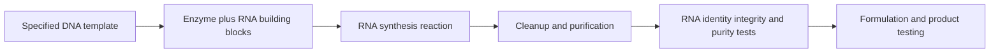

# In vitro transcription

## In one sentence

In vitro transcription makes RNA from a DNA template using enzymes outside living cells, after which the RNA must be purified and tested for its intended use.

## The intuition

The DNA template is a master pattern, and the transcription reaction makes RNA copies from it. A photocopier analogy helps explain copying, but misses an important detail: a biochemical reaction can produce incomplete copies and unwanted side products. Making the intended sequence is the beginning of quality control.

**Before you start:** [DNA → RNA → protein](/wiki/education/concepts/biology-basics/genetics/central-dogma) separates transcription from translation; [mRNA construct anatomy](/wiki/education/concepts/engineering-and-manufacturing/nucleic-acid-design/mrna-construct-anatomy) identifies the intended message.

## How it works

**In vitro** means outside a living organism, in a controlled experimental setting. For in vitro transcription (**IVT**), an **RNA polymerase** enzyme reads a DNA template and joins nucleotide building blocks into RNA. A **promoter** is the DNA sequence where the appropriate enzyme starts. T7 RNA polymerase is a commonly used enzyme for this purpose.

The template and process specify the RNA sequence, including the coding region and supporting features. A cap can be incorporated during synthesis or added enzymatically afterward. The poly(A) tail can be encoded in the template or added using a separate process. These are product-design choices; the label IVT does not reveal which strategy was used.

*The DNA pattern and the administered RNA product are different materials.*

A reaction can contain residual DNA, enzymes, unused building blocks, shortened RNA and [double-stranded RNA impurities](/wiki/education/concepts/engineering-and-manufacturing/nucleic-acid-design/dsrna-impurities-and-purification). Cleanup and purification need to address the relevant impurities. No single cleanup step can be assumed to remove every class.

Testing then asks whether the RNA matches the specified sequence, remains sufficiently intact and meets defined purity and functional requirements. **Integrity** describes the RNA's physical completeness; **identity** asks whether it is the intended material. A high RNA amount answers neither question by itself. Formulation and [batch release](/wiki/education/concepts/engineering-and-manufacturing/cmc-and-quality/gmp-and-batch-release) add further checks.

## Why it matters in cancer

A personalized vaccine's target list can change between recipients, while the manufacturing process still needs controlled specifications and reproducible tests. The DNA template is a manufacturing input, not the intended payload of a conventional mRNA vaccine. Residual template is a quality question, not evidence that the vaccine was designed as DNA gene therapy.

## Try it

A fictional laboratory produces the expected total RNA mass. Its integrity assay shows substantial short products. Is this a successful batch?

**Answer:** Amount alone is insufficient. The team must assess the actual RNA against its predefined integrity, identity, impurity and functional criteria. An expected yield does not cancel a failed quality test.

## Common confusions

- **Transcription versus translation:** IVT makes RNA; ribosomes later make protein in recipient cells.
- **Transcription versus reverse transcription:** The latter copies RNA into DNA, the opposite information direction.
- **Synthesis versus release:** Laboratory synthesis does not establish a sterile, stable, clinically authorized product.
- **Modified versus unmodified RNA:** IVT can use different building-block chemistries according to the specification.

## Related concepts

- [Modified nucleosides](/wiki/education/concepts/engineering-and-manufacturing/nucleic-acid-design/modified-nucleosides) change RNA chemistry.
- [RNA-lipoplex](/wiki/education/concepts/engineering-and-manufacturing/delivery-vehicles/rna-lipoplex) is one way to formulate the resulting RNA.

## Sources and scope

Source check: October 9, 2026; expert and learner review pending. This describes process logic, not an executable manufacturing recipe or release specification.

- [Henderson et al., 2021: a primary protocol for capped-mRNA synthesis and characterization](https://doi.org/10.1002/cpz1.39).
- [Mu et al., 2018: an origin of immunogenic double-stranded RNA during IVT](https://doi.org/10.1093/nar/gky177).
- [Sahin et al., 2026: primary RNA-vaccine manufacturing methods in TNBC-MERIT](https://www.nature.com/articles/s41586-025-10004-2).

<!-- BEGIN GENERATED USED IN -->
## Used in

- [How a personalized vaccine is manufactured](/wiki/education/designing-a-vaccine/05-how-vaccines-are-manufactured)
- [How a personalized cancer vaccine is designed](/wiki/education/guides/personalized-cancer-vaccine/index)
<!-- END GENERATED USED IN -->
