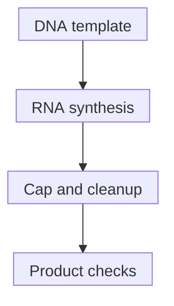

# In vitro transcription

## In one sentence

In vitro transcription makes RNA from a DNA template using enzymes outside living cells, after which the RNA must be purified and tested for its intended use.

## The intuition

Think of making copies from a master, then checking what the copying process actually produced. The master is [DNA](/wiki/education/concepts/biology-basics/molecules/dna); the product is [RNA](/wiki/education/concepts/biology-basics/molecules/rna-and-mrna). The analogy stops at copying: molecular synthesis can produce incomplete or unintended material, and a correct template does not certify every product molecule.

## How it works

**In vitro** means outside a living organism in an experimental preparation; here synthesis occurs without a living production cell. An RNA polymerase is an [enzyme](/wiki/education/concepts/biology-basics/molecules/enzymes-and-binding) that builds RNA using a DNA template and nucleotide building blocks. **IVT** abbreviates in vitro transcription. T7 RNA polymerase is commonly used and starts at its recognized **promoter**, a DNA initiation feature. The promoter is distinct from the RNA's Kozak translation context.

The template specifies the intended RNA sequence and endpoint. For a conventional [mRNA construct](/wiki/education/concepts/engineering-and-manufacturing/nucleic-acid-design/mrna-construct-anatomy), that includes untranslated regions and its coding region. The cap can be introduced during transcription or added afterwards with enzymes. The poly(A) stretch can be template-encoded or added enzymatically later. These are alternative process choices, not a claim that every method produces identical ends.

After synthesis, the preparation may contain template DNA, enzymes, free building blocks, incomplete transcripts and [double-stranded RNA byproducts](/wiki/education/concepts/engineering-and-manufacturing/nucleic-acid-design/dsrna-impurities-and-purification). DNA degradation and cleanup address different components; purification must be chosen and checked for the intended product. A cleanup step that removes free nucleotides may not remove every RNA impurity.

Henderson and colleagues describe one capped-RNA protocol and its characterization. Mu and colleagues demonstrate one route by which T7 synthesis generates unintended complementary RNA. Together they show why synthesis, cleanup and testing are separate jobs; neither supplies a universal release specification.

*Capping may occur during synthesis or afterwards. The sequence is process logic, not a laboratory recipe or proof of release.*

## Why it matters in cancer

The DNA is a manufacturing input for an RNA product; using a DNA template does not make the intended treatment a DNA-delivery therapy. Residual DNA is a separate quality question. The manufactured RNA must remain traceable to the approved antigen design. Expression and [potency assays](/wiki/education/concepts/engineering-and-manufacturing/cmc-and-quality/potency-assays) add functional evidence, while delivery, immunity and patient benefit require other evidence.

## How it is measured

| Assay question | What to record |
|---|---|
| **Measures / how** | Identity analysis; size/integrity analysis; cap/tail characterization; residual-DNA and other impurity assays; relevant expression/function testing. |
| **Input / consumption** | Defined template and RNA lot, consumed aliquots and any assay cells; record storage and handling. |
| **Output / units** | RNA quantity in mass units; length in nucleotides and size distribution; method-defined end/impurity results; defined functional output. |
| **Thresholds** | Product- and method-specific acceptance/reporting criteria; an expected mass is not a universal pass. |
| **Failure modes** | Wrong or incompletely prepared template, degradation, truncation, unintended products or loss during cleanup. Free building blocks can inflate absorbance-based quantity estimates. |
| **Cannot tell** | A correct-sized band does not identify every sequence or impurity; total mass does not establish full-length functional RNA. |
| **Validation context** | A research protocol establishes a tested method. [Good manufacturing practice (GMP) batch release](/wiki/education/concepts/engineering-and-manufacturing/cmc-and-quality/gmp-and-batch-release) requires its own controlled process and justified specifications. |

## Common confusions

- **IVT versus cellular transcription:** this synthesis does not require transcription inside a living cell.
- **Yield versus integrity:** enough total RNA does not establish the intended size distribution.
- **Purification versus everything removed:** identify what each cleanup method separates.
- **Manufacturing success versus benefit:** a quality-controlled message still has biological gates ahead.

## Try it

A fictional batch reaches the expected total RNA mass, but size analysis shows many shorter-than-intended molecules. May it pass because “the correct amount was made”?

**Answer:** Total mass includes material that may not be the intended full-length product. Investigate the template, synthesis, handling and cleanup, then assess the batch using its specified methods and criteria. Neither the mass nor this one failing observation supplies the rest of a release decision.

## Explain it back

“The DNA template defines ___; synthesis produces ___; testing must distinguish ___.”

One answer: “the intended message; a preparation containing RNA and possible byproducts; quantity, identity, integrity and function.”

## Takeaway

**IVT makes the message; purification and fit-for-purpose testing establish what was actually made.**

## Related concepts

- [Construct anatomy](/wiki/education/concepts/engineering-and-manufacturing/nucleic-acid-design/mrna-construct-anatomy)
- [Impurities and purification](/wiki/education/concepts/engineering-and-manufacturing/nucleic-acid-design/dsrna-impurities-and-purification)

## Sources and scope

Source check: October 10, 2026. The example is fictional. This is process reasoning, not an executable manufacturing recipe or clinical specification; expert and learner review remain pending.

- [Henderson et al., 2021: capped-RNA synthesis, template design and characterization](https://doi.org/10.1002/cpz1.39).
- [Mu et al., 2018: an unintended complementary-RNA synthesis mechanism](https://doi.org/10.1093/nar/gky177).

<!-- BEGIN GENERATED USED IN -->
## Used in

- [How a personalized vaccine is manufactured](/wiki/education/designing-a-vaccine/05-how-vaccines-are-manufactured)
- [Turn selected targets into an mRNA message](/wiki/education/guides/personalized-cancer-vaccine/06-writing-the-message)
- [How a personalized cancer vaccine is designed](/wiki/education/guides/personalized-cancer-vaccine/index)
<!-- END GENERATED USED IN -->
