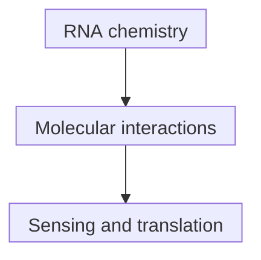

# Modified nucleosides in mRNA

## In one sentence

Modified nucleosides are chemically altered RNA building blocks that can change how a message is sensed and translated without changing its intended protein sequence.

## The intuition

Imagine printing the same instructions with a different ink. The intended words remain, but the material can change how the message is handled. For [messenger RNA (mRNA)](/wiki/education/concepts/biology-basics/molecules/rna-and-mrna), chemistry affects molecular interactions, sensing and translation. The analogy stops at intention: using a different building block does not guarantee that every translated protein has the expected identity or that every immune response improves.

## How it works

A **nucleoside** is a base joined to a sugar; a **nucleotide** also includes phosphate. RNA synthesis uses nucleotide building blocks. Pseudouridine (Ψ) and N1-methylpseudouridine (m1Ψ) are alternatives to the ordinary uridine building block. The intended coding message can remain the same while its chemistry changes.

Cells sense RNA through several pathways. Karikó and colleagues tested human Toll-like-receptor systems and dendritic cells, showing that particular modifications reduced the activation they measured. Andries and colleagues compared m1Ψ with Ψ in cell lines and mice. These are defined experimental comparisons, not proof that all modified RNA is invisible to every sensor.

The intended antigen sequence and RNA sensing are different questions. So are chemistry and [purity](/wiki/education/concepts/engineering-and-manufacturing/nucleic-acid-design/dsrna-impurities-and-purification): modified transcripts can still contain unwanted double-stranded RNA. Karikó's purification study tested that additional source of activation.

Translation fidelity also deserves its own check. Mulroney and colleagues demonstrated sequence-dependent +1 reading-frame shifts with m1Ψ-containing RNA in experimental systems, and reduced them through synonymous sequence changes. This does not mean every modified construct mistranslates, nor did the study establish adverse clinical outcomes from the observed products. It shows why intended coding identity and measured translation products should not be treated as identical evidence.

*Sensing and translation are distinct outcomes of RNA interactions; the map does not promise a universal change in either.*

## Why it matters in cancer

RNA sensing can influence antigen production and immune activation. Lower innate activation in one assay does not mean lower antigen-specific immunity, and greater protein output does not establish a stronger T-cell response. Unmodified and modified RNA designs need comparisons in their intended delivery and biological context. Chemistry does not choose the tumor target or establish benefit.

## How it is measured

| Assay question | What to record |
|---|---|
| **Measures / how** | Chemistry/identity analysis, impurity testing, protein identity and quantity, and selected innate-sensing readouts. |
| **Input / consumption** | Consumed RNA aliquots and cells. For a comparison, match sequence, amount, cap, untranslated regions, purity, formulation and handling as far as the question requires. |
| **Output / units** | Building-block composition; protein amount or reporter units; specified cytokine concentrations or activation signals at stated times. |
| **Thresholds** | Method-specific detection/reporting limits and justified specifications; no universal modification score. |
| **Failure modes** | Unequal uptake, residual impurities, different viability or a reporter that does not identify the protein produced. |
| **Cannot tell** | A single translation or cytokine readout cannot establish antigen display, T-cell recognition, clinical safety or efficacy. |
| **Validation context** | Cell-line and animal comparisons support those systems. Product-quality and clinical claims require their own evidence. |

## Common confusions

- **Modification versus codon choice:** chemistry changes the building block; [codon optimization](/wiki/education/concepts/engineering-and-manufacturing/nucleic-acid-design/codon-optimization) changes sequence.
- **Reduced sensing versus no sensing:** the conclusion belongs to the measured pathway and conditions.
- **Modified versus purified:** both specifications matter; neither substitutes for the other.
- **More signal versus correct product:** protein amount and identity are distinct checks.

## Try it

In a fictional matched cell-line comparison, modified RNA produces more reporter signal and less of one cytokine. A researcher concludes, “It must make a stronger cancer-specific T-cell response.” What is missing?

**Answer:** The experiments establish reporter output and that cytokine readout in that model. They have not measured antigen display or antigen-specific recognition. Check protein identity and comparable impurity/delivery conditions, then test the relevant downstream biology. Neither higher expression nor lower sensing proves benefit.

## Explain it back

“Changing RNA chemistry can affect ___, while purification addresses ___; neither alone establishes ___.”

One answer: “sensing and translation; unwanted material; useful tumor-specific immunity.”

## Takeaway

**Evaluate RNA chemistry, impurities and translation products separately before connecting them to immune function.**

## Related concepts

- [Construct anatomy](/wiki/education/concepts/engineering-and-manufacturing/nucleic-acid-design/mrna-construct-anatomy)
- [Impurities and purification](/wiki/education/concepts/engineering-and-manufacturing/nucleic-acid-design/dsrna-impurities-and-purification)

## Sources and scope

Source check: October 10, 2026. The practice is fictional. Findings below are bounded to their experimental systems; expert and learner review remain pending.

- [Karikó et al., 2005: modified nucleosides and Toll-like-receptor sensing](https://pubmed.ncbi.nlm.nih.gov/16111635/).
- [Andries et al., 2015: m1Ψ/Ψ comparisons in cell lines and mice](https://pubmed.ncbi.nlm.nih.gov/26342664/).
- [Karikó et al., 2011: purification as a separate determinant](https://pubmed.ncbi.nlm.nih.gov/21890902/).
- [Mulroney et al., 2024: sequence-dependent frameshifting and sequence changes](https://www.nature.com/articles/s41586-023-06800-3).

<!-- BEGIN GENERATED USED IN -->
## Used in

- [How a personalized vaccine is manufactured](/wiki/education/designing-a-vaccine/05-how-vaccines-are-manufactured)
- [Turn selected targets into an mRNA message](/wiki/education/guides/personalized-cancer-vaccine/06-writing-the-message)
- [How a personalized cancer vaccine is designed](/wiki/education/guides/personalized-cancer-vaccine/index)
<!-- END GENERATED USED IN -->
