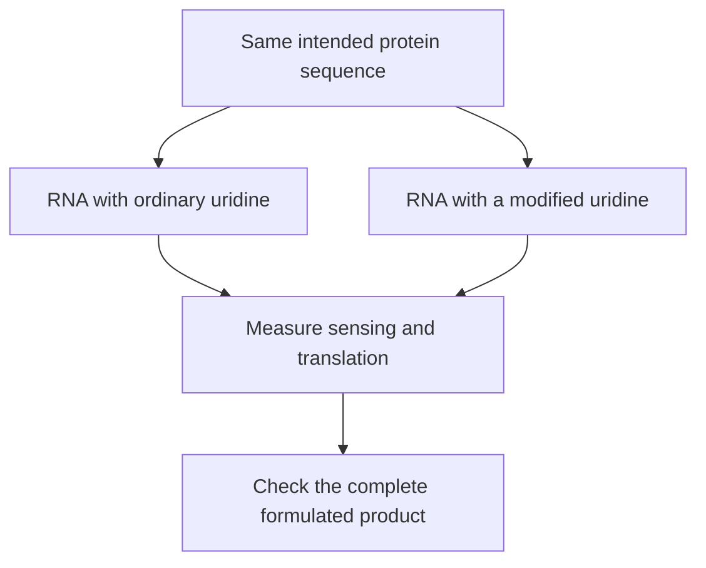

# Modified nucleosides in mRNA

## In one sentence

Modified nucleosides are chemically altered RNA building blocks that can change how a message is sensed and translated without changing its intended protein sequence.

## The intuition

You can print the same instructions with a different kind of ink. The words may stay the same while the material behaves differently. For messenger ribonucleic acid (**mRNA**), the “ink” is the chemistry of its building blocks. Cells both read the message and inspect the molecule. The analogy breaks because biological inspection can change whether translation continues at all.

**Before you start:** [DNA → RNA → protein](/wiki/education/concepts/biology-basics/genetics/central-dogma) explains translation; [mRNA construct anatomy](/wiki/education/concepts/engineering-and-manufacturing/nucleic-acid-design/mrna-construct-anatomy) explains the message's regions.

## How it works

A **nucleoside** consists of a base attached to a sugar. A **nucleotide** adds phosphate; nucleotide building blocks are used to make RNA. Ordinary RNA contains adenine, cytosine, guanine and uracil bases. Some manufactured messages use an altered form of a nucleoside, such as pseudouridine or N1-methylpseudouridine, in place of ordinary uridine.

These substitutions can preserve the intended amino-acid sequence while changing interactions with innate immune sensors. Those sensors detect molecular patterns; they do not recognize a particular cancer antigen the way a T cell does. Primary experiments found that certain modifications reduced particular sensing responses and improved protein production in the tested systems. The result depends on the modification, RNA design, cell and assay.

*The comparison concerns RNA chemistry. It does not establish a clinical winner.*

Chemistry is one design variable. RNA sequence, cap, purity, delivery and recipient cells also influence expression and inflammation. [Double-stranded RNA impurities](/wiki/education/concepts/engineering-and-manufacturing/nucleic-acid-design/dsrna-impurities-and-purification) can remain in a modified-RNA preparation. Changing the ink does not remove every manufacturing byproduct.

## Why it matters in cancer

A vaccine needs antigen production and an appropriate immune response. Suppressing a particular RNA-sensing pathway is not identical to suppressing all immunity, and stronger innate stimulation is not automatically better either. Some cancer-vaccine designs deliberately use unmodified RNA. Their evidence belongs to the entire product and protocol.

## Try it

A fictional team reports more protein from a modified message in one cell line. Can it conclude that the vaccine will produce stronger tumor-specific T-cell responses?

**Answer:** It has shown a translation result in that assay. Antigen processing, display, T-cell recognition and clinical benefit remain separate questions. The comparison also needs matched purity and delivery conditions.

## Common confusions

- **Modified nucleoside versus codon choice:** [Codon optimization](/wiki/education/concepts/engineering-and-manufacturing/nucleic-acid-design/codon-optimization) changes the letter sequence; nucleoside modification changes chemical building blocks.
- **Reduced sensing versus no inflammation:** Other RNA features and the formulation can still activate immune pathways.
- **Modified versus purified:** These are separate choices and need separate tests.
- **Cap chemistry versus internal substitutions:** A cap is a feature at the message's end; modifications can occur within the message.

## Related concepts

- [In vitro transcription](/wiki/education/concepts/engineering-and-manufacturing/nucleic-acid-design/in-vitro-transcription) makes the specified RNA.
- [T-cell priming](/wiki/education/concepts/immunology/t-cells/t-cell-priming-three-signals) explains the immune-learning step.

## Sources and scope

Source check: October 9, 2026; expert and learner review pending. These primary experiments establish mechanisms in their tested systems, not a universal product specification.

- [Karikó et al., 2005: nucleoside modification and Toll-like-receptor sensing](https://pubmed.ncbi.nlm.nih.gov/16111635/).
- [Andries et al., 2015: N1-methylpseudouridine compared with pseudouridine in cell and mouse experiments](https://pubmed.ncbi.nlm.nih.gov/26342664/).
- [Karikó et al., 2011: purification of nucleoside-modified mRNA](https://pubmed.ncbi.nlm.nih.gov/21890902/).

<!-- BEGIN GENERATED USED IN -->
## Used in

- [How a personalized vaccine is manufactured](/wiki/education/designing-a-vaccine/05-how-vaccines-are-manufactured)
- [Turn selected targets into an mRNA message](/wiki/education/guides/personalized-cancer-vaccine/06-writing-the-message)
- [How a personalized cancer vaccine is designed](/wiki/education/guides/personalized-cancer-vaccine/index)
<!-- END GENERATED USED IN -->
