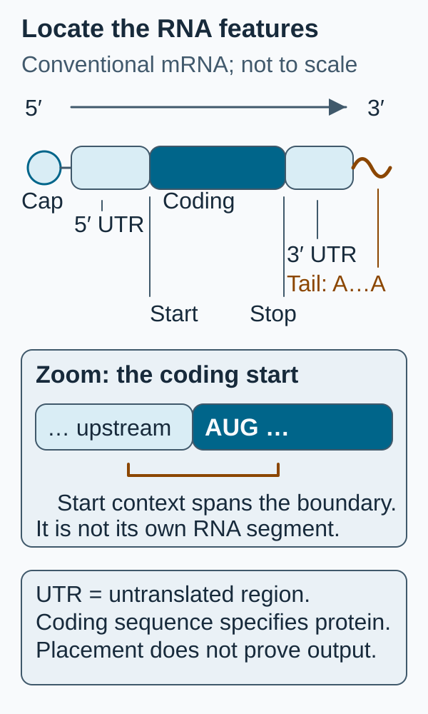

# mRNA construct anatomy

## In one sentence

An mRNA construct combines a protein-coding message with sequence features that influence its translation, stability and processing.

## The intuition

Think of a message with opening instructions, a main text and a closing section. The main text specifies a protein; the surrounding features help the cell use the message. Here the message is [messenger RNA (mRNA)](/wiki/education/concepts/biology-basics/molecules/rna-and-mrna). The analogy has a limit: these are interacting molecules, not a reader following every instruction reliably. A well-designed message still needs to reach a cell and its translation machinery.

## How it works

For a conventional engineered mRNA, **5′ and 3′ name the two ends** of the molecule. Reading from 5′ to 3′, the main features are:

| Feature | Job and limit |
|---|---|
| **5′ cap** | A modified guanosine joined to the RNA end; it supports recognition by translation-initiation proteins and helps protect the message. It is not a delivery coating. |
| **5′ untranslated region (UTR)** | Sequence before the main protein-coding region. Its sequence and structure can affect initiation. Untranslated does not mean inactive. |
| **Kozak context** | Bases around the start codon that affect how efficiently a scanning ribosome starts there. This is an RNA translation feature, not a [DNA](/wiki/education/concepts/biology-basics/molecules/dna) transcription promoter or a guarantee of correct initiation. |
| **Open reading frame (ORF)** | The intended coding sequence, read in three-base codons from a start to a stop. It specifies the [protein's amino-acid sequence](/wiki/education/concepts/biology-basics/molecules/protein-and-peptide). |
| **3′ UTR** | Sequence after the coding region that can influence RNA persistence, translation and localization. |
| **Poly(A) tail** | A stretch of adenosines at the 3′ end that works with binding proteins to support stability and translation. It is not a protein segment; a longer tail is not universally better. |

Kozak's start-context experiments and Gallie's cap/tail experiments tested particular constructs and cell systems. They support the mechanisms, not one universally best sequence. Holtkamp and colleagues separately altered 3′ features in antigen-encoding RNA delivered to dendritic cells; those comparisons do not establish a clinical specification for every formulation.

*The start context crosses the untranslated/coding boundary. It is a sequence neighborhood, not a separate feature inserted between them.*

## Why it matters in cancer

A vaccine target list is not the finished construct. [Multi-epitope designs](/wiki/education/concepts/engineering-and-manufacturing/nucleic-acid-design/multi-epitope-constructs) add coding windows, spacers and sometimes protein-trafficking features. Changing a UTR can leave the intended protein unchanged while altering expression; changing a coding spacer changes the combined protein and may alter processing. [Nucleoside chemistry](/wiki/education/concepts/engineering-and-manufacturing/nucleic-acid-design/modified-nucleosides) and delivery formulation are additional specifications.

## How it is measured

| Assay question | What to record |
|---|---|
| **Measures / how** | Sequence analysis for identity; size analysis for integrity; appropriate cap/tail characterization; a cell-based expression comparison. One test does not cover them all. |
| **Input / consumption** | A defined RNA lot and consumed aliquots, plus cells for expression testing. Record handling and formulation. |
| **Output / units** | Sequence and length in nucleotides; method-defined cap/tail results; protein amount or reporter signal at stated times. |
| **Thresholds** | Analytical reporting limits and product-specific acceptance criteria; no universal “good construct” score. |
| **Failure modes** | Wrong revision, degraded RNA, mixtures of transcript lengths, unequal delivery or an insensitive readout. |
| **Cannot tell** | RNA identity alone cannot establish protein identity, antigen display, tumor recognition or patient benefit. |
| **Validation context** | A reporter comparison supports that model. Product release requires justified, fit-for-purpose methods and specifications. |

## Common confusions

- **Cap versus carrier:** the cap is part of the molecule; a lipid formulation helps delivery.
- **UTR versus disposable sequence:** untranslated regions can regulate use of the message.
- **Kozak versus promoter:** initiation of protein translation differs from synthesis of RNA from DNA.
- **Same target names versus same product:** retain the complete RNA and intended protein revisions.

## Try it

Two fictional constructs encode the same antigen protein. Version B changes only its 3′ UTR and produces twice the reporter signal in matched cells. Is B a different antigen? Does it have twice the cancer benefit?

**Answer:** Its intended antigen sequence is unchanged. The result supports greater reporter output under those conditions. It does not establish antigen processing, tumor recognition or clinical benefit. Confirm identity and integrity, then investigate the next relevant biological question.

## Explain it back

“The ORF specifies ___; the surrounding features influence ___; a sequence record alone cannot establish ___.”

One answer: “the intended protein; how the RNA is used; the measured protein and its biological effect.”

## Takeaway

**A construct is a complete molecular specification whose identity and biological performance need separate checks.**

## Related concepts

- [In vitro transcription](/wiki/education/concepts/engineering-and-manufacturing/nucleic-acid-design/in-vitro-transcription)
- [Multi-epitope constructs](/wiki/education/concepts/engineering-and-manufacturing/nucleic-acid-design/multi-epitope-constructs)

## Sources and scope

Source check: October 10, 2026. The example is fictional. These textbook mechanisms and experimental comparisons do not prescribe a clinical construct. Expert and learner review remain pending.

- [Cooper, The Cell: translation of mRNA, including ends and UTRs](https://www.ncbi.nlm.nih.gov/books/NBK9849/).
- [Kozak, 1986: start-context mutagenesis in a preproinsulin construct](https://pubmed.ncbi.nlm.nih.gov/3943125/).
- [Gallie, 1991: cap/poly(A) interaction in tested cell systems](https://pubmed.ncbi.nlm.nih.gov/1682219/).
- [Holtkamp et al., 2006: antigen-RNA 3′ features in dendritic-cell experiments](https://pubmed.ncbi.nlm.nih.gov/16940422/).

<!-- BEGIN GENERATED USED IN -->
## Used in

- [How a personalized vaccine is manufactured](/wiki/education/designing-a-vaccine/05-how-vaccines-are-manufactured)
- [Turn selected targets into an mRNA message](/wiki/education/guides/personalized-cancer-vaccine/06-writing-the-message)
- [How a personalized cancer vaccine is designed](/wiki/education/guides/personalized-cancer-vaccine/index)
<!-- END GENERATED USED IN -->
