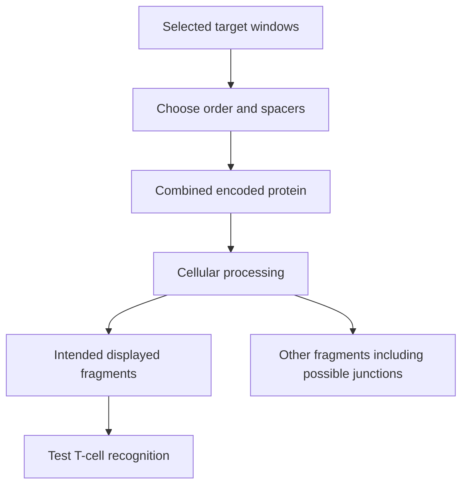

# Multi-epitope constructs

## In one sentence

A multi-epitope construct encodes several intended immune targets in one design, but each target still has to survive expression, processing, display and recognition.

## The intuition

A set of promising ingredients does not tell you how they behave when cooked together. Joining target sequences changes their neighbors. A vaccine construct can therefore include the same target list as another design and still produce different fragments for immune cells to inspect. The cooking analogy stops at prediction: the biology has to be measured.

**Before you start:** [mRNA construct anatomy](/wiki/education/concepts/engineering-and-manufacturing/nucleic-acid-design/mrna-construct-anatomy) explains what is encoded; [antigen processing](/wiki/education/concepts/immunology/antigen-presentation/antigen-processing-machinery) explains how protein becomes displayed fragments.

## How it works

An **epitope** is the part of an antigen recognized by an immune receptor. In a T-cell vaccine, a designed segment may contain a candidate epitope plus surrounding amino acids. The whole encoded segment is not necessarily the peptide eventually displayed by [human leukocyte antigen (HLA)](/wiki/education/concepts/immunology/antigen-presentation/hla).

A multi-epitope design can arrange several such segments in a longer protein. A **spacer** or **linker** is an inserted sequence between them. Order, spacing and trafficking signals can influence where protein goes and how enzymes cut it. A **junctional peptide** crosses a newly created boundary between segments or a segment and linker. Its existence in the sequence does not prove it will be displayed, but it is a reason to inspect the new design.

*Encoding an intended target starts a chain; it does not complete it.*

Computational methods can compare predicted cleavage, binding or junctions. These predictions are useful for design review, but they are not direct evidence of display. [Immunopeptidomics](/wiki/education/concepts/measurement/proteins-and-spatial/immunopeptidomics) measures peptides recovered from HLA in a tested specimen. T-cell assays answer recognition questions. Neither a predicted cleavage score nor a bulk protein measurement answers all of these questions.

## Why it matters in cancer

Including several targets may broaden the intended response and reduce dependence on one antigen. It does not ensure that every encoded segment generates an immune response, covers every tumor cell or prevents [immune escape](/wiki/education/concepts/immunology/tumor-immunology/immune-escape). A formulation containing multiple RNA strands and a single RNA encoding multiple segments are also different architectures.

## Try it

A fictional construct joins windows A and B with spacer S. A production revision changes S but keeps A and B. Can reviewers reuse the old antigen-processing assessment unchanged?

**Answer:** The source targets are retained, but the combined sequence has changed. Review the new boundaries and relevant expression, processing and display evidence. Record the exact approved version; “same target list” is insufficient.

## Common confusions

- **Encoded segment versus displayed epitope:** A longer sequence can generate several fragments, or fail to generate the intended one.
- **More targets versus more proven responses:** Count encoded candidates separately from measured responders.
- **Predicted junction versus observed junction:** Keep the evidence labels explicit.
- **Helper segment versus universal requirement:** A design supporting CD4 T cells in one setting does not establish a required feature for every vaccine.

## Related concepts

- [Codon optimization](/wiki/education/concepts/engineering-and-manufacturing/nucleic-acid-design/codon-optimization) changes synonymous message choices.
- [HLA](/wiki/education/concepts/immunology/antigen-presentation/hla) displays the processed fragments.

## Sources and scope

Source check: October 9, 2026; expert and learner review pending. The design paper is computational; the clinical studies test specific constructs and cannot establish a universal best linker.

- [Schubert and Kohlbacher, 2016: computational spacer design for string-of-beads vaccines](https://doi.org/10.1186/s13073-016-0263-6).
- [Sahin et al., 2017: personalized RNA mutanome vaccination in melanoma](https://pubmed.ncbi.nlm.nih.gov/28678784/).
- [Rojas et al., 2023: personalized RNA vaccine methods and immune measurements in pancreatic cancer](https://www.nature.com/articles/s41586-023-06063-y).

<!-- BEGIN GENERATED USED IN -->
## Used in

- [How a personalized vaccine is manufactured](/wiki/education/designing-a-vaccine/05-how-vaccines-are-manufactured)
- [Turn selected targets into an mRNA message](/wiki/education/guides/personalized-cancer-vaccine/06-writing-the-message)
- [How a personalized cancer vaccine is designed](/wiki/education/guides/personalized-cancer-vaccine/index)
<!-- END GENERATED USED IN -->
