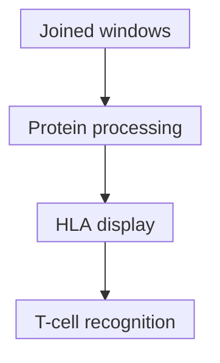

# Multi-epitope constructs

## In one sentence

A multi-epitope construct encodes several intended immune targets in one design, but each target still has to survive expression, processing, display and recognition.

## The intuition

Think of ingredients joined into one recipe: the neighbors and preparation affect what reaches the plate. A vaccine can join several antigen-containing sequence windows into one [protein](/wiki/education/concepts/biology-basics/molecules/protein-and-peptide). The limit is important: a list of ingredients is not proof that every intended fragment reaches a cell's display system or is recognized by T cells.

## How it works

An [epitope](/wiki/education/concepts/immunology/antigen-presentation/antigen-and-epitope) is a feature recognized by an immune receptor. For T-cell targets, a design may encode longer windows containing intended short peptides. A window is not necessarily the peptide ultimately displayed by [HLA (human leukocyte antigen)](/wiki/education/concepts/immunology/antigen-presentation/hla).

In a **string-of-beads** design, antigen windows are concatenated. **Spacers or linkers** are additional encoded amino-acid sequences between them; they are not untranslated gaps. Order and spacer choice can influence cleavage. Joining windows also creates new boundaries: a **junction peptide** can span neighboring sequences. Its existence in the design does not establish that it is produced, displayed or immunogenic. Schubert and Kohlbacher modeled class-I cleavage and binding to optimize spacers; their predicted gains are not measured human protection.

A **signal peptide** is an encoded protein-trafficking feature. It can help route the newly made protein to a cellular compartment; it does not direct the RNA carrier to a particular cell. In human and mouse dendritic-cell experiments, Kreiter and colleagues combined an N-terminal leader with a C-terminal trafficking signal to change class-I and class-II presentation. That combined design is not evidence that one leader guarantees presentation in every platform.

A helper segment is intended to engage [CD4 helper T cells](/wiki/education/concepts/immunology/t-cells/cd4-vs-cd8), often through HLA class II. Processing, the recipient's HLA molecules and available T-cell receptors still matter. A helper sequence is not universally necessary or sufficient for every vaccine. Nor is a multi-target vaccine necessarily one RNA strand: designs can distribute targets across strands.

*Processing can yield intended or unintended fragments. Each measured gate belongs to the tested construct and cell context.*

## Why it matters in cancer

Multiple intended targets can broaden a design's opportunities, but target count is not measured response breadth. Tumor expression, [processing machinery](/wiki/education/concepts/immunology/antigen-presentation/antigen-processing-machinery), HLA compatibility and immune recognition remain separate gates. A linker change may leave the named targets unchanged while altering their recovery. Changing that protein sequence differs from [synonymous codon redesign](/wiki/education/concepts/engineering-and-manufacturing/nucleic-acid-design/codon-optimization).

## How it is measured

| Assay question | What to record |
|---|---|
| **Measures / how** | Sequence verification, expression assays, [immunopeptidomics](/wiki/education/concepts/measurement/proteins-and-spatial/immunopeptidomics) for recovered HLA peptides, and target-specific functional assays. |
| **Input / consumption** | Exact construct revision and consumed cells/sample material; record the HLA and processing context. |
| **Output / units** | Protein quantity; peptide identities and method-defined abundance; defined T-cell function per stated input. |
| **Thresholds** | Assay-specific identification/reporting rules; prediction scores are not presentation thresholds. |
| **Failure modes** | Unexpected cleavage, insensitive peptide detection, mismatched HLA or a functional assay using peptide loading that bypasses processing. |
| **Cannot tell** | Non-detection does not prove absence; peptide-stimulated responses do not alone establish tumor recognition. |
| **Validation context** | Construct/cell comparisons answer particular gates. Immune breadth and clinical benefit require additional evidence. |

## Common confusions

- **More beads versus more responders:** intended targets and measured responses have different denominators.
- **Junction prediction versus harmful immunity:** a candidate fragment needs further evidence.
- **Signal versus delivery targeting:** intracellular protein routing differs from carrier uptake.
- **One successful spacer versus a universal best spacer:** sequence and assay context matter.

## Try it

A fictional A–spacer–B construct has measured display of A. A manufacturer replaces the spacer but says the previous result covers the new version because A and B are unchanged. Is that justified?

**Answer:** No. The combined protein and its boundaries changed. Retain the old evidence, but identify which expression, processing and display questions need renewed testing for the new revision. The old result also did not establish B's display or either target's tumor recognition.

## Explain it back

“Joining targets changes ___; a predicted peptide still needs ___ before a claim about tumor recognition.”

One answer: “their sequence neighborhood; relevant processing, display and functional evidence.”

## Takeaway

**Review the complete multi-target design and each biological gate, rather than counting its intended epitopes as responses.**

## Related concepts

- [Construct anatomy](/wiki/education/concepts/engineering-and-manufacturing/nucleic-acid-design/mrna-construct-anatomy)
- [Antigen processing](/wiki/education/concepts/immunology/antigen-presentation/antigen-processing-machinery)

## Sources and scope

Source check: October 10, 2026. The exercise is fictional. Computational and experimental designs below do not establish a universal clinical construct; expert and learner review remain pending.

- [Schubert and Kohlbacher, 2016: computational spacer design for class-I-restricted sequences](https://doi.org/10.1186/s13073-016-0263-6).
- [Kreiter et al., 2008: combined trafficking features in human/mouse dendritic-cell models](https://pubmed.ncbi.nlm.nih.gov/18097032/).
- [Sahin et al., 2017: primary personalized multi-target RNA vaccination in melanoma](https://pubmed.ncbi.nlm.nih.gov/28678784/).
- [Rojas et al., 2023: a primary two-strand RNA-vaccine manufacturing example](https://www.nature.com/articles/s41586-023-06063-y).

<!-- BEGIN GENERATED USED IN -->
## Used in

- [How a personalized vaccine is manufactured](/wiki/education/designing-a-vaccine/05-how-vaccines-are-manufactured)
- [Turn selected targets into an mRNA message](/wiki/education/guides/personalized-cancer-vaccine/06-writing-the-message)
- [How a personalized cancer vaccine is designed](/wiki/education/guides/personalized-cancer-vaccine/index)
<!-- END GENERATED USED IN -->
