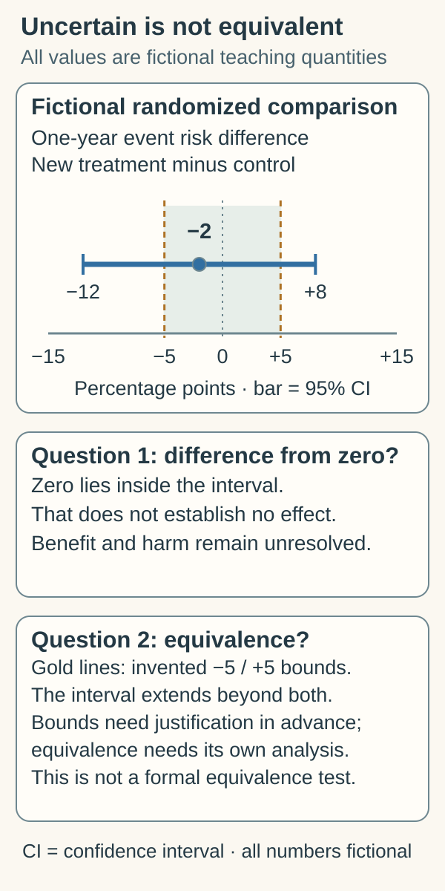

# Absence of evidence

## In one sentence

Absence of evidence means the available search, study or measurement has not established a claim; how informative that absence is depends on what it could reliably detect or exclude.

## The intuition

Looking through a small window and seeing no rain is a different observation from surveying the whole neighborhood with a working instrument. Both observations have boundaries. The analogy helps us ask what a negative observation covers; biological tests rarely inspect every place and time.

“We did not find it” can be honest and useful. It becomes misleading when the scope of the search or measurement disappears from the conclusion.

## Three different kinds of missing evidence

| Situation | What has not been established | What to check |
|---|---|---|
| Literature search finds no relevant paper | Published support in the searched sources | Query, synonyms, databases, access and cutoff date |
| A test does not detect its target | A detectable signal in this tested preparation | Sample, recovery, sensitivity, controls and threshold |
| A study does not find a statistically significant difference | A difference under that analysis's decision rule | Effect estimate, precision, design and meaningful effect size |

These situations require different follow-up. A failed literature search cannot become a biological experiment. A technically valid negative assay cannot answer a question it was not designed to measure. A [false-negative result](/wiki/education/concepts/measurement/computational-analysis/analytical-validity-clinical-validity-and-utility) can occur when the condition is present but the test says otherwise. [National Cancer Institute definition](https://www.cancer.gov/publications/dictionaries/cancer-terms/def/false-negative-test-result).

## How it works

Read the effect estimate with its [confidence interval (CI)](/wiki/education/concepts/evidence-and-statistics/effect-measures/confidence-interval), rather than turning “not statistically significant” into “no effect.” A wide interval may leave important benefit and harm unresolved. Precision addresses sampling uncertainty under the analysis; it does not remove every bias. [Greenland et al., 2016](https://pmc.ncbi.nlm.nih.gov/articles/PMC4877414/).

More informative evidence can exclude effects larger than a specified meaningful threshold under a sound design. Formal **equivalence testing** starts with justified, preferably prespecified lower and upper bounds and an appropriate analysis. It is a distinct question from testing whether a difference equals zero. It does not prove perfect equality or make the bounds meaningful for every person and outcome. [Lakens, 2017](https://pmc.ncbi.nlm.nih.gov/articles/PMC5502906/).

## Why it matters in cancer

A gene may have no exact-variant drug-response study in the searched literature. That leaves the proposed match unsupported; it does not demonstrate resistance. Nor does the remaining uncertainty support calling the drug beneficial. Both positive and negative clinical claims need evidence.

A functional assay can also return a normal result while missing a different relevant function. The primary variant-assessment guidance emphasizes disease mechanism, assay validity and the specific function tested. [Brnich et al., 2019](https://pmc.ncbi.nlm.nih.gov/articles/PMC6938631/). A normal protein-function assay, for example, need not exclude an effect on [ribonucleic acid (RNA) processing](/wiki/education/concepts/biology-basics/genetics/splicing).

## The readout card

For a negative measurement, retain input material, units, recovery, controls, detection limit and the covered time and compartment. For a study, retain population, endpoint, comparator, effect scale, uncertainty, follow-up and missing-data rules. For a search, record exact terms and date. “No evidence found within this documented search” is more reproducible than “no evidence exists.”

## Common confusions

- **No detection versus no disease:** incomplete sampling or limited sensitivity can leave disease unseen.
- **No significant difference versus equivalence:** a study may simply be imprecise.
- **Evidence against a large effect versus zero effect:** smaller effects may remain unresolved.
- **Unknown versus promising:** a gap does not count as favorable evidence.
- **One normal assay versus every function intact:** keep the assay's biological scope attached.

## Try it

A fictional randomized study estimates the difference in one-year event risk, new treatment minus control, as −2 percentage points. Its 95% CI is −12 to +8 percentage points. A press release says the treatments have identical outcomes. Is that supported?

**Answer:** No. The invented interval includes appreciable benefit and harm, as well as no difference. It does not establish equivalence. A narrower interval could constrain meaningful effects, but the design, prespecified bounds and analysis would still matter. These are illustrative bounds, not a calculation for a patient.

*The interval includes zero and extends beyond both invented meaningful-effect bounds; nonsignificance does not establish equivalence.*

The shared [confidence-interval figure](/wiki/education/concepts/evidence-and-statistics/effect-measures/confidence-interval) teaches repeated coverage and precision; this view asks what one interval leaves unresolved.

**Figure check:** Do the gold bounds create a universal definition of a trivial effect? **Answer:** No. They are invented for teaching; real bounds require context, justification and an appropriate equivalence analysis.

## Explain it back

“Nothing was found by ___ under ___; that leaves ___ unresolved.” One answer: “this assay; its sample and detection limits; signals outside those conditions.”

## Takeaway

**A negative result becomes informative when its coverage, sensitivity and precision are explicit. Uncertainty supports neither an automatic benefit claim nor an automatic no-benefit claim.**

## Related concepts

[Confidence intervals](/wiki/education/concepts/evidence-and-statistics/effect-measures/confidence-interval) explains statistical precision. [The variant-to-benefit evidence chain](/wiki/education/concepts/evidence-and-statistics/reasoning-tools/evidence-chain-variant-to-benefit) shows where a missing observation leaves a specific claim open.

## Sources and scope

Source check: October 10, 2026. General evidence and measurement teaching; the interval example is fictional. Equivalence bounds are context-specific. Expert and learner review pending.

- [Greenland et al., 2016: statistical tests and common misinterpretations](https://pmc.ncbi.nlm.nih.gov/articles/PMC4877414/) — primary methods discussion of nonsignificance, uncertainty and assumptions.
- [Lakens, 2017: primary equivalence-testing primer](https://pmc.ncbi.nlm.nih.gov/articles/PMC5502906/) — meaningful bounds and a distinct hypothesis test.
- [National Cancer Institute: false-negative test result](https://www.cancer.gov/publications/dictionaries/cancer-terms/def/false-negative-test-result) — official definition.
- [Brnich et al., 2019: primary functional-evidence recommendations](https://pmc.ncbi.nlm.nih.gov/articles/PMC6938631/) — a normal assay need not assess every relevant function.

<!-- BEGIN GENERATED USED IN -->
## Used in

- [Authenticate and attribute the finding](/wiki/education/guides/from-variant-to-drug/01-authenticate-and-attribute-the-finding)
- [Check clinical evidence and access](/wiki/education/guides/from-variant-to-drug/03-check-clinical-evidence-and-access)
- [Check applicability and uncertainty](/wiki/education/guides/reading-cancer-evidence/03-check-applicability-and-uncertainty)
- [Read trial claims and survival statistics](/wiki/education/guides/reading-cancer-evidence/index)
<!-- END GENERATED USED IN -->
