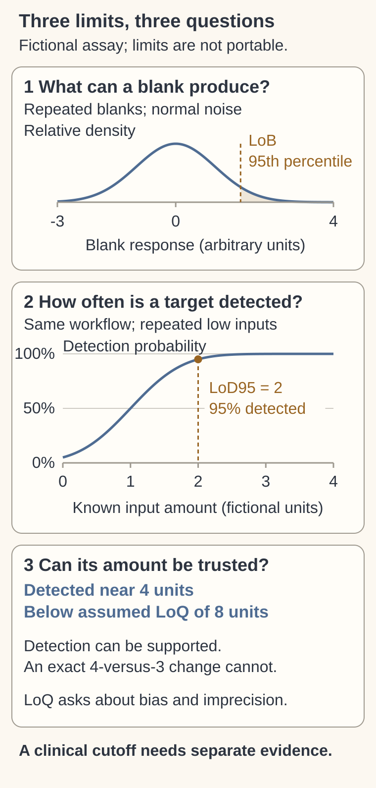

# Limits of blank, detection and quantitation

## In one sentence

Limits of blank, detection and quantitation describe background, the ability to detect a signal and the ability to measure its amount reliably under specified conditions.

## The intuition

In a quiet room, you may hear a faint voice without being able to judge its loudness accurately. First you need to know the room's background noise; then whether a voice is distinguishable; then how well its level can be measured.

The analogy has limits: an assay has specimen-specific background, calibration and decision rules. These limits are evaluated statistically rather than chosen by listening once.

## How it works

**Limit of blank (LoB)** describes a high-end background result expected from samples without the target, at a stated probability. A blank can still produce measurement noise, contamination or nonspecific response. Its distribution helps distinguish background from signal; a single blank reading is not enough.

**Limit of detection (LoD)** describes the smallest amount or concentration detected with a stated probability under stated conditions, allowing a specified false-positive risk. **LoD95** denotes a 95% detection probability in those conditions. It does not mean that every sample above the limit is positive, every sample below it is negative, or the patient's diagnosis is 95% certain.

**Limit of quantitation (LoQ)** describes the lowest amount reliably measured to specified accuracy requirements. Those requirements include acceptable bias and imprecision, or a defined total-error goal. A detected signal can be below the quantitative range. LoD and LoQ can coincide in some methods; they are different performance questions rather than a mandatory fixed spacing.

Thresholds for clinical decisions are another job. A clinically important concentration may differ from the LoD or LoQ. A positive qualitative assay also has its own classification rule; it need not report a quantitative value.

*Fictional normal-response model: background response and known-input amount have separate axes. At the LoD95 of 2 units, detection probability is 95%; a detected result near 4 remains below the separately assumed LoQ of 8. The curve and limit spacing are not universal; no clinical cutoff is supplied.*

## How it is measured

| Assay-card item | Validation question |
|---|---|
| Measures / how | Repeat blanks and low-level samples across specified conditions; evaluate detection and quantitative error |
| Input and cost | Representative clinical or suitably equivalent reference specimens; repeated tests consume material |
| Output / units | Background response, amount/concentration and detection probability; accuracy criteria for LoQ |
| Thresholds | Prespecified false-positive/false-negative and quantitative-error requirements |
| Failure modes | Wrong matrix, unrepresentative targets, contamination, calibration bias, lot/operator variation or inadequate input |
| Cannot tell | Clinical sensitivity, tumor location, prognosis or benefit from acting on the result |
| Validation | Exact analyte, specimen matrix, workflow, input range and assay version; independent verification where appropriate |

“Matrix” means the surrounding specimen material, such as plasma or tissue lysate. Spiked material can support testing, but similarity to real specimens must be justified. A claimed limit should identify whether it starts at purified material or covers collection through the final report. Compare conditions before comparing numbers: [targeted protein quantitation](/wiki/education/concepts/measurement/proteins-and-spatial/targeted-proteomics-and-loq) and [blood molecular detection](/wiki/education/concepts/measurement/liquid-biopsy/limit-of-detection-and-sampling) have different inputs and error sources.

## Why it matters in cancer

A lower nominal limit can be useful analytically without showing better recurrence detection or better care. **Clinical sensitivity** uses people with a defined condition as its denominator. It is not a unit conversion from laboratory LoD. A value below LoQ should not be used for an exact fold-change story without supporting quantitative performance.

## Common confusions

- LoB concerns background response; it is not itself the lowest reliably detected target concentration.
- “Sensitivity” is ambiguous: ask whether the claim concerns a calibration slope, detection capability or clinical classification.
- Another assay's limit cannot be transferred across analytes, units, input or specimen preparation.

## Try it

A fictional test has LoD95 of 2 units and LoQ of 8 units under its validated workflow. A sample produces a qualifying detected result near 4 units. Can its amount be reported as precisely established, then compared with 3 units as an exact 33% increase?

**Answer:** No. Detection can be supported while reliable quantitation is not. Preserve the qualification instead of interpreting the small numerical difference as an established biological change.

**Figure check:** At the known input amount of 2 units, is every repeat detected?

**Answer:** No. In the fictional workflow, detection probability is 95%, leaving about 5% misses across repetitions. That is an analytical performance statement, not a probability of a person having a condition.

## Explain it back

Which question does each of LoB, LoD and LoQ answer?

## Takeaway

Keep the performance requirement, specimen and input beside every claimed limit.

## Related concepts

- [limit of detection and sampling](/wiki/education/concepts/measurement/liquid-biopsy/limit-of-detection-and-sampling)
- [targeted proteomics and loq](/wiki/education/concepts/measurement/proteins-and-spatial/targeted-proteomics-and-loq)

## Sources and scope

Source check: October 10, 2026. Fictional quantities; expert and learner review remain pending.

- [CLSI harmonized terminology database](https://htd.clsi.org/listterms.asp?button=Submit) — authoritative definitions, probability and accuracy requirements.
- [CLSI EP17, second edition](https://clsi.org/shop/standards/ep17/) — evaluation and verification scope; public sample checked, full standard not accessed.
- [FDA 2024 circulating tumor DNA (ctDNA) drug-development guidance](https://www.fda.gov/media/183874/download) — specimen equivalence, workflow and clinical-material confirmation for molecular assays.

<!-- BEGIN GENERATED USED IN -->
## Used in

- [Why a personalized cancer vaccine can help](/wiki/education/designing-a-vaccine/index)
- [Write the exact claim before judging it](/wiki/education/guides/judging-a-test-or-vendor-claim/01-write-the-exact-claim)
- [Read the blood result before reading the trend](/wiki/education/guides/monitoring-residual-disease/01-read-the-blood-result)
- [Understand blood tests and imaging after treatment](/wiki/education/guides/monitoring-residual-disease/index)
- [Read blood measurements as a time series](/wiki/education/molecular-profiling/06-ctdna-and-mrd)
<!-- END GENERATED USED IN -->
