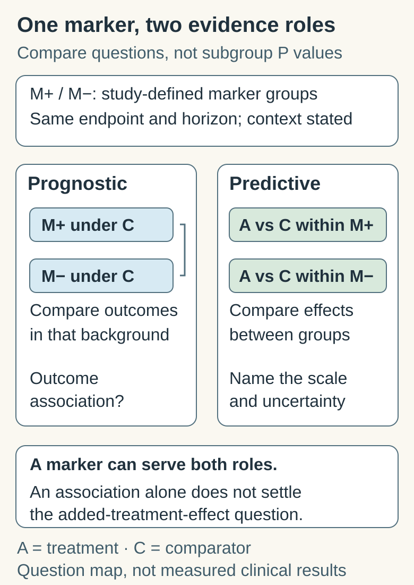

# Prognostic versus predictive biomarkers

## In one sentence

A prognostic biomarker is associated with outcome, while a predictive biomarker identifies differences in the effect of a particular treatment.

## The intuition

A weather forecast describes how likely rain is. A comparison of umbrellas asks which one changes how wet you become. Knowing the risk of rain is useful, but it does not tell you the added benefit of one umbrella over another.

The analogy has limits: clinical outcomes depend on disease, treatment and many other factors. Prognosis is estimated in a specified setting, not a timeless property of a marker.

## How it works

A **prognostic** biomarker helps characterize the likelihood of a defined outcome, such as recurrence over a stated horizon. Its interpretation needs the population, specimen, time point and treatment background. It does not automatically describe untreated natural history.

A **predictive** biomarker concerns the effect of a particular exposure or treatment relative to a comparator. Generally, compare treatment effects in people with and without the marker. A randomized study with prespecified marker groups supports that comparison by reducing treatment-selection confounding. Some targeted therapies were developed in biomarker-enriched populations based on compelling mechanistic and early clinical evidence; the design and limits still need inspection.

A marker can be both prognostic and predictive. Higher response rates among marker-positive people receiving one drug alone cannot usually distinguish those roles. “Predicting response” in a machine-learning model is also not automatically predictive-biomarker evidence in the treatment-effect sense.

### Compare the evidence roles

*M+ and M− are the study's marker groups; A is a studied treatment and C its comparator. Outcome association and treatment-effect modification are different questions, and one marker can have both roles. These boxes are questions, not empirical results or a treatment recommendation.*

| Question | Prognostic role | Predictive role |
|---|---|---|
| What is compared? | Outcomes between marker groups in a specified care context | A-versus-C treatment effects within marker groups, then the difference between those effects |
| What must stay attached? | Marker/assay, population, timing, background care, endpoint and horizon | The same context, plus treatment/comparator, effect scale and interaction uncertainty |
| What evidence is insufficient? | A risk association does not identify which added treatment helps | Responses among people given A alone do not isolate its added effect |
| What is a further question? | Does using the marker improve decisions and outcomes? | Does a marker-guided strategy improve outcomes enough to justify harms? |

Use the existing trial below to compare the roles on **absolute and relative** scales. A marker's role is not a ranking of treatments, and significance in one subgroup alone does not establish different effects.

## Worked example

Suppose a fictional randomized trial measures a bad outcome by two years:

| Marker | Comparator | New treatment | Absolute reduction |
|---|---|---|---|
| Positive | 40% | 20% | 20 percentage points |
| Negative | 20% | 10% | 10 percentage points |

The positive group has worse outcomes under the comparator, supplying prognostic information. Treatment halves risk in both groups. There is a difference on the **absolute** effect scale, but no difference in the risk ratio in these assumed exact quantities. Predictive evidence must specify its effect scale; “the benefit is twice as large” is ambiguous.

Real estimates have uncertainty. A statistically significant effect in one subgroup and a nonsignificant effect in another do not establish that effects differ. The interaction comparison itself must be evaluated, with uncertainty and multiple-testing considerations. See [absolute versus relative effects](/wiki/education/concepts/evidence-and-statistics/effect-measures/absolute-relative-risk-and-nnt).

## Why it matters in cancer

A recurrence-associated blood signal may identify a higher-risk group without identifying which added treatment helps. A marker of drug response in one disease or regimen may not transfer to a different treatment setting. [Clinical utility](/wiki/education/concepts/measurement/computational-analysis/analytical-validity-clinical-validity-and-utility) asks a further question: does using the marker to guide decisions improve outcomes enough to justify harms?

## How evidence is assessed

Attach the exact marker and assay, timing, population, treatment/comparator, endpoint and horizon. Inspect whether groups were prespecified, whether missing specimens selected the analyzed population, and whether the interaction was independently validated. A post-treatment marker may reflect prior treatment response; it is not automatically a baseline selection test.

## Common confusions

- Worse prognosis does not automatically mean greater relative treatment benefit.
- More responses on one regimen do not isolate the contribution of one component.
- A treatment interaction does not by itself prove a safe withholding or escalation strategy.

## Try it

A fictional single-group study gives Drug A to everyone. Marker-positive participants have more responses. Does this establish that the marker predicts added benefit from Drug A compared with usual treatment?

**Answer:** No. Without a suitable comparator, the association can reflect prognosis, background treatment effects or other differences. It supports a scoped response association, not that comparative treatment-effect claim.

## Explain it back

What extra comparison turns an outcome association into a treatment-effect question?

**One possible answer:** compare A with C within the marker groups, then compare those effects for the same endpoint and horizon on a named scale. The comparison and its uncertainty matter.

## Takeaway

Always finish the sentence: prognostic for which outcome, or predictive of which treatment effect?

## Related concepts

- [actionability](/wiki/education/concepts/evidence-and-statistics/biomarkers/actionability)
- [analytical validity clinical validity and utility](/wiki/education/concepts/measurement/computational-analysis/analytical-validity-clinical-validity-and-utility)

## Sources and scope

Source check: October 10, 2026. Fictional trial and arithmetic; expert and learner review remain pending.

- [FDA–NIH BEST: understanding prognostic versus predictive biomarkers](https://www.ncbi.nlm.nih.gov/books/NBK402284/) — definitions, comparator requirements and qualitative/quantitative interactions.
- [Altman and Bland 2003: interaction revisited](https://doi.org/10.1136/bmj.326.7382.219) — compare effect estimates rather than subgroup significance labels.
- [FDA 2024 circulating tumor DNA (ctDNA) drug-development guidance](https://www.fda.gov/media/183874/download) — prognostic enrichment is distinct from testing treatment optimization.

<!-- BEGIN GENERATED USED IN -->
## Used in

- [Compare related ideas](/wiki/education/comparisons/index)
- [Check clinical evidence and access](/wiki/education/guides/from-variant-to-drug/03-check-clinical-evidence-and-access)
- [From a variant to a drug claim](/wiki/education/guides/from-variant-to-drug/index)
- [Write the exact claim before judging it](/wiki/education/guides/judging-a-test-or-vendor-claim/01-write-the-exact-claim)
- [Read the validation behind the claim](/wiki/education/guides/judging-a-test-or-vendor-claim/02-read-the-validation)
- [Connect evidence to a decision](/wiki/education/guides/judging-a-test-or-vendor-claim/03-connect-evidence-to-a-decision)
- [Judge a test or company claim](/wiki/education/guides/judging-a-test-or-vendor-claim/index)
- [Ask what a result should change](/wiki/education/guides/monitoring-residual-disease/03-ask-what-a-result-should-change)
- [Understand blood tests and imaging after treatment](/wiki/education/guides/monitoring-residual-disease/index)
- [Name the comparison and endpoint](/wiki/education/guides/reading-cancer-evidence/01-name-the-comparison-and-endpoint)
- [Check applicability and uncertainty](/wiki/education/guides/reading-cancer-evidence/03-check-applicability-and-uncertainty)
- [Read trial claims and survival statistics](/wiki/education/guides/reading-cancer-evidence/index)
- [Build the next question](/wiki/education/guides/reading-pathology-and-surgery-results/03-build-the-next-question)
- [Read pathology and surgery results](/wiki/education/guides/reading-pathology-and-surgery-results/index)
- [Connect treatment jobs with evidence](/wiki/education/guides/start-here/03-connect-treatment-and-evidence)
- [Start here: read the biology, then the evidence](/wiki/education/guides/start-here/index)
- [Use the findings in the next conversation](/wiki/education/guides/treating-early-tnbc/03-use-the-findings-in-the-next-conversation)
- [Test clinical relevance and learn from feedback](/wiki/education/modeling-tumor-response/verification-and-feedback-loops)
- [Read blood measurements as a time series](/wiki/education/molecular-profiling/06-ctdna-and-mrd)
- [Build an integrated claim without skipping the clinical question](/wiki/education/molecular-profiling/07-from-data-to-care-plan)
- [What does multi-omics tell us about a tumor?](/wiki/education/reading-a-tumor/omics-and-multi-omics)
- [Overlap and sequencing](/wiki/education/targeted-therapy-modalities/03-overlap-and-sequencing)
<!-- END GENERATED USED IN -->
