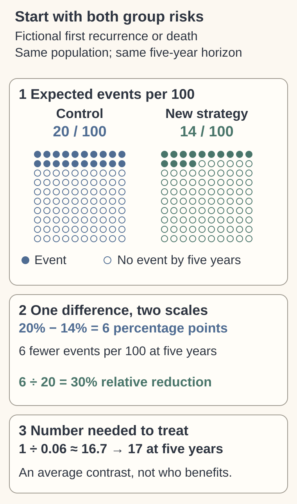

# Absolute risk, relative risk, and number needed to treat

## In one sentence

Absolute risk is the chance of a defined event by a specified time; relative risk compares those chances, and number needed to treat summarizes their difference.

## The intuition

“Risk fell by a third” leaves out the starting point. Reducing 3 events to 2 per 100 people has a different absolute effect from reducing 30 to 20. Attach the [endpoint](/wiki/education/concepts/evidence-and-statistics/endpoints/survival-endpoints), horizon and comparator. These fictional numbers describe groups; they do not identify who benefits.

## How it works

For an **undesirable event** by the same date:

- **Absolute risk reduction (ARR)** = control risk minus treatment risk.
- **Risk ratio (RR)** = treatment risk divided by control risk.
- **Relative risk reduction (RRR)** = `1 − RR`.
- **Number needed to treat (NNT)** = `1/ARR`, with ARR as a fraction, when ARR is positive.

Use the same population, event definition, comparison and horizon. With incomplete follow-up, use suitable time-specific outcome estimates rather than observed events divided by enrollment. [Altman and Andersen](https://pmc.ncbi.nlm.nih.gov/articles/PMC1117211/).

**The sign matters.** A negative ARR means more undesirable events with treatment. Report the absolute risk increase and **number needed to harm (NNH)**, or explicitly label a signed NNT convention. Taking an absolute value and calling it benefit reverses the result. ARR zero has no finite NNT; RR is undefined if control risk is zero. For a desirable outcome, define the improvement in the opposite direction before calculating.

## Worked example

A fictional randomized comparison estimates first recurrence or death by five years at 20% with control and 14% with a new strategy.

| Measure | Calculation | Meaning |
|---|---|---|
| ARR | `20% − 14% = 6 percentage points` | 6 fewer events per 100 by five years. |
| RR | `0.14/0.20 = 0.70` | Treatment risk is 70% of control risk. |
| RRR | `1 − 0.70 = 30%` | 30% relative reduction in that risk. |
| NNT | `1/0.06 ≈ 16.7`, rounded up to 17 | About 17 treated for one additional person to avoid the event by five years. |

NNT is an average contrast between strategies, not “every seventeenth person is helped.” Harms have separate endpoints and calculations. [Cook and Sackett](https://doi.org/10.1136/bmj.310.6977.452).

*Each grid represents expected outcomes per 100 under the same fictional five-year comparison, not linked individual people. Going from 20% to 14% means 6 percentage points fewer events and a 30% relative reduction. The five-year NNT rounds up to 17; it does not identify beneficiaries or weigh harms.*

## What is measured

| Check | What to retain |
|---|---|
| Inputs | Both absolute risks, comparator and event direction. |
| Output and units | Risk in percentages; ARR in percentage points; RR without units; NNT in people over the stated horizon. |
| Uncertainty | The risk difference's interval, then its appropriately transformed NNT interval. |
| Failure | Mismatched timepoints, biased comparison or a benefit label on harm. |
| Cannot tell | The identity of beneficiaries or whether benefit outweighs toxicity. |

## Uncertainty belongs beside the number

If the fictional ARR has a [95% confidence interval](/wiki/education/concepts/evidence-and-statistics/effect-measures/confidence-interval) of 2–10 percentage points, transforming its positive bounds gives NNT 10–50 at five years. If the ARR interval crosses zero, the corresponding NNT interval runs through infinity into benefit and harm. Report those regions explicitly, or show the clearer ARR interval. [Altman](https://doi.org/10.1136/bmj.317.7168.1309).

## Why it matters in cancer

Similar relative effects can produce different absolute benefits when baseline risks differ. A [hazard ratio](/wiki/education/concepts/evidence-and-statistics/effect-measures/hazard-ratio) compares conditional event rates, not cumulative risks. NNT is never the inverse of an HR; an HR alone does not provide ARR.

## Common confusions

- Percent reduction and percentage-point reduction differ.
- Three-year and five-year NNTs answer different questions.
- Avoiding an event by a date does not prove permanent cure.
- A favorable NNT does not combine benefit, harms and quality of life into one verdict.

## Try it

A fictional adverse effect occurs in 6% of controls and 8% with treatment over one year. Is `1/0.02 = 50` a benefit NNT?

**Answer:** No. The absolute risk increase is 2 percentage points; NNH is 50 over one year. ARR under our convention is −0.02. Calling 50 a benefit would erase its direction.

## Explain it back

Explain why “30% lower relative risk” can correspond to only 6 fewer events per 100 people.

## Takeaway

Keep both absolute risks, the sign, endpoint and time horizon beside NNT.

## Related concepts

- [Survival endpoints](/wiki/education/concepts/evidence-and-statistics/endpoints/survival-endpoints) define the event and the clock.
- [Kaplan–Meier curves](/wiki/education/concepts/evidence-and-statistics/endpoints/kaplan-meier) estimate event-free probability over follow-up.
- [Confidence intervals](/wiki/education/concepts/evidence-and-statistics/effect-measures/confidence-interval) express precision and prevent overreading a point estimate.

## Sources and scope

Source check: 2026-10-10. General effect-size education; expert and learner review pending. All worked risks and intervals are invented for arithmetic practice, not clinical estimates or thresholds.

- [Cook and Sackett 1995: number needed to treat as a measure of effect](https://doi.org/10.1136/bmj.310.6977.452).
- [Altman and Andersen 1999: number needed to treat for time-to-event outcomes](https://pmc.ncbi.nlm.nih.gov/articles/PMC1117211/).
- [Altman 1998: confidence intervals for number needed to treat](https://doi.org/10.1136/bmj.317.7168.1309).

<!-- BEGIN GENERATED USED IN -->
## Used in

- [Read the curve and effect](/wiki/education/guides/reading-cancer-evidence/02-read-the-curve-and-effect)
- [Read trial claims and survival statistics](/wiki/education/guides/reading-cancer-evidence/index)
<!-- END GENERATED USED IN -->
