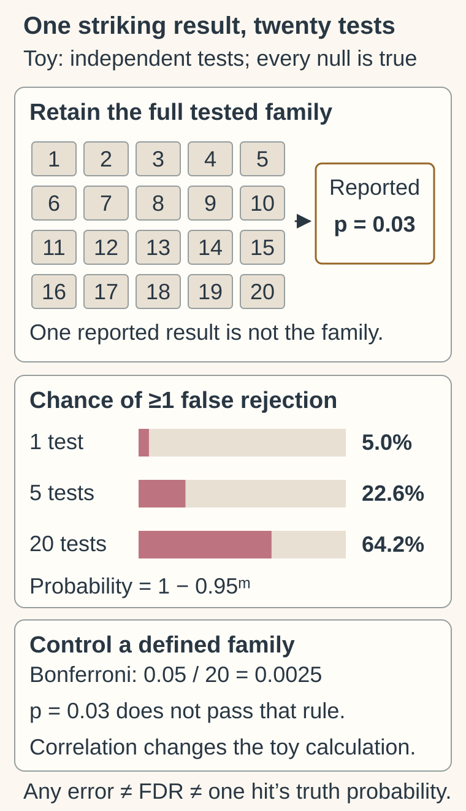

# P-values and multiple testing

## In one sentence

A p-value describes how incompatible the observed data are with a specified statistical model, while multiple testing creates more opportunities for misleading findings.

## The intuition

Searching many drawers gives you more opportunities to find something surprising. A test asks how unusual a result would be under a stated model. Showing only the most striking result hides the search. The analogy stops at probability: tests can be related, and their assumptions matter.

## How it works

A **null hypothesis** states the comparison being tested, such as no treatment effect on a defined endpoint. A p-value is calculated under that hypothesis and the other analysis assumptions. It concerns results at least as extreme as the observed result under the chosen test.

It is not the probability that the hypothesis is true, that the result happened “by chance,” or that a selected finding is false. A small p-value does not measure effect size. [ASA statement](https://doi.org/10.1080/00031305.2016.1154108).

**Multiple testing** means examining many hypotheses. **Family-wise error rate** is the probability of making at least one false rejection within a defined family. By contrast, [false discovery rate](/wiki/education/concepts/evidence-and-statistics/tests-and-prediction/false-discovery-rate) concerns the expected false fraction among selected findings. They are different error quantities.

A confirmatory trial may allocate its error allowance across endpoints or use a prespecified testing sequence. A later exploratory analysis has a different role. One method, **Bonferroni correction**, divides the family-level allowance by the number of tests. Its control does not require independent tests, provided the individual tests are valid. The choice of family and method still matters. [FDA multiple-endpoint guidance](https://www.fda.gov/media/162416/download).

## Worked example

The 20 drawers stand for the full fictional test family, while the sheet illustrates a selected report. Under independent valid tests with every null true and 0.05 false-rejection probability per test, the chance of any false rejection is about 64.2% for 20 tests; this is not an individual hit’s truth probability.

Imagine 20 independent tests, all with true null hypotheses and each with a 5% false-positive probability. The chance of at least one false positive is `1 − 0.95^20 ≈ 64%`. This is fictional arithmetic under independence, not a measured cancer-research rate.

For a family-level allowance of 0.05, Bonferroni gives `0.05/20 = 0.0025` per test. A p-value of 0.03 passes an unadjusted 0.05 threshold but fails this correction. Correlation changes the 64% calculation; it does not automatically invalidate Bonferroni.

## What is measured

| Check | Information needed |
|---|---|
| Input | The full tested family, hypotheses, test statistics and analysis assumptions. |
| Specification | One- or two-sided testing, prespecified order and error-control method. |
| Output | Raw or adjusted p-values, identified as such, beside effect estimates and intervals. |
| Failure | Choosing outcomes, cutpoints or subgroups after seeing results and hiding those choices. |
| Cannot tell | Clinical importance, personal benefit or the probability that a hypothesis is true. |

A result that misses a threshold does not demonstrate no effect. Equivalence needs its own margin and analysis. Conversely, a tiny p-value can accompany an effect too small to matter clinically.

## Why it matters in cancer

Molecular studies can examine thousands of genes and pathways. A selected small p-value may generate a useful hypothesis, but cannot establish a drug dependency or benefit. Keep the effect estimate and [confidence interval](/wiki/education/concepts/evidence-and-statistics/effect-measures/confidence-interval) beside it, and read the [analysis plan](/wiki/education/concepts/evidence-and-statistics/study-design/exploratory-vs-prespecified-analysis).

## Common confusions

- p = 0.03 does not mean a 97% probability of benefit.
- A statistical threshold does not establish clinical importance.
- Error control cannot repair biased measurements or an irrelevant comparison.
- A diagnostic false-positive rate describes a test against a reference condition; it is not automatically a multiple-testing allowance.
- Prespecification reduces analytical flexibility; it does not guarantee a study is well designed.

## Try it

A report tested 50 pathways but mentions only one with p = 0.04. What would a Bonferroni threshold be for that family at 0.05?

**Answer:** `0.05/50 = 0.001`; 0.04 does not pass it. Ask for all tested pathways, the actual planned method, estimated effect and uncertainty. This calculation does not prove the selected pathway has no biological role.

## Explain it back

Explain how “probability of any false finding” differs from “expected false fraction among selected findings.”

## Takeaway

A p-value belongs to a hypothesis and analysis; read it with the full search, effect size and uncertainty.

## Related concepts

- [False discovery rate](/wiki/education/concepts/evidence-and-statistics/tests-and-prediction/false-discovery-rate)
- [Prespecified and exploratory analysis](/wiki/education/concepts/evidence-and-statistics/study-design/exploratory-vs-prespecified-analysis)

## Sources and scope

Source check: October 10, 2026. Hypothetical arithmetic; expert and learner review remain pending.

- [Wasserstein and Lazar, 2016: ASA statement on p-values](https://doi.org/10.1080/00031305.2016.1154108).
- [FDA, 2022: multiple endpoints in clinical trials](https://www.fda.gov/regulatory-information/search-fda-guidance-documents/multiple-endpoints-clinical-trials).

- [ASA official 2016 press release summarizing the principles](https://www.amstat.org/asa/files/pdfs/p-valuestatement.pdf).

<!-- BEGIN GENERATED USED IN -->
## Used in

- [Check applicability and uncertainty](/wiki/education/guides/reading-cancer-evidence/03-check-applicability-and-uncertainty)
- [Read trial claims and survival statistics](/wiki/education/guides/reading-cancer-evidence/index)
- [Choose the comparison before interpreting the signal](/wiki/education/multi-omics-foundations/07-comparisons-and-evidence)
<!-- END GENERATED USED IN -->
