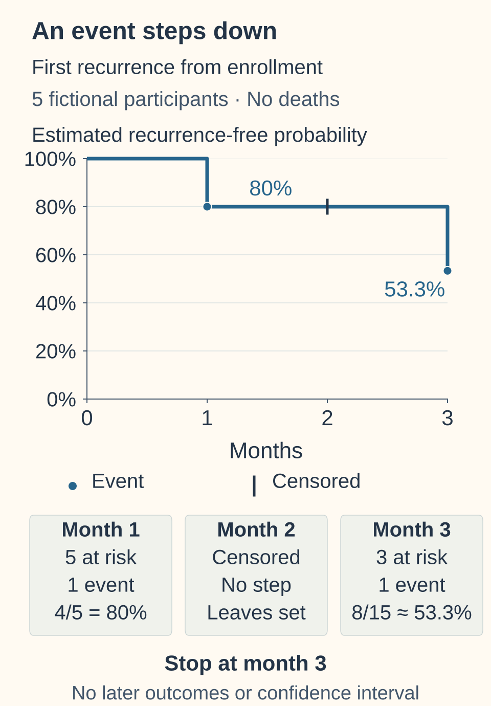

# Kaplan–Meier curves

## In one sentence

A Kaplan–Meier curve estimates the probability of remaining free of a defined event over time while accounting for incomplete follow-up.

## The intuition

A **Kaplan–Meier curve** follows a group along a clock. It steps down when the defined event occurs. Some people's observation ends before an event is seen: their earlier follow-up contributes information, while their later outcome is unknown. The curve is an estimate, not a photograph proving every participant reached every date.

## How it works

First identify the [survival endpoint](/wiki/education/concepts/evidence-and-statistics/endpoints/survival-endpoints). The horizontal axis measures time from its origin; the vertical axis estimates remaining free of its event set.

**Right censoring** means observation ends without that event being observed, perhaps at a planned cutoff or loss to follow-up. A tick mark is neither an event nor proof of permanent event freedom.

At each event time, count the people still **at risk** just before it: observed and without a previous qualifying event. Multiply the preceding survival estimate by the fraction of that risk set avoiding an event. Censored people leave subsequent risk sets without causing a downward step. [Kaplan and Meier](https://doi.org/10.1080/01621459.1958.10501452); [NIST calculation guide](https://www.itl.nist.gov/div898/handbook/apr/section2/apr215.htm).

Interpretation needs censoring to be sufficiently independent of future event time within the analysis. Losing contact because disease is worsening can bias an estimate; censoring is a statistical assumption, not a remedy for every missing outcome.

## Worked example

Five fictional participants are followed for first recurrence from enrollment. Nobody dies in this example.

| Month | At risk just before this time | Observation | Recurrence-free estimate afterward |
|---|---:|---|---:|
| 0 | 5 | Follow-up begins | 100% |
| 1 | 5 | One recurrence | `1 × 4/5 = 80%` |
| 2 | 4 | One person is censored | 80% |
| 3 | 3 | One recurrence | `0.80 × 2/3 ≈ 53.3%` |

*In this five-person fictional example, events lower the estimate; the month-2 censor tick leaves it unchanged but removes a person from the next risk set. With 3 at risk just before the month-3 event, the estimate is (4/5) × (2/3) = 8/15 ≈ 53.3%. The plot ends there: no later outcome, confidence interval or individual prognosis is shown. Censoring assumptions still matter.*

The month-2 censoring changes the next denominator. Simply subtracting two observed recurrences from five original participants would ignore the missing later observation.

## A fixed-time rate versus a landmark analysis

A five-year curve height estimates survival through five years **from the stated origin**. Calling that date a “landmark” in ordinary prose does not change the population.

A **landmark analysis** instead selects people meeting a defined condition at a later date, such as being observed and event-free at month 6, then evaluates subsequent outcomes. Its population and clock must be stated. It does not include early events in the same way as the original randomized comparison. Classifying people by a response achieved later can also introduce bias if that timing is mishandled. [Anderson, Cain and Gelber](https://pubmed.ncbi.nlm.nih.gov/6668489/).

## What is measured

Read the endpoint, origin, cutoff, censoring rules, number-at-risk table and [confidence intervals](/wiki/education/concepts/evidence-and-statistics/effect-measures/confidence-interval) together. At-risk counts are changing denominators, not a new enrollment count. A late flat line may rest on very few people.

**Median survival** is when the estimated curve reaches 50%; “not reached” means it did not do so during observed follow-up. Median follow-up describes observation time instead. Neither statement means there were no events.

## Why it matters in cancer

A recurrence curve may treat death as a competing event. Censoring deaths and taking `1 − Kaplan–Meier` does not automatically estimate the real-world probability of recurrence; a competing-risk analysis addresses that different question. [Fine and Gray](https://doi.org/10.1080/01621459.1999.10474144).

## Common confusions

- A tick is incomplete observation, not a recurrence.
- A flat tail does not prove cure.
- Curve separation does not establish a causal effect without the study design.
- Curve height is not a [hazard ratio](/wiki/education/concepts/evidence-and-statistics/effect-measures/hazard-ratio).
- A conditional landmark estimate cannot be substituted for an original trial estimate.

## Try it

In the fictional example, what is known about the censored person's month-3 recurrence status?

**Answer:** Nothing beyond being recurrence-free when observation ended at month 2. The 53.3% group estimate does not fill in that individual's missing outcome.

## Explain it back

Explain why an event lowers the line while censoring changes a later denominator.

## Takeaway

Read the curve with its event rules, clock, risk table and uncertainty.

## Related concepts

- [Survival endpoints](/wiki/education/concepts/evidence-and-statistics/endpoints/survival-endpoints) define the clock and event rules.
- [Absolute risk and number needed to treat](/wiki/education/concepts/evidence-and-statistics/effect-measures/absolute-relative-risk-and-nnt) compare suitable estimates at the same time.
- [Confidence intervals](/wiki/education/concepts/evidence-and-statistics/effect-measures/confidence-interval) show precision under the analysis.

## Sources and scope

Source check: 2026-10-10. General curve-reading education; expert and learner review pending. The five-participant example is fictional. An endpoint with competing events needs its own appropriate analysis.

- [Kaplan and Meier 1958: original estimation method](https://doi.org/10.1080/01621459.1958.10501452).
- [U.S. Food and Drug Administration: cancer-trial endpoint guidance](https://www.fda.gov/regulatory-information/search-fda-guidance-documents/clinical-trial-endpoints-approval-cancer-drugs-and-biologics).
- [Fine and Gray 1999: original competing-risk regression method](https://doi.org/10.1080/01621459.1999.10474144).

- [NIST: product-limit calculation with censored observations](https://www.itl.nist.gov/div898/handbook/apr/section2/apr215.htm).
- [Anderson, Cain and Gelber 1983: response classification and survival-comparison bias](https://pubmed.ncbi.nlm.nih.gov/6668489/).

<!-- BEGIN GENERATED USED IN -->
## Used in

- [Read the curve and effect](/wiki/education/guides/reading-cancer-evidence/02-read-the-curve-and-effect)
- [Read trial claims and survival statistics](/wiki/education/guides/reading-cancer-evidence/index)
<!-- END GENERATED USED IN -->
