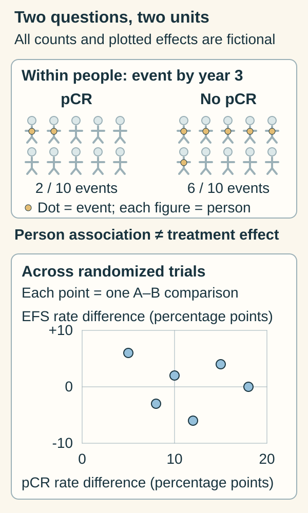

# Surrogate endpoints: the pCR paradox

## In one sentence

A surrogate endpoint is a measured outcome used in place of a direct clinical benefit outcome, with evidence needed to support that substitution in a specified setting.

## The intuition

A journey's checkpoint may tell us something useful before the destination is reached. But moving a checkpoint does not necessarily shorten the journey. The analogy helps separate an early signal from the outcome we ultimately care about; it does not make cancer outcomes a predictable route.

An endpoint describes what a study measures. A surrogate substitutes for a different outcome, such as living longer or feeling better. Earlier measurement can make research more practical. The important question is whether a treatment's effect on that measure reliably predicts its effect on the intended clinical outcome.

## How it works

Two relationships need separate tests:

| Question | Evidence being examined |
|---|---|
| Do people with a favorable marker tend to have better outcomes? | Association between marker and outcome within patient groups |
| Do treatments that improve the marker also improve the clinical outcome? | Agreement between treatment effects across relevant randomized comparisons |

The first can be useful [prognostic evidence](/wiki/education/concepts/evidence-and-statistics/biomarkers/prognostic-vs-predictive) without establishing the second. A treatment may affect the marker and also affect another pathway, toxicity or later disease. Validation therefore belongs to a particular disease, treatment context and intended outcome. The primary statistical framework distinguishes individual-level from trial-level relationships. [Buyse et al., 2000](https://pubmed.ncbi.nlm.nih.gov/12933525/).

*Association among people and agreement between treatment effects are separate questions.*

Start with the unit: a person above, a randomized A–B comparison below. Pathologic complete response (pCR) is the early tissue result; event-free survival (EFS) describes remaining free of the defined clinical events. The upper counts assume complete follow-up to a common three-year horizon. They group people by achieved pCR, rather than treatment assignment. Below, each point compares randomized arms: the difference in pCR rates and the difference in three-year EFS rates, both in percentage points. All numbers are invented; these are not CTNeoBC observations or its statistical model. [Primary two-level framework](https://pubmed.ncbi.nlm.nih.gov/12933525/), [CTNeoBC methods and interpretation](https://pubmed.ncbi.nlm.nih.gov/24529560/).

**Read the picture:** Does the upper association establish that a treatment improving pCR will improve EFS? **Answer:** No. That needs the separate treatment-effect relationship in the relevant setting.

## Why it matters in cancer

[Pathologic complete response (pCR)](/wiki/education/concepts/breast-cancer/surgery-and-pathology-results/pcr) is assessed in tissue after treatment before surgery. The 2014 Collaborative Trials in Neoadjuvant Breast Cancer (CTNeoBC) pooled analysis included 11,955 patients from 12 breast-cancer trials. Achieving pCR was associated with better long-term outcomes, with a particularly strong association in aggressive subtypes. Yet the analysis could not validate changes in pCR rates between treatment groups as a surrogate for improved [event-free survival (EFS) or overall survival (OS)](/wiki/education/concepts/evidence-and-statistics/endpoints/survival-endpoints). [Cortazar et al., 2014](https://pubmed.ncbi.nlm.nih.gov/24529560/).

This is the “pCR paradox”: a favorable result for a person and a valid substitute for comparing treatments are different claims. It does not mean pCR is useless, that increasing it can never accompany survival benefit, or that the 2014 analysis answers every later regimen. Nor does it turn a group association into an individual's forecast.

## Read the endpoint card

Record the population, intervention, comparator, definition, assessment time and intended clinical outcome. For pCR, retain the breast-and-node pathology definition and how missing surgery or specimens were handled. Report rates with their denominators and uncertainty. Survival has its own event definition, starting clock and follow-up.

The U.S. Food and Drug Administration (FDA) distinguishes context-specific surrogate uses. A measure accepted for one development program should not be transferred automatically to another; “validated” and “reasonably likely” are different evidence claims. [FDA surrogate-endpoint table and limitations](https://www.fda.gov/drugs/development-resources/table-surrogate-endpoints-were-basis-drug-approval-or-licensure). [Approval types](/wiki/education/concepts/access-and-regulation/approval/fda-approval-types) explains the regulatory distinction.

## Common confusions

- **Earlier versus surrogate:** an early outcome is not automatically a validated substitute for a later one.
- **Association versus treatment effect:** comparing responders with nonresponders does not preserve a randomized treatment comparison.
- **One trial versus broad validation:** a study can show both endpoints improve without validating the substitute across other treatments.
- **Response versus benefit:** a pathology or imaging response does not capture every benefit or harm.

## Try it

A fictional randomized trial increases pCR from 40 of 100 to 55 of 100 participants. Survival follow-up is immature. May its report claim a proven survival improvement?

**Answer:** No. It supports a 15-percentage-point pCR difference under the trial's definition, with uncertainty still needed. Survival benefit requires its own relevant evidence; an earlier endpoint cannot supply the missing result automatically.

## Explain it back

“A marker can predict ___ without proving that changing it changes ___.” One answer: “outcome differences between patient groups; the clinical outcome through a particular treatment.”

## Takeaway

**Ask whether the marker describes prognosis, measures treatment activity, or has been validated to substitute for the specific clinical outcome.**

## Related concepts

[Prognostic versus predictive biomarkers](/wiki/education/concepts/evidence-and-statistics/biomarkers/prognostic-vs-predictive) distinguishes association from treatment selection. [Survival endpoints](/wiki/education/concepts/evidence-and-statistics/endpoints/survival-endpoints) keeps the intended clinical events and clocks explicit.

## Sources and scope

Source check: October 10, 2026. General endpoint teaching; the practice trial is fictional. CTNeoBC is a versioned pooled analysis, not a personal prognosis model. Expert and learner review pending.

- [Buyse et al., 2000: individual-level and trial-level surrogate validation](https://pubmed.ncbi.nlm.nih.gov/12933525/) — primary statistical framework.
- [Cortazar et al., 2014: CTNeoBC pooled analysis](https://pubmed.ncbi.nlm.nih.gov/24529560/) — primary breast-cancer analysis; selected methods and discussion also checked in the [author-hosted original paper](https://unclineberger.org/peroulab/wp-content/uploads/sites/1008/2015/04/pCR-endpoint-FDA-Cortazar-LANCET-2014.pdf).
- [FDA: surrogate-endpoint table, context and limitations](https://www.fda.gov/drugs/development-resources/table-surrogate-endpoints-were-basis-drug-approval-or-licensure) — official explanation, not a treatment recommendation.

<!-- BEGIN GENERATED USED IN -->
## Used in

- [Name the comparison and endpoint](/wiki/education/guides/reading-cancer-evidence/01-name-the-comparison-and-endpoint)
- [Read trial claims and survival statistics](/wiki/education/guides/reading-cancer-evidence/index)
- [Test clinical relevance and learn from feedback](/wiki/education/modeling-tumor-response/verification-and-feedback-loops)
<!-- END GENERATED USED IN -->
