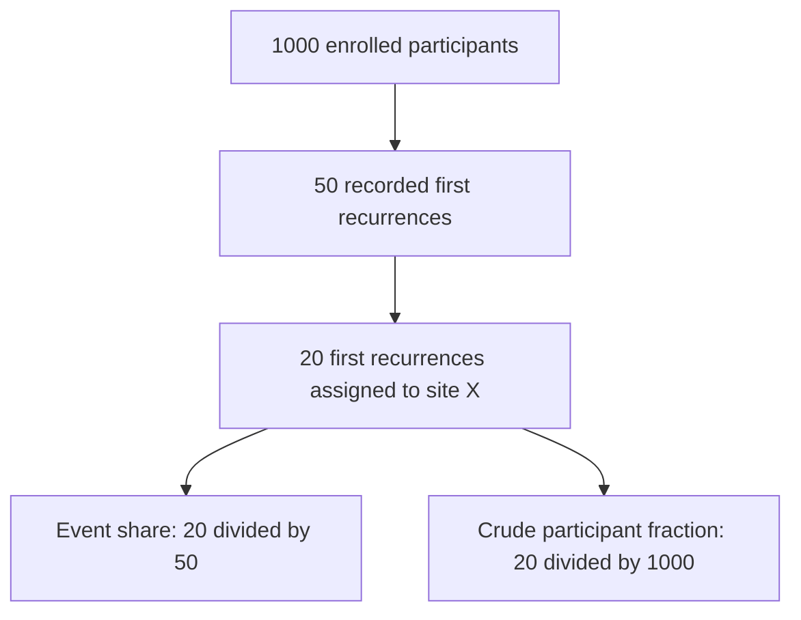

# Survival endpoints

## In one sentence

A survival endpoint specifies the starting time and which events count during follow-up.

## The intuition

A survival curve is a clock with a rule for stopping it. Changing either the starting point or the stop rule changes what the percentage means. “Survival” alone is not enough information to compare studies.

## How it works

Overall survival (OS) counts death from any cause. Progression-free survival (PFS) typically counts progression or death. Event-free survival (EFS) uses a protocol-defined set of events; in a neoadjuvant study it can include progression preventing definitive surgery. Invasive disease-free survival (IDFS) concerns defined invasive disease events and often death after a specified starting point.

Distant recurrence-free interval and distant recurrence-free survival can handle death and other events differently. Disease-free survival also has study-specific definitions. Read the protocol and endpoint definition, rather than assuming a familiar acronym always means the same thing.

KEYNOTE-522’s co-primary endpoints were [pCR (pathologic complete response)](/wiki/education/concepts/breast-cancer/surgery-and-pathology-results/pcr) and EFS. Calling its five-year EFS an IDFS result changes the endpoint. Likewise, a postoperative biomarker cohort using a last available draw during the first year is not equivalent to a trial measuring from randomization or a uniform early postoperative draw.

An endpoint occurring sooner can make a study feasible, but it is not automatically a validated surrogate for overall survival. Regulatory approval can use different evidence depending on the indication and pathway. There is no universal requirement that a cancer drug demonstrate PFS for full approval. [FDA: cancer-trial endpoints](https://www.fda.gov/media/71195/download).

## Why it matters in cancer

It makes comparisons between trial results meaningful by retaining their starting points and event definitions.

## Worked example

A person has a local invasive recurrence but remains alive without distant recurrence. That event may count in IDFS and not yet in a distant-recurrence endpoint; OS still has no death event. All three descriptions can be correct under their definitions.

## An event share is not patient risk

Imagine 1,000 fictional participants followed for first recurrence. At the data cutoff, 50 first recurrences have been recorded, with each assigned to one site category; 20 are assigned to site X. Some participants have incomplete follow-up.

*The numerator is the same; the denominators answer different questions.*

The **event share**, 20/50 = 40%, describes site X among recorded first recurrences. The **crude observed participant fraction**, 20/1,000 = 2%, describes those events relative to everyone enrolled. Neither automatically supplies five-year patient risk when follow-up is incomplete or unequal.

A **cumulative incidence** estimate gives the probability of a specified event by a specified time, accounting for follow-up and **competing events** under the analysis's assumptions. A competing event prevents the event as defined: death before recurrence, or a different first-recurrence category when studying site X as the first site. A later recurrence at X is a different question. [Fine and Gray: competing-risk analysis](https://doi.org/10.1080/01621459.1999.10474144).

## Try it

A fictional headline says: “Site X accounts for 40% of first recurrences, so each participant has a 40% risk at that site.” What changed?

**Answer:** The headline switched from the recurrence denominator to the participant denominator and omitted the time horizon. Even the crude 2% participant fraction is not automatically a time-specific incidence estimate. Ask for the endpoint, clock, follow-up and appropriate analysis.

## Common confusions

- IDFS, EFS, PFS and OS cannot be relabeled to simplify a table.
- A five-year estimate needs its origin, event definition and population. An event-location share uses a different denominator.
- A biomarker’s association with an endpoint is different from evidence that acting on it improves that endpoint.

## Related concepts

[[wiki/education/concepts/evidence-and-statistics/effect-measures/hazard-ratio|Hazard ratio]] and [[wiki/education/concepts/evidence-and-statistics/endpoints/kaplan-meier|Kaplan–Meier]].

## Sources and scope

General teaching, source-checked October 9, 2026. The examples are hypothetical unless a study is explicitly named. Expert and learner review remain pending.

- [STEEP standardized breast-trial endpoint definitions](https://pubmed.ncbi.nlm.nih.gov/17513820/).
- [KEYNOTE-522 EFS primary report](https://pubmed.ncbi.nlm.nih.gov/35139274/).
- [Fine and Gray 1999: cumulative incidence and competing risks](https://doi.org/10.1080/01621459.1999.10474144).
- [FDA 2018: Clinical Trial Endpoints for the Approval of Cancer Drugs and Biologics](https://www.fda.gov/media/71195/download).

<!-- BEGIN GENERATED USED IN -->
## Used in

- [Understand local therapy and the immune system](/wiki/education/guides/local-therapy-and-the-immune-system/index)
- [Name the comparison and endpoint](/wiki/education/guides/reading-cancer-evidence/01-name-the-comparison-and-endpoint)
- [Check applicability and uncertainty](/wiki/education/guides/reading-cancer-evidence/03-check-applicability-and-uncertainty)
- [Read trial claims and survival statistics](/wiki/education/guides/reading-cancer-evidence/index)
- [Ask what a combination trial actually proved](/wiki/education/local-treatment-modalities/03-overlap-and-sequencing)
- [Local-treatment reference shelf](/wiki/education/local-treatment-modalities/index)
<!-- END GENERATED USED IN -->
