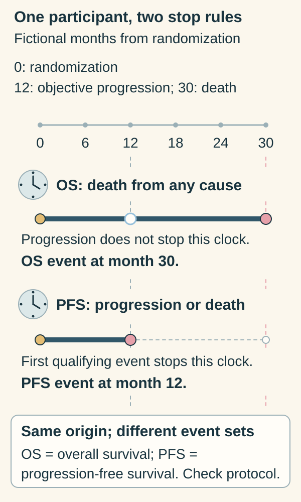

# Survival endpoints

## In one sentence

A survival endpoint specifies the starting time and which events count during follow-up.

## The intuition

A survival curve is a clock with a rule for stopping it. Changing the starting point or stop rule changes what its percentage means. The analogy has a limit: a curve estimates a group's experience with incomplete follow-up; it does not predict an individual's stopping time.

## How it works

An **event set** specifies which outcomes count, usually taking the first qualifying event. The acronym alone is insufficient. These are useful starting descriptions, with the protocol supplying the actual rules:

| Endpoint | Event set to check |
|---|---|
| **Overall survival (OS)** | Death from any cause. |
| **Event-free survival (EFS)** | Prespecified events; neoadjuvant trials may include progression that prevents definitive surgery, recurrence, second primary cancer and death. |
| **Invasive disease-free survival (IDFS)** | Under STEEP definitions: invasive local, regional, distant or contralateral breast events, a second nonbreast invasive primary, or death from any cause. In situ disease is excluded. |
| **Disease-free survival (DFS)** | Study-defined recurrence, new cancer and/or death events. Do not automatically substitute IDFS or EFS. |
| **Distant recurrence-free interval (DRFI)** | Under STEEP: distant recurrence or breast-cancer death. A study's death rules must still be checked. |
| **Progression-free survival (PFS)** | Usually objective progression or death; scan criteria, assessment times and missing assessments matter. |

STEEP 2.0 also defines an invasive breast cancer–free survival endpoint excluding second nonbreast primaries. That is a distinct endpoint, rather than a reason to silently change IDFS. [STEEP 2.0](https://doi.org/10.1200/JCO.20.03613).

Distant recurrence-free **survival** can count any-cause death, unlike the STEEP DRFI definition. Keep the actual paper's rules. A person with a local invasive recurrence who remains alive without distant recurrence may have an IDFS event without an OS or DRFI event.

The clock can begin at randomization, consent, surgery or a biomarker assessment. KEYNOTE-522 used [pathologic complete response](/wiki/education/concepts/breast-cancer/surgery-and-pathology-results/pcr) and EFS as co-primary endpoints; renaming its EFS result IDFS changes the claim. A postoperative cohort's clock is another comparison.

*The same event can stop one endpoint clock while another continues.*

For this illustration, both clocks start at randomization. Overall survival (OS) counts death from any cause. Progression-free survival (PFS) counts the first objective progression or death. The participant has progression in month 12 and dies in month 30. The dashed later course belongs to the same known history; it is not a censoring mark or a survival-probability estimate. Other endpoints and protocols require their own origins, qualifying events and assessment rules. [FDA definitions](https://www.fda.gov/media/71195/download).

**Read the clocks:** Which one stops at month 12? **Answer:** PFS. Progression qualifies for PFS; the participant is still alive, so OS continues.

## What is measured

| Reading question | Information needed |
|---|---|
| Input | Participant-level dates, event types and follow-up status. |
| Method | Protocol event set, time origin, censoring rules and analysis cutoff. |
| Output | A time-specific probability, curve or rate comparison with uncertainty. |
| Main failure | Mixing clocks, event sets or analysis populations. |
| Cannot tell | Which individual benefits, or whether an earlier endpoint is a validated substitute for OS. |

Regulatory evidence depends on the indication and pathway. There is no universal requirement that every cancer drug demonstrate PFS for full approval. [FDA endpoint guidance](https://www.fda.gov/media/71195/download).

## Why it matters in cancer

A favorable distant-event result does not settle local control or overall survival. A biomarker's association with an endpoint also differs from evidence that acting on that biomarker improves outcomes.

## Worked example: keep the denominator

Among 1,000 fictional participants, 50 first recurrences are recorded; 20 are assigned to site X. Some follow-up is incomplete.

| Calculation | Question answered |
|---|---|
| `20/50 = 40%` | What share of recorded first recurrences was assigned to X? |
| `20/1000 = 2%` | What crude fraction of enrolled participants had that recorded event? |

Neither calculation automatically gives five-year risk. A **cumulative incidence** estimate accounts for follow-up and competing events. Death before recurrence prevents that recurrence; a different first site prevents X from being the first site. A later recurrence at X is a different endpoint. [Fine and Gray](https://doi.org/10.1080/01621459.1999.10474144).

## Common confusions

- Event-location share is not participant risk.
- A second operation is not automatically an EFS event.
- “Five-year” needs a starting date; it does not reset when you read the result.
- DFS, EFS, IDFS, DRFI and PFS are not interchangeable labels.

## Try it

A headline turns “X caused 40% of recorded first recurrences” into “everyone has a 40% five-year risk at X.” What changed?

**Answer:** The denominator changed from recurrences to participants, and a time horizon was added without a supporting time-to-event analysis. Ask for the clock, event set and follow-up.

## Explain it back

Explain how local recurrence, distant recurrence and death can produce different endpoints for the same person.

## Takeaway

Name the clock, event set and denominator before interpreting a survival percentage.

## Related concepts

[[wiki/education/concepts/evidence-and-statistics/effect-measures/hazard-ratio|Hazard ratio]] and [[wiki/education/concepts/evidence-and-statistics/endpoints/kaplan-meier|Kaplan–Meier]].

## Sources and scope

General teaching, source-checked October 10, 2026. The examples are hypothetical unless a study is explicitly named. Expert and learner review remain pending.

- [STEEP 2.0: updated event sets and distinct invasive breast cancer–free survival](https://doi.org/10.1200/JCO.20.03613).
- [STEEP standardized breast-trial endpoint definitions](https://pubmed.ncbi.nlm.nih.gov/17513820/).
- [KEYNOTE-522 EFS primary report](https://pubmed.ncbi.nlm.nih.gov/35139274/).
- [Fine and Gray 1999: cumulative incidence and competing risks](https://doi.org/10.1080/01621459.1999.10474144).
- [FDA 2018: Clinical Trial Endpoints for the Approval of Cancer Drugs and Biologics](https://www.fda.gov/media/71195/download).

<!-- BEGIN GENERATED USED IN -->
## Used in

- [Understand local therapy and the immune system](/wiki/education/guides/local-therapy-and-the-immune-system/index)
- [Name the comparison and endpoint](/wiki/education/guides/reading-cancer-evidence/01-name-the-comparison-and-endpoint)
- [Check applicability and uncertainty](/wiki/education/guides/reading-cancer-evidence/03-check-applicability-and-uncertainty)
- [Read trial claims and survival statistics](/wiki/education/guides/reading-cancer-evidence/index)
- [Ask what a combination trial actually proved](/wiki/education/local-treatment-modalities/03-overlap-and-sequencing)
- [Local-treatment reference shelf](/wiki/education/local-treatment-modalities/index)
<!-- END GENERATED USED IN -->
