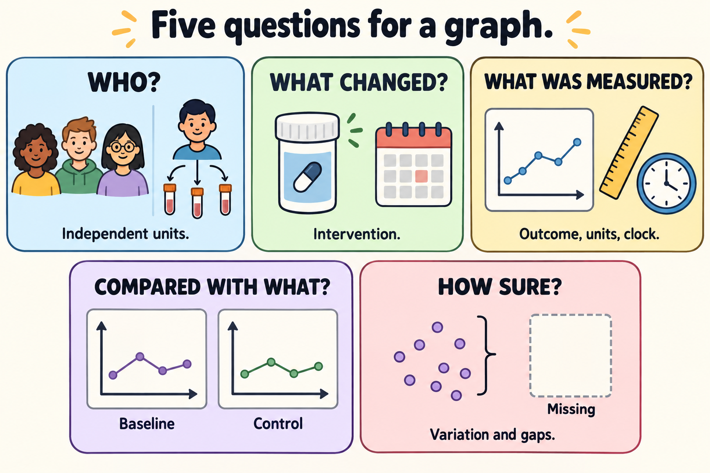

# Read a graph in five passes

## In one sentence

Reading a graph in five passes means checking its population, intervention, outcome, comparison and uncertainty before interpreting its pattern.

## The intuition

A graph is a compact answer to a question. Its shape can catch your eye before you know the question. Give yourself five passes through the figure, its caption and its methods. Each pass adds a label that the shape cannot supply by itself.

This is a reading habit, not a score that certifies a study. Sometimes the most useful result is a clearly marked blank: “The independent sample count is not reported.”

*Ask all five questions. Three samples from one donor still represent one donor; the miniature plots are schematic icons, and the empty card means missing observation.*

## How it works

| Pass | What to find | A useful question |
|---|---|---|
| Population | People, animals, donors or laboratory material; entry criteria and independent sample count | Who or what does one dot represent? |
| Intervention | What was administered or changed, with dose and timing | Did the experiment test a whole product or one component? |
| Outcome | Axis labels, units, scale, measurement site and time origin | Is this cell activity, tumor size, recurrence or survival? |
| Comparison | The reference group or baseline and what else differs | Is the claim about change from baseline or difference from a control? |
| Uncertainty | Individual observations, interval definitions, missing data and follow-up | What variation is shown, and what information is absent? |

**Biological replicates** are independent biological units relevant to the question, such as donors or animals. **Technical replicates** repeat measurements on the same material. Ten wells from one donor provide ten measurements, not ten independent patients. [Preclinical evidence](/wiki/education/concepts/evidence-and-statistics/study-design/preclinical-evidence) explains why the independent unit matters.

Read axis numbers as well as distances. Equal spacing on a logarithmic axis represents equal ratios; equal spacing on a linear axis represents equal differences. A shortened vertical axis can emphasize a small difference. Neither choice is automatically wrong, but the interpretation must follow the actual scale.

Find the definition of each error bar. A standard deviation describes variation in observations; a standard error describes uncertainty in an estimated mean. A [confidence interval](/wiki/education/concepts/evidence-and-statistics/effect-measures/confidence-interval) uses a specified procedure and assumptions. These are different quantities, even when the bars look alike. [Lord and colleagues: error bars and independent experiments](https://doi.org/10.1083/jcb.202001064).

## A worked example

In a fictional animal experiment, both groups start with tumors of 100 cubic millimeters. At day 28, the control average is 1,000 and the treated average is 300. Four independent animals contributed to each group.

The treated average is 70% smaller than the concurrent control, yet three times its own baseline. That is reduced growth relative to control; it is not shrinkage below baseline. If the figure instead shows twenty wells from one animal, the number of independent animals is still one. The [reduction-versus-regression concept](/wiki/education/concepts/evidence-and-statistics/reasoning-tools/reduction-is-not-regression) keeps those reference points separate.

For a [Kaplan–Meier curve](/wiki/education/concepts/evidence-and-statistics/endpoints/kaplan-meier), the same passes require the event definition, the starting clock, censoring rules and the number still at risk. A late flat tail with few observed participants is weak support for a precise late estimate.

## Try it

A fictional caption says, “Twelve measurements show a lower signal after treatment.” All measurements came from three donors, and the error bars are undefined. What two questions would you ask before interpreting the difference?

**Answer:** Ask how repeated measurements from each donor were handled; there are three independent donors, not twelve. Ask what the error bars represent. You would still need the intervention, outcome, comparison and missing-data details before drawing a conclusion.

## Why it matters in cancer

- A mouse tumor-volume graph and a patient survival curve answer different questions.
- A biological signal cannot become a clinical outcome just because its plotted difference is large.
- A treatment comparison needs both an appropriate design and a clearly stated outcome. [CONSORT 2025](https://www.bmj.com/content/389/bmj-2024-081123).

## Common confusions

- **Dots versus independent units:** several measurements can come from one person or animal.
- **Missing observations versus zero values:** an absent measurement is not a measured absence.
- **Large visual separation versus large clinical benefit:** check units, scale, endpoint and harms.
- **A complete caption versus a trustworthy conclusion:** the methods and underlying comparison still matter.

## Related concepts

- [Denominators and conditional probability](/wiki/education/concepts/evidence-and-statistics/reasoning-tools/denominators-and-conditional-probability) identify the group behind a percentage.
- [Absolute and relative risk](/wiki/education/concepts/evidence-and-statistics/effect-measures/absolute-relative-risk-and-nnt) keep effect measures distinct.
- [Preclinical evidence](/wiki/education/concepts/evidence-and-statistics/study-design/preclinical-evidence) names the model and independent unit.

## Sources and scope

Source check: October 10, 2026. The five-pass sequence is a teaching synthesis seeded from the cell-therapy evidence lesson. All numerical examples are fictional. Expert and learner review remain pending.

- [Lord et al. 2020: SuperPlots](https://doi.org/10.1083/jcb.202001064) — independent experiments, individual measurements and descriptive versus inferential error bars.
- [NIST/SEMATECH: graphical techniques](https://www.itl.nist.gov/div898/handbook/eda/section3/eda33.htm) — graph types alongside quantitative methods.
- [CONSORT 2025 statement](https://www.bmj.com/content/389/bmj-2024-081123) — participant flow, outcomes, analysis counts, effects and precision.
- [FDA: clinical trial endpoints for cancer drugs and biologics](https://www.fda.gov/regulatory-information/search-fda-guidance-documents/clinical-trial-endpoints-approval-cancer-drugs-and-biologics) — event and assessment definitions.

<!-- BEGIN GENERATED USED IN -->
## Used in

- [Reading cell-therapy evidence](/wiki/education/cellular-therapies/09-reading-cell-therapy-evidence)
- [Read the validation behind the claim](/wiki/education/guides/judging-a-test-or-vendor-claim/02-read-the-validation)
- [Judge a test or company claim](/wiki/education/guides/judging-a-test-or-vendor-claim/index)
- [Read the curve and effect](/wiki/education/guides/reading-cancer-evidence/02-read-the-curve-and-effect)
- [Read trial claims and survival statistics](/wiki/education/guides/reading-cancer-evidence/index)
<!-- END GENERATED USED IN -->
