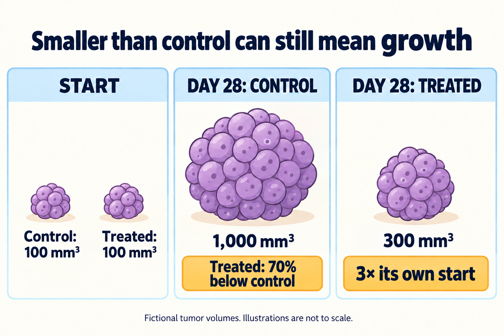

# Reduction is not necessarily regression

## In one sentence

A reduction relative to a comparison group does not establish tumor regression, which requires a decrease relative to the tumor's own earlier size under a defined assessment.

## The intuition

Two plants begin the same size. One grows more slowly, so it is much smaller than the other a month later. It did not necessarily shrink. The analogy is about comparison arithmetic; tumor biology, measurement and patient outcomes need their own evidence.

When a paper says “70% reduction,” pause at the missing words: **70% relative to what?** A control group, the tumor's starting measurement and its smallest previous measurement can yield very different answers.

## How it works

*A smaller treated-versus-control comparison can coexist with growth from the starting size. These fictional volumes are not a patient response category; the drawing is not to scale. Tap the image to enlarge.*

Consider a fictional [preclinical experiment](/wiki/education/concepts/evidence-and-statistics/study-design/preclinical-evidence). Two groups have representative tumor volumes of 100 cubic millimeters (mm³) at treatment start. At day 28:

| Measurement | Control | Treated |
|---|---|---|
| Start | 100 mm³ | 100 mm³ |
| Day 28 | 1,000 mm³ | 300 mm³ |
| Change from own start | +900 mm³ | +200 mm³ |

Compared with the control at the same time, the treated volume is **70% lower**: (1,000 − 300) / 1,000 = 0.70. Compared with its own start, it is **three times as large**, a 200% increase. This is compatible with slower growth under treatment. It is not regression from the starting size.

The table shows invented representative values, not individual observations or a statistical treatment-effect estimate. Real studies need group distributions, independent experimental units, allocation, missing measurements and uncertainty. Even “tumor growth inhibition” can use different formulas; some compare changes from baseline rather than final volumes. Recover the paper's actual calculation before quoting its percentage.

## Why it matters in cancer

[Response Evaluation Criteria in Solid Tumours (RECIST)](/wiki/education/concepts/measurement/imaging/response-criteria) uses a sum of selected lesion diameters, with specified rules for lymph nodes, non-target disease and new lesions. A percentage calculated from mouse tumor volumes cannot be inserted into a clinical diameter threshold. Cubic millimeters and millimeters measure different quantities. [Eisenhauer et al., 2009](https://recist.eortc.org/recist/wp-content/uploads/sites/14/2025/12/RECISTGuidelines.pdf).

RECIST partial response uses baseline as its comparison; target-lesion progression uses the smallest previous sum, called the nadir, plus its specified thresholds. The overall assessment also considers the rest of the disease. A decrease in one lesion does not automatically make the person an overall responder.

Nor does a lower laboratory signal necessarily describe tumor size. Cell number, metabolic activity and target-cell death are distinct readouts; use the method's actual validated quantity. A graph's axis label is part of the claim, not decoration.

## The readout card

Write down:

- the measured object: tumor, selected lesions, cells or a biochemical signal;
- the units, timing and definition of the reference value;
- the calculation: final-value contrast, change from start, or another stated formula;
- the independent unit, controls, uncertainty and excluded observations.

After establishing shrinkage, ask about duration, other disease sites and harms. A tumor-size result does not supply every clinical benefit outcome. [FDA oncology endpoint guidance, 2018](https://www.fda.gov/media/71195/download). [Response rates](/wiki/education/concepts/evidence-and-statistics/endpoints/response-rates) explains how defined responses become participant-level fractions.

## Common confusions

- **Smaller than control versus smaller than start:** the first can occur while the tumor grows.
- **200% increase versus threefold size:** both describe 100 → 300; “300% increase” would be different.
- **Slower growth versus cell death:** size alone does not identify the mechanism.
- **Regression versus disappearance:** a shrinking tumor can remain measurable; disappearance on a scan does not prove eradication.
- **Statistical regression:** the statistical modeling term is a different use of the word.

## Try it

In another fictional experiment, a tumor starts at 100 mm³ and is measured at 60 mm³ later. The control is 300 mm³. Name both comparisons.

**Answer:** The treated tumor is 40% below its own start, supporting regression under this volume assessment. It is also 80% below the same-time control. Those are two different percentages. Neither establishes a RECIST category, complete eradication or patient benefit.

## Explain it back

“The treated tumor was ___ compared with control, but ___ compared with its own start.” For the first table: “70% smaller; three times as large.”

## Takeaway

**Keep the reference value, units and time attached to every reduction claim.**

For a longer worked exercise, use [reading cell-therapy evidence](/wiki/education/cellular-therapies/09-reading-cell-therapy-evidence).

## Related concepts

[Response criteria](/wiki/education/concepts/measurement/imaging/response-criteria) defines clinical measurement rules. [Preclinical evidence](/wiki/education/concepts/evidence-and-statistics/study-design/preclinical-evidence) explains what a model comparison can establish.

## Sources and scope

Source check: October 10, 2026. All volume values and calculations are fictional. Clinical criteria are a separate measurement framework. Expert and learner review pending.

- [Eisenhauer et al., 2009: primary RECIST 1.1 guideline](https://recist.eortc.org/recist/wp-content/uploads/sites/14/2025/12/RECISTGuidelines.pdf) — baseline, nadir and overall disease rules.
- [FDA, December 2018: oncology clinical-trial endpoints](https://www.fda.gov/media/71195/download) — tumor activity, durability and clinical outcome interpretation.

<!-- BEGIN GENERATED USED IN -->
## Used in

- [Reading cell-therapy evidence](/wiki/education/cellular-therapies/09-reading-cell-therapy-evidence)
- [Test a mechanism in a living model](/wiki/education/molecular-profiling/05-functional-drug-response)
<!-- END GENERATED USED IN -->
