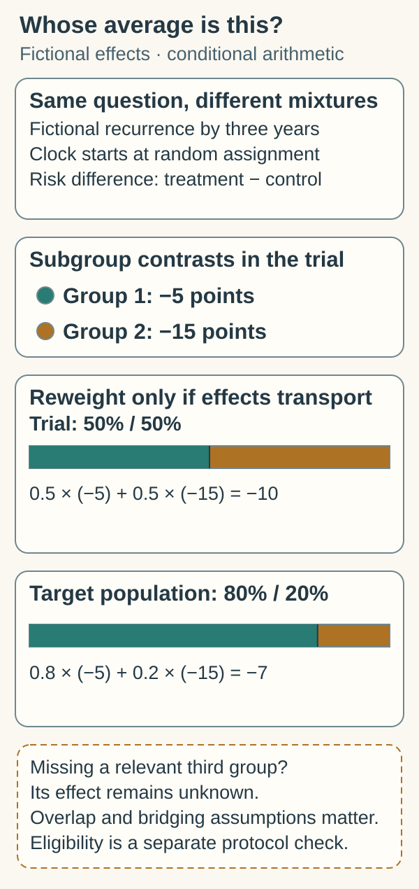

# Transportability and eligibility

## In one sentence

Transportability asks whether a study's treatment-effect estimate can apply to a specified different population or setting, while eligibility asks whether someone meets a protocol's entry rules.

## The intuition

A school tests a teaching method in selected classrooms. The result may be convincing there, while a different school has different students, staffing and background lessons. An entry rule tells you who could join the study; it does not tell you whether its average improvement carries across schools.

The analogy helps separate selection from assignment. Biology, treatment exposure and cancer care add differences that a classroom comparison cannot capture.

## How it works

[Randomization](/wiki/education/concepts/evidence-and-statistics/study-design/trial-phases-and-randomization) forms treatment groups within the enrolled sample. It does not randomly select participants from everyone who might receive treatment. Eligible people can differ from those invited, enrolled and followed.

Start by naming a **target population**: the people and setting for which you want an effect estimate. Align the disease, treatment history, intervention and background care, comparator, [endpoint and starting clock](/wiki/education/concepts/evidence-and-statistics/endpoints/survival-endpoints). Changing the treatment sequence or comparator can change the question itself.

A **prognostic factor** predicts outcomes; an **effect modifier** changes a treatment contrast on a stated scale. Those roles differ, as [prognostic versus predictive evidence](/wiki/education/concepts/evidence-and-statistics/biomarkers/prognostic-vs-predictive) explains. Even a constant relative effect can produce different absolute benefits when baseline risks differ. The effect scale belongs beside any claim of similarity.

Researchers can **standardize** subgroup estimates to a target population's mixture, or **weight** trial observations to represent that mixture. These approaches need appropriate trial and target-population data, measured relevant differences, well-defined comparable treatments and adequate **overlap**: the relevant target profiles must have informative counterparts in the trial. If a needed profile is absent, weighting cannot invent its treatment response. The assumption that measured profiles are sufficient to bridge populations is not fully established by a tidy adjusted plot. [Dahabreh and colleagues, published 2021](https://pmc.ncbi.nlm.nih.gov/articles/PMC8536837/).

## A fictional worked example

Suppose a well-conducted invented randomized trial measures recurrence by three years from assignment. Its two baseline groups have treatment-versus-control risk differences of −5 and −15 percentage points. With equal groups, a simple average is −10 points.

A target population contains 80% of the first group and 20% of the second. **If** those subgroup effects transport and all relevant differences are addressed, its weighted contrast would be `0.8 × (−5) + 0.2 × (−15) = −7` points. This arithmetic illustrates an assumption, not a personal forecast or proof that the assumption holds. Missing a third important group would leave its contribution unresolved.

*Changing the mixture changes the conditional average; weighting cannot supply an absent group or validate the bridging assumptions.*

Keep the [cross-trial comparison boundaries](/wiki/education/concepts/evidence-and-statistics/reasoning-tools/cross-trial-comparison) attached when comparing settings.

**Figure check:** Does calculating −7 prove transportability or eligibility? **Answer:** No. It follows only if the subgroup effects transport and relevant differences are addressed. Protocol eligibility requires its own assessment.

## Why it matters in cancer

A metastatic study after several treatments and an early-disease postoperative study can differ in biology, competing risks, treatment tolerance and endpoints. A similar marker or cancer label does not bridge an untested intervention. Relevant evidence can guide reasoning while leaving a specific treatment-effect question open.

Eligibility is a separate protocol check: disease, prior treatment, organ function, safety history and assay definitions can matter. Meeting entry criteria does not guarantee benefit, enrollment or an available slot. [Finding and checking a trial](/wiki/education/concepts/access-and-regulation/trials-and-access/finding-a-trial) owns the dated study-team confirmation.

## The applicability card

Retain the trial sample and intended target population; eligibility versus actual enrollment; treatment/comparator; endpoint, clock and effect units; plausible effect modifiers; overlap and missing groups; adjustment assumptions; follow-up, harms and uncertainty. There is no universal similarity score or threshold that certifies transportability.

## Common confusions

- **Eligible versus representative:** entry rules do not ensure that the enrolled sample represents everyone meeting them.
- **Randomized versus universally applicable:** assignment protects the internal comparison, not every extrapolation.
- **Adjusted versus established:** weighting cannot remove an unmeasured effect modifier or settle a different treatment question.
- **Population effect versus individual outcome:** even a sound target-population estimate is not a person's guaranteed benefit.

## Try it

An invented trial allows older adults, but enrolls almost none with a particular organ-function limitation. A reader meets the age rule. Does that establish the trial average for the reader's setting?

**Answer:** No. Check the full eligibility rules and study team's interpretation separately, then examine actual representation, safety data, treatment context and the assumptions needed for that target group. An age match alone settles neither question.

## Explain it back

“Eligibility asks ___; transportability asks ___.” One answer: “whether the protocol permits participation; whether a specified treatment-effect estimate can extend to a specified population under defensible assumptions.”

## Takeaway

**Name the population and question before carrying a treatment estimate across settings.**

## Related concepts

- [Cross-trial comparison](/wiki/education/concepts/evidence-and-statistics/reasoning-tools/cross-trial-comparison): contrasting separate studies requires compatible questions.
- [Absolute and relative risk](/wiki/education/concepts/evidence-and-statistics/effect-measures/absolute-relative-risk-and-nnt): the effect scale and baseline risk matter.

## Sources and scope

Source check: October 10, 2026. All numerical results and the trial are fictional. Primary methods and official trial guidance; no actual eligibility, access or personal prognosis is inferred. Expert and learner review remain pending.

- [Dahabreh et al., 2021: study designs for extending randomized-trial inferences](https://pmc.ncbi.nlm.nih.gov/articles/PMC8536837/) — target populations, sampling and identifiability; [May 2019 v1 preprint](https://arxiv.org/pdf/1905.07764), sections 2.2–2.3 and 3–4, inspected for assumptions and weighting; published-report abstract and indexed methods checked separately.
- [National Cancer Institute: how clinical trials work](https://www.cancer.gov/research/participate/clinical-trials/how-trials-work) — assignment within a study.
- [National Cancer Institute: steps to find a clinical trial](https://www.cancer.gov/research/participate/clinical-trials-search/steps) — eligibility rules and study-team assessment.

<!-- BEGIN GENERATED USED IN -->
## Used in

- [Connect evidence to a decision](/wiki/education/guides/judging-a-test-or-vendor-claim/03-connect-evidence-to-a-decision)
- [Judge a test or company claim](/wiki/education/guides/judging-a-test-or-vendor-claim/index)
- [Check applicability and uncertainty](/wiki/education/guides/reading-cancer-evidence/03-check-applicability-and-uncertainty)
- [Read trial claims and survival statistics](/wiki/education/guides/reading-cancer-evidence/index)
<!-- END GENERATED USED IN -->
