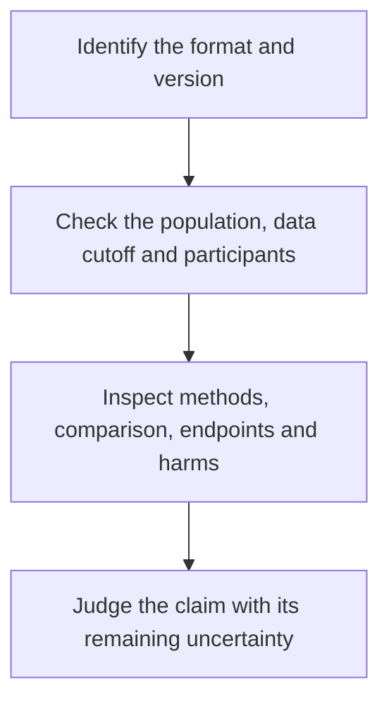

# Conference abstracts, preprints and full papers

## In one sentence

Publication format tells you how much of a study you can inspect and what review it has received, but does not by itself establish the study's validity.

## The intuition

An abstract is like a short account of a long journey. It may accurately describe the destination while leaving out the route, delays and travelers who left early. A fuller account lets you ask more questions.

Review by other researchers adds scrutiny. It does not make an unsupported claim true or supply information that the authors never collected.

## How it works

| Format | What you may be able to inspect | What to check |
|---|---|---|
| Conference abstract or presentation | A brief methods/result summary, sometimes supplemented by slides or a poster | Actual data cutoff, population, comparison and endpoint; methods may be incomplete |
| Preprint | A fuller manuscript released before completion of journal peer review | Version, methods, limitations and whether a reviewed version now exists |
| Full journal article | Methods, results and discussion, often with a supplement | Review status, protocol, analysis plan, missing data and the scope of its conclusion |
| Correction, update or retraction | A change to the publication record | Which part changed and whether the original inference still holds |

An **abstract** can also be the summary at the beginning of a full article. “There is an abstract” does not mean “only a conference abstract exists.” Identify the underlying document.

**Peer review** is critical assessment by other people in the field as part of a journal's editorial process. Practices vary. Conference submissions can undergo selection or review too, but acceptance for presentation does not provide the same report as a complete article and supplement.

When newer results appear, compare study identifiers, population, follow-up, outcomes and analysis. A later article may provide more mature follow-up or a changed analysis population. Preserve the earlier record as historical evidence rather than mixing its numbers with the later report.

*The format affects what can be inspected; study design and data determine which conclusions are supported.*

## A worked fictional example

A fictional conference report says that 12 of 20 participants responded after a short follow-up. A later full report includes 30 participants, explains who could be evaluated, and reports response duration and serious harms.

Both documents may be accurate for their stated cutoff. You cannot combine the first report's response percentage with the later report's follow-up and call the result one study estimate. Ask which version supports each number and whether people appear in both reports.

If the full report supplies a comparison that the abstract omitted, that can change your interpretation. If it remains a single-group study, publication alone does not create a randomized control group.

## Why it matters in cancer

Early oncology findings often appear at conferences before a full report. They can be useful for understanding an emerging question. A treatment decision claim needs enough methods and matched clinical evidence to assess it; a polished slide or journal logo does not substitute for that assessment.

## Common confusions

- Peer review and independent replication are different forms of scrutiny.
- More recent does not automatically mean better designed.
- A full paper can still contain exploratory analyses or missing information.
- A study report, a news release and a commentary are different source types.
- Repeated reports from the same participants are not independent confirmations.

## Related concepts

- [Case reports and N-of-1 trials](/wiki/education/concepts/evidence-and-statistics/study-design/case-reports-and-n-of-1)
- [Confidence intervals](/wiki/education/concepts/evidence-and-statistics/effect-measures/confidence-interval)
- [Judge a claim's validation](/wiki/education/guides/judging-a-test-or-vendor-claim/02-read-the-validation)

## Sources and scope

Source check: October 9, 2026. Counts are invented to illustrate version tracking. A publication category is not a clinical evidence grade. Expert and learner review remain pending.

- [CONSORT for abstracts](https://journals.plos.org/plosmedicine/article?id=10.1371/journal.pmed.0050020) — essential information in randomized trial summaries.
- [ICMJE: responsibilities in submission and peer review](https://www.icmje.org/recommendations/browse/roles-and-responsibilities/responsibilities-in-the-submission-and-peer-peview-process.html) — editorial and reviewer roles.
- [CONSORT 2025 statement](https://journals.plos.org/plosmedicine/article?id=10.1371/journal.pmed.1004587) — transparent reporting of the full trial and supporting materials.

<!-- BEGIN GENERATED USED IN -->
## Used in

- [Check applicability and uncertainty](/wiki/education/guides/reading-cancer-evidence/03-check-applicability-and-uncertainty)
- [Ask what a combination trial actually proved](/wiki/education/local-treatment-modalities/03-overlap-and-sequencing)
- [Local-treatment reference shelf](/wiki/education/local-treatment-modalities/index)
<!-- END GENERATED USED IN -->
