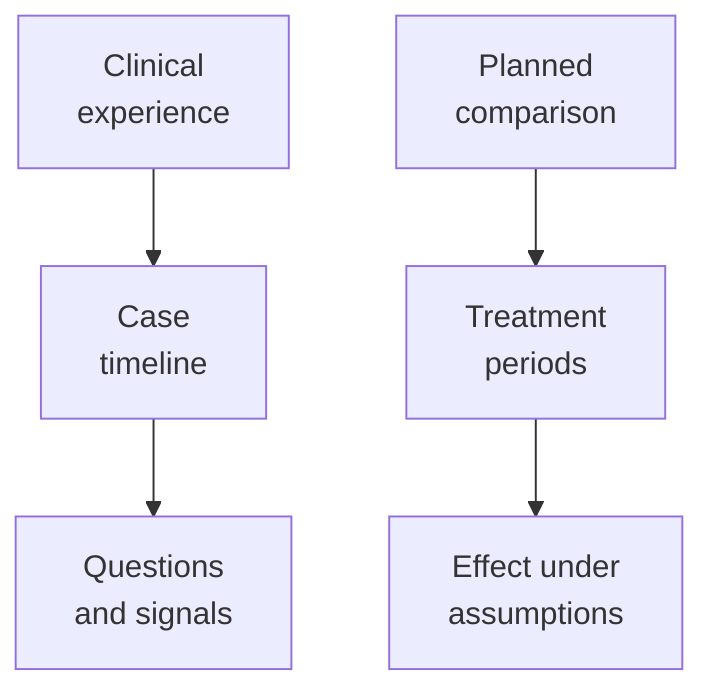
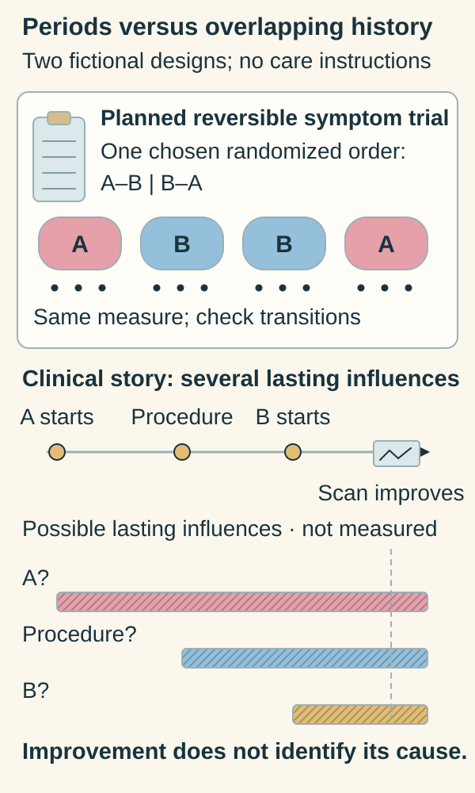

# Case reports and N-of-1 trials

## In one sentence

A case report describes an individual clinical experience, while an N-of-1 trial prospectively compares interventions within one person using a planned experimental design.

## The intuition

An individual story can make a possibility visible. You learn what happened, what was difficult and what questions deserve attention. You do not automatically learn what would have happened to that person under different care.

An N-of-1 trial tries to make a particular comparison more informative within one person. The name describes the study unit; it does not make every personal treatment journey a controlled experiment.

## How it works

A **case report** documents a person's clinical course, interventions, measurements and outcomes. A careful timeline includes other care and alternative explanations. Such reports can alert researchers to unusual responses or harms and motivate further investigation.

They usually lack a concurrent comparison showing the outcome under another approach. People with memorable experiences may be more likely to be reported. A collection of published successes therefore does not reveal how many people received the treatment without that success.

In the crossover framework used here, a **planned N-of-1 trial** compares treatment periods, sometimes with [randomized order and blinding](/wiki/education/concepts/evidence-and-statistics/study-design/trial-phases-and-randomization). “N-of-1” is also used for personalized single-patient studies; inspect the actual design rather than assuming crossover or randomization. It specifies the question, measurements and analysis before interpreting the results. Repeated comparison within the same person can reduce some between-person differences.

*A documented experience and a planned comparison support different claims; neither alone establishes the average effect in a wider population.*

That design needs a suitable clinical situation. Repeated crossover is most informative when the condition is relatively stable and effects begin and end quickly enough for the periods to be interpretable. A **carryover effect** is an effect of an earlier intervention that persists into a later comparison period.

Progressive disease, lasting immune effects and irreversible procedures can undermine that logic. Cancer surgery followed by a continuing systemic therapy cannot simply be reversed to recreate an untreated comparison. Changing or interrupting cancer care to create a comparison is not a learning exercise; any proposed clinical experiment requires its own appropriate clinical and research oversight.

Random order does not erase carryover or a changing condition. A **period effect** is a change over time apart from the compared treatment; **autocorrelation** means nearby measurements are related. The analysis must address those features and missing observations. Keep period lengths, assigned order, background care, outcome units and assessment times beside the result.

*A sequence of events becomes an interpretable comparison only under a suitable design and assumptions.*

The upper strip shows one possible randomized order for two planned A–B symptom comparisons. The dots stand for repeated observations using the same measure. Suitable transitions, rapid reversibility and a sufficiently stable condition need checks; the drawing does not give a washout duration or show measured benefits.

Below, follow the existing clinical story: A starts, a procedure is added, B starts, and a scan improves. The hatched ribbons show possible lasting influences overlapping at the scan, not measured effect sizes or known treatment durations. Horizontal placement shows order only. The last intervention cannot receive all the credit from timing alone. Randomization would not erase carryover or time trends. [Official methods guidance, selected N-of-1 section and table](https://www.ncbi.nlm.nih.gov/books/NBK223329/?report=printable), [Case-report timeline and attribution guidance](https://pmc.ncbi.nlm.nih.gov/articles/PMC3784031/). The existing “Try it” below tests that carryover problem.

## A worked fictional example

Someone receives Treatment A. A procedure is added, Treatment B starts, and the next scan shows improvement. The report supports the observation that improvement occurred during that combined course.

It does not establish that the procedure caused the improvement or that B added benefit beyond A. A complete timeline, measurements at multiple sites and a study with an appropriate comparison could strengthen a particular claim. They answer different questions.

Now imagine a separately planned study of a reversible symptom treatment, with randomized A and B periods and the same symptom measure each day. If its assumptions hold, it can provide an individual comparison. That is a different design from the cancer-treatment story above.

## Why it matters in cancer

Peer experiences can help people navigate care and formulate questions. They can also reveal signals that deserve formal study. Keep those contributions separate from an estimate of response probability, a treatment ranking or proof that a combination works.

## Common confusions

- One person with several scans is still one person; the scans are not independent trial participants.
- A striking response does not remove uncertainty about attribution.
- A published case report is not automatically a planned N-of-1 trial.
- “After treatment” establishes temporal order. “Because of treatment” needs a stronger causal argument.
- A rigorous individual comparison does not establish the average effect in everyone with the same cancer label.

## Try it

In a fictional randomized A–B symptom comparison, A has lasting effects during B. Does random order establish a clean A–B effect?

**Answer:** No. Carryover still mixes the periods. A suitable design and analysis need interpretable treatment periods; some clinical situations cannot provide them.

## Explain it back

“A detailed timeline shows ___; a controlled individual comparison additionally needs ___.” One answer: “what happened; a planned, interpretable alternative under stated assumptions.”

## Takeaway

**Value the individual observation while keeping attribution and generalization separate.**

## Related concepts

- [Observational studies and confounding](/wiki/education/concepts/evidence-and-statistics/study-design/observational-studies-and-confounding)
- [Controlled perturbation](/wiki/education/concepts/evidence-and-statistics/study-design/perturbation-and-controls)
- [Read the comparison and endpoint](/wiki/education/guides/reading-cancer-evidence/01-name-the-comparison-and-endpoint)

## Sources and scope

Source check: October 10, 2026. Both examples are fictional. This page explains study interpretation, not a proposal to change a person's care. Expert and learner review remain pending.

- [Case-report reporting guidelines](https://pmc.ncbi.nlm.nih.gov/articles/PMC3784031/) — complete clinical timelines, outcomes and the role of case reports.
- [CENT 2015 statement](https://www.bmj.com/content/350/bmj.h1738) — planned N-of-1 trial design and situations suited to repeated comparisons.
- [CENT explanation and elaboration](https://www.bmj.com/content/350/bmj.h1793) — treatment periods, carryover and transparent reporting.

<!-- BEGIN GENERATED USED IN -->
## Used in

- [Check applicability and uncertainty](/wiki/education/guides/reading-cancer-evidence/03-check-applicability-and-uncertainty)
- [Ask what a combination trial actually proved](/wiki/education/local-treatment-modalities/03-overlap-and-sequencing)
- [Local-treatment reference shelf](/wiki/education/local-treatment-modalities/index)
<!-- END GENERATED USED IN -->
