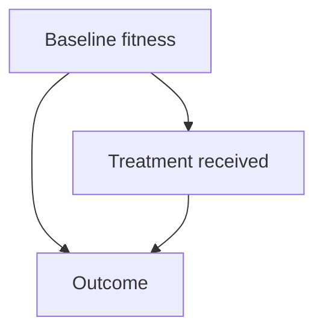

# Observational studies and confounding

## In one sentence

An observational study records care or exposures without assigning them, so other differences between groups can distort the apparent effect of a treatment.

## The intuition

Suppose hikers who carry expensive boots finish more difficult trails. The boots might help. But experienced hikers may both buy those boots and choose harder trails. Comparing boot owners with everyone else mixes the equipment's effect with the people wearing it.

Cancer treatment comparisons face a similar problem: people receive different care for reasons that also affect their outcomes. Recognizing those reasons helps you read a result without dismissing the whole study.

## How it works

An **observational study** follows or reconstructs what happened without assigning the treatment or exposure being compared. A **cohort** follows a defined group over time. A **case-control study** selects people with and without an outcome and examines earlier exposures; a **cross-sectional study** measures a population at a particular time. “Prospective” describes forward follow-up, not random assignment.

A **confounder** is a factor that helps explain both who receives an intervention and how the outcome develops, outside the effect being estimated. Disease burden, fitness, access to care and prior treatment can make groups different before an intervention begins.

The diagram shows two possible paths to the outcome. Observing a treatment–outcome association does not tell us how much traveled along each path. **Confounding by indication** means the reason for choosing a treatment also affects the outcome—for example, giving a more intensive treatment to people with more severe disease.

Researchers can restrict eligibility, match participants or statistically adjust for measured differences. Each method depends on assumptions and adequate data. Recording a variable poorly, missing an important difference, or having groups with little overlap can leave the comparison misleading. Adjusting for every available variable is not a universal remedy; a consequence of treatment is not automatically a baseline confounder.

### Check the starting clock

An observational comparison that tries to emulate a trial should align eligibility, treatment-strategy assignment and the start of follow-up. Selecting treated people because they survived long enough to receive treatment, while counting the comparison group from an earlier date, can build a survival advantage into the design. More data do not fix that mismatch. [Hernán and Robins, 2016](https://pmc.ncbi.nlm.nih.gov/articles/PMC4832051/).

## A worked fictional example

Two groups each contain 100 people. A defined symptom-improvement outcome by six weeks from treatment start occurs equally often within each baseline-health category:

| Baseline health | Treatment A | Treatment B |
|---|---|---|
| Better health | 60 of 80: 75% | 15 of 20: 75% |
| Poorer health | 5 of 20: 25% | 20 of 80: 25% |
| Everyone combined | 65 of 100: 65% | 35 of 100: 35% |

The combined comparison favors A, although this constructed example has no difference within either category. More people with better baseline health received A. Real studies rarely have just one perfectly measured source of difference, so the table illustrates a problem rather than providing a recipe for correcting every study.

## Why it matters in cancer

Observational evidence can describe uncommon harms, care patterns and outcomes in people who were underrepresented in trials. A large sample does not remove systematic bias. Ask why the groups received different care, when follow-up began, and which differences the analysis could address.

## Common confusions

- Association is a relationship in the data; causation is a claim about changing an outcome by changing an intervention.
- An adjusted estimate can still be confounded by unmeasured or poorly measured factors.
- **Reverse causation** is a related problem: developing disease can change an exposure, making its direction of influence easy to misread.
- [Randomization](/wiki/education/concepts/evidence-and-statistics/study-design/trial-phases-and-randomization) helps form comparable groups; it does not guarantee flawless follow-up or universal applicability.

## Try it

A fictional database compares people who started a treatment with people who did not. The article follows both groups forward. Has it become a randomized trial?

**Answer:** No. Treatment was not assigned by chance. Inspect baseline differences, aligned starting times, outcome measurement, missing follow-up and adjustment assumptions.

## Explain it back

“One reason groups may differ before treatment is ___.” One answer: “the same disease severity can influence treatment choice and outcome.”

## Takeaway

**Ask how groups and clocks were formed before reading the adjusted estimate.**

## Related concepts

- [Absolute and relative risk](/wiki/education/concepts/evidence-and-statistics/effect-measures/absolute-relative-risk-and-nnt)
- [Prognostic versus predictive evidence](/wiki/education/concepts/evidence-and-statistics/biomarkers/prognostic-vs-predictive)
- [Check a study's applicability](/wiki/education/guides/reading-cancer-evidence/03-check-applicability-and-uncertainty)

## Sources and scope

Source check: October 10, 2026. The table is invented to explain selection and confounding, not a treatment result. Expert and learner review remain pending.

- [National Cancer Institute: observational studies](https://www.cancer.gov/research/participate/how/observational-studies) — purposes and designs.
- [Strengthening the Reporting of Observational Studies in Epidemiology (STROBE), 2007](https://journals.plos.org/plosmedicine/article?id=10.1371/journal.pmed.0040296) — reporting guidance, not a study-quality score or causal guarantee.
- [Hernán and Robins, 2016: emulating a target trial](https://pmc.ncbi.nlm.nih.gov/articles/PMC4832051/) — explicit comparison rules, confounding and time zero.

<!-- BEGIN GENERATED USED IN -->
## Used in

- [Read the validation behind the claim](/wiki/education/guides/judging-a-test-or-vendor-claim/02-read-the-validation)
- [Check applicability and uncertainty](/wiki/education/guides/reading-cancer-evidence/03-check-applicability-and-uncertainty)
- [Ask what a combination trial actually proved](/wiki/education/local-treatment-modalities/03-overlap-and-sequencing)
<!-- END GENERATED USED IN -->
