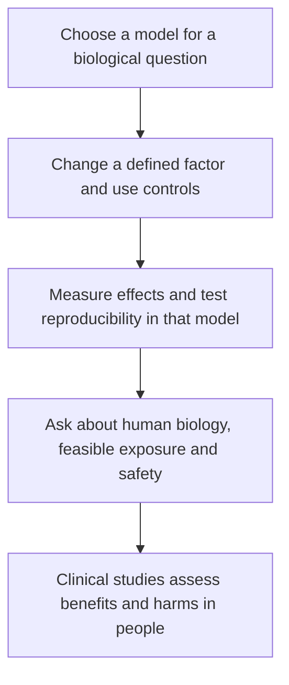

# Preclinical evidence

## In one sentence

Preclinical evidence tests biological effects, mechanisms or safety in experimental systems before or alongside studies of an intervention in people.

## The intuition

A flight simulator can show whether a design behaves sensibly under specified conditions. It cannot make every possible flight safe. Biological models have a similar job: make a question testable while leaving some parts of the real situation out.

The useful question is, “What did this model let the researchers test?” That is more informative than calling all laboratory work weak or treating a successful experiment as proof of patient benefit.

## How it works

**In vitro** means outside a living organism, such as cells in a dish. **In vivo** means in a living organism; in a preclinical study, this may be a mouse. “In vivo” by itself does not mean “tested in patients.” Human tissue studied outside the body can also support a preclinical intervention claim.

Model choice determines which mechanisms can be examined. A simple cancer-cell culture can test a direct cellular effect. A living immune-intact mouse model can ask some questions about interactions among tumor, immune cells and other tissues. Neither recreates a person's full cancer, immune history and treatment context.

Specify what changed, the [controls](/wiki/education/concepts/evidence-and-statistics/study-design/perturbation-and-controls), the measured outcome and the independent experimental unit. Random allocation and blinded assessment can strengthen an animal experiment. Reporting timing, doses, exclusions and all outcomes helps others evaluate and repeat it.

Repeated measurements are not automatically independent. Several wells from one tissue specimen help estimate technical variability. Independently obtained specimens, animals or experimental runs answer other reproducibility questions. The unit used in the analysis should match the design.

*Each step asks additional questions; a model's successful result does not establish a successful clinical treatment.*

## A worked fictional example

Researchers treat one tumor in each mouse and observe slower growth of another untreated tumor. If the comparison and controls are appropriate, the experiment can support a distant effect in that model.

They then remove a particular immune-cell population, and the distant effect diminishes. That adds evidence that those cells contribute under the tested conditions. It does not establish that people with a particular cancer will benefit from the same combination.

Translation adds further questions: can a relevant exposure be achieved safely, does the human target behave similarly, and do comparative clinical outcomes support the intervention? A mechanism can be real while its clinical implementation fails.

## Why it matters in cancer

Preclinical work can explain resistance, motivate combinations and identify hazards. A graph of tumor size in mice is not a patient survival curve. Nor is a large laboratory effect a reliable estimate of clinical benefit.

## Common confusions

- “Human-derived” describes the material's origin, not validation of a treatment in people.
- An immune effect cannot be inferred from a model that lacks the relevant immune components.
- A reproducible biological signal can still depend on an exposure that is impractical or harmful clinically.
- Transparent reporting enables appraisal; completing a checklist does not prove the conclusion.
- Regulatory safety studies and exploratory academic experiments have different purposes and requirements.

## Related concepts

- [Patient-derived xenografts](/wiki/education/concepts/measurement/functional-models/patient-derived-xenograft)
- [Organoids](/wiki/education/concepts/measurement/functional-models/organoid)
- [Evaluating virtual-cell models](/wiki/education/concepts/measurement/computational-analysis/virtual-cell-model)
- [Trial phases and randomization](/wiki/education/concepts/evidence-and-statistics/study-design/trial-phases-and-randomization)

## Sources and scope

Source check: October 9, 2026. The mouse experiment is fictional. No laboratory protocol or clinical benefit estimate is implied. Expert and learner review remain pending.

- [FDA: preclinical research](https://www.fda.gov/patients/drug-development-process/step-2-preclinical-research) — safety evaluation in drug development.
- [ARRIVE 2.0 reporting guidelines](https://journals.plos.org/plosbiology/article?id=10.1371/journal.pbio.3000410) — animal study design, sample size, randomization, blinding and reporting.
- [ARRIVE explanation and elaboration](https://journals.plos.org/plosbiology/article?id=10.1371/journal.pbio.3000411) — experimental units and interpretation.

<!-- BEGIN GENERATED USED IN -->
## Used in

- [Choose a target with a usable safety window](/wiki/education/guides/engineered-cell-therapy/02-choosing-a-target)
- [Read the validation behind the claim](/wiki/education/guides/judging-a-test-or-vendor-claim/02-read-the-validation)
- [Check applicability and uncertainty](/wiki/education/guides/reading-cancer-evidence/03-check-applicability-and-uncertainty)
- [Ask what a combination trial actually proved](/wiki/education/local-treatment-modalities/03-overlap-and-sequencing)
<!-- END GENERATED USED IN -->
