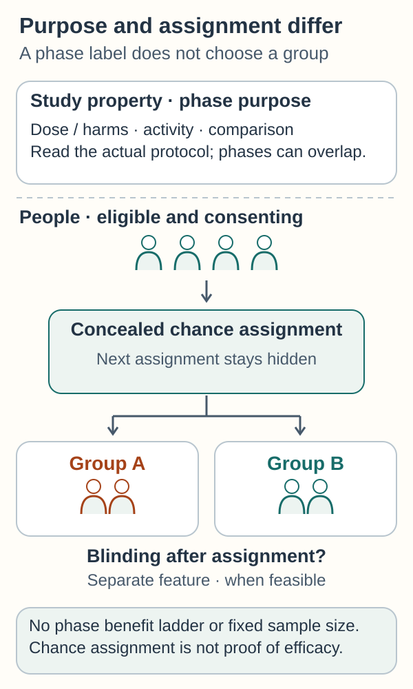

# Trial phases and randomization

## In one sentence

Trial phases describe the questions a treatment study asks, while randomization assigns participants by chance to make treatment groups more comparable.

## The intuition

Think of developing a new treatment as asking a sequence of questions. Can people receive it safely? Does it show useful activity? Does it improve outcomes compared with another approach?

The phase tells you roughly which question a study emphasizes. Randomization tells you how it forms comparison groups. Neither word, by itself, tells you whether this person can join or will benefit.

## How it works

Cancer treatment trials often move through these phases. A protocol is the study's written plan. Its actual design matters more than a phase label alone.

| Phase | Main teaching question | What the label does not promise |
|---|---|---|
| 1 | How should this treatment be given, and what harms appear? | Proven benefit or absence of serious toxicity |
| 2 | Is there enough activity in this population to study further? | Better outcomes than another treatment |
| 3 | How does it compare with a defined alternative? | That the new treatment wins |
| 4 | What do we learn about an approved treatment during broader use? | That every investigated use is approved |

Some studies combine phases. Phase is a development purpose, not a fixed sample-size rule or assignment method. Phase 1 can also measure drug exposure and early activity. Some phase 2 studies are randomized; a **single-arm** study has one intervention group and no concurrent randomized comparator. Look for the actual comparison and the [outcome being measured](/wiki/education/concepts/evidence-and-statistics/endpoints/survival-endpoints).

**Randomization** uses chance to assign eligible, consenting participants to study groups. It reduces the risk that human choices place healthier people in one group. It can also help balance factors researchers did not measure. Chance can still leave imbalances, especially in small studies.

**Allocation concealment** protects the next assignment from being known or manipulated while people enter the trial. It differs from blinding after assignment. An alternating A–B list that staff can predict is not a concealed random sequence.

**Blinding** is a separate design feature: keeping participants, staff or outcome assessors unaware of assignment when feasible. It can reduce differences in care or assessment. Randomization does not automatically make a study blinded.

Researchers should report how assignment was performed and how outcomes were analyzed. Ask whether participants were analyzed in their original assigned groups, and retain the reasons for exclusions. Dropout, missing assessments, treatment changes and unequal follow-up can complicate the result even after a sound assignment process.

### A closer look

*Read the study purpose, the chance assignment and blinding separately. Concealment protects the next assignment; blinding can follow it. A phase label promises neither a fixed sample size nor personal benefit nor efficacy.*

## Why it matters in cancer

A patient may enter a randomized trial without being assigned the experimental treatment. The control could be standard care, standard care plus a placebo, or another specified approach. Read the protocol rather than assuming the control means no treatment.

A single-arm study can reveal meaningful activity and harms. It is less able to separate treatment effects from selection, natural history and other care. That does not make it worthless; it changes the claim it can support.

## Worked example

A fictional early study treats volunteers with Drug A. Their tumors shrink, but no comparison group receives the usual therapy. This supports studying activity. It does not show that Drug A improves survival more than usual therapy.

A later randomized study assigns eligible volunteers to Drug A plus usual therapy or usual therapy alone. That design can test the added treatment's effect, provided its conduct and analysis are sound. A particular volunteer still cannot choose the group.

## Common confusions

- A higher phase is not an individual benefit score.
- Random assignment and random sampling are different. Trial volunteers are still a selected population.
- A trial listed as recruiting may have no open local slot for the relevant cohort.
- A promising phase 1 signal is neither a drug approval nor proof in another cancer setting.

## Try it

A fictional phase 2 study assigns two groups by chance. Is it less randomized because it is not phase 3?

**Answer:** No. Read its assignment method, comparator, endpoint and conduct. The phase describes its purpose; it does not determine whether a comparison is randomized.

## Explain it back

“The phase asks ___; assignment decides ___.” One answer: “what the development study emphasizes; how participants enter comparison groups.”

## Takeaway

**Read the purpose, assignment and actual comparison separately.**

## Related concepts

- [Transportability and eligibility](/wiki/education/concepts/evidence-and-statistics/reasoning-tools/transportability-and-eligibility): random assignment does not make participants a random population sample.

- [Clinical trials versus expanded access](/wiki/education/concepts/access-and-regulation/trials-and-access/clinical-trial-vs-expanded-access)
- [Survival endpoints](/wiki/education/concepts/evidence-and-statistics/endpoints/survival-endpoints)
- [Prognostic versus predictive biomarkers](/wiki/education/concepts/evidence-and-statistics/biomarkers/prognostic-vs-predictive)

## Sources and scope

Source check: October 10, 2026. Examples are fictional; no trial outcomes or enrollment promises are implied. Expert and learner review remain pending.

- [National Cancer Institute: how clinical trials work](https://www.cancer.gov/research/participate/clinical-trials/how-trials-work) — phases, randomization and controls.
- [FDA: clinical research in the drug-development process](https://www.fda.gov/patients/drug-development-process/step-3-clinical-research) — phase questions and study design.
- [National Cancer Institute: clinical trial protocol](https://www.cancer.gov/research/participate/clinical-trials/what-to-expect) — the plan that defines a particular trial.

- [CONSORT 2025, expanded checklist](https://journals.plos.org/plosmedicine/article?id=10.1371/journal.pmed.1004587) — sequence generation, concealment, blinding, analysis populations and missing data.

<!-- BEGIN GENERATED USED IN -->
## Used in

- [Reading cell-therapy evidence](/wiki/education/cellular-therapies/09-reading-cell-therapy-evidence)
- [Check a real trial opportunity](/wiki/education/guides/accessing-experimental-therapy/02-check-a-real-trial-opportunity)
- [Understand access to an experimental therapy](/wiki/education/guides/accessing-experimental-therapy/index)
- [Read a research-product study without losing the denominator](/wiki/education/guides/engineered-cell-therapy/10-read-a-research-product-study)
- [Read the validation behind the claim](/wiki/education/guides/judging-a-test-or-vendor-claim/02-read-the-validation)
- [Judge a test or company claim](/wiki/education/guides/judging-a-test-or-vendor-claim/index)
- [Read an injected-treatment study](/wiki/education/guides/local-therapy-and-the-immune-system/07-read-an-injected-treatment-study)
- [Understand local therapy and the immune system](/wiki/education/guides/local-therapy-and-the-immune-system/index)
- [Name the comparison and endpoint](/wiki/education/guides/reading-cancer-evidence/01-name-the-comparison-and-endpoint)
- [Check applicability and uncertainty](/wiki/education/guides/reading-cancer-evidence/03-check-applicability-and-uncertainty)
- [Read trial claims and survival statistics](/wiki/education/guides/reading-cancer-evidence/index)
- [Ask what a combination trial actually proved](/wiki/education/local-treatment-modalities/03-overlap-and-sequencing)
<!-- END GENERATED USED IN -->
