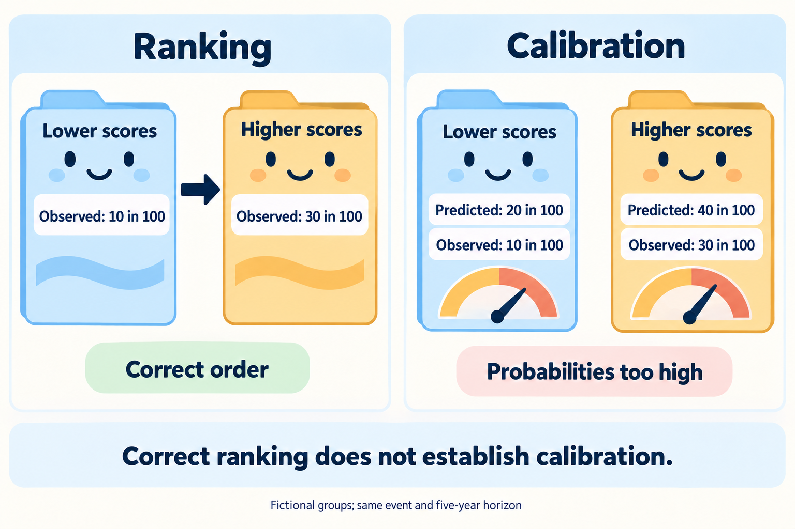

# Calibration of predicted probabilities

## In one sentence

Calibration describes how closely predicted probabilities agree with observed outcome frequencies in a defined population and time period.

## The intuition

If a weather service predicts a 20% chance of rain on many comparable days, you would hope about one in five turns rainy. It can order days from drier to wetter without getting the percentages right. Cancer-risk models face the same distinction between [ordering](/wiki/education/concepts/evidence-and-statistics/tests-and-prediction/auc-and-c-index) and probability agreement. The weather analogy does not supply evidence about a patient's outcome.

## How it works

Calibration compares predicted probabilities with observed outcome frequencies for the same endpoint, population and horizon. Grouped comparisons or a smooth calibration curve can reveal predictions that are too high, too low or too extreme. Finite samples add uncertainty.

**Calibration in the large** checks average predicted against observed frequency. That average can be right while lower- and higher-risk predictions are wrong. A **calibration slope** evaluates prediction strength under a specified model. A slope below one commonly signals predictions that are too extreme; a slope above one indicates too little spread in that calibration model. A suitable intercept and slope of one do not guarantee agreement everywhere. [Van Calster and colleagues](https://doi.org/10.1186/s12916-019-1466-7).

Changing treatment era, eligibility, assay or baseline event frequency can change calibration. **Recalibration** updates a model for another setting; the updated version needs evaluation. A familiar calculator name does not replace that record. [TRIPOD+AI](https://www.bmj.com/content/385/bmj-2023-078378).

## Worked example

*Correct ordering can coexist with probabilities that are too high; the fictional counts below share one five-year endpoint.*

Two equally sized fictional groups each contain 100 people with complete five-year follow-up.

| Group | Predicted risk | Observed events |
|---|---|---|
| Lower scores | 20% | 10 of 100 |
| Higher scores | 40% | 30 of 100 |

The groups are ordered correctly, but both risks are overstated. The model predicts `20 + 40 = 60` events and observes `10 + 30 = 40`. These invented counts do not measure any cancer model's performance.

Now imagine predictions of 10% and 50%, with 20 and 40 events in those groups. Predicted and observed totals are both 60. Overall agreement hides errors in both groups.

## What is measured

| Check | Information needed |
|---|---|
| Input | Stored predictions made before outcomes, model version, endpoint and follow-up. |
| Method | Calibration curve or named summary, uncertainty and suitable outcome estimation. |
| Output | Predicted versus observed frequencies at the same horizon. |
| Failure | Counting every censored participant as event-free, or checking only the overall average. |
| Cannot tell | Which individual has an event or whether using the model improves outcomes. |

For survival predictions, incomplete follow-up needs an appropriate time-to-event method. Competing-event predictions need their corresponding outcome definition and estimation. Check relevant subgroups as well as overall agreement. [Riley and colleagues](https://www.bmj.com/content/384/bmj-2023-074820).

## Why it matters in cancer

A recurrence probability may inform a discussion only with its endpoint, clock, inputs and relevant validation attached. A calibrated 20% prediction describes agreement across comparable observations; it cannot say which person will recur. Even accurate probabilities do not establish that choosing treatment with the model helps patients.

## Common confusions

- A high AUC does not establish calibration.
- Calibration in one era does not automatically transfer to another.
- Correct overall frequency does not guarantee correct subgroup predictions.
- A model assigning everyone the same probability can match the average yet offer no ranking information.
- Software's narrow display range is not proof that model or input uncertainty is small.

## Try it

In the second fictional example, is an overall predicted average of 30% sufficient evidence of calibration?

**Answer:** No. Observed overall frequency is also `60/200 = 30%`, but the lower group is predicted at 10% and observed at 20%; the higher group is predicted at 50% and observed at 40%. The average conceals both errors.

## Explain it back

Explain how correct ordering, correct overall frequency and correct probabilities across risk groups can come apart.

## Takeaway

Check probability agreement at the relevant endpoint and horizon, including uncertainty and subgroup context.

## Related concepts

- [Discrimination](/wiki/education/concepts/evidence-and-statistics/tests-and-prediction/auc-and-c-index)
- [Clinical validity and utility](/wiki/education/concepts/measurement/computational-analysis/analytical-validity-clinical-validity-and-utility)
- [Confidence intervals](/wiki/education/concepts/evidence-and-statistics/effect-measures/confidence-interval)

## Sources and scope

Source check: October 10, 2026. Examples are fictional; expert and learner review remain pending.

- [Riley et al., 2024: external validation and calibration evaluation](https://www.bmj.com/content/384/bmj-2023-074820).
- [Van Calster et al., 2019: calibration definitions and evaluation](https://doi.org/10.1186/s12916-019-1466-7).
- [TRIPOD+AI, 2024: required prediction-model reporting](https://www.bmj.com/content/385/bmj-2023-078378).

<!-- BEGIN GENERATED USED IN -->
## Used in

- [Read the validation behind the claim](/wiki/education/guides/judging-a-test-or-vendor-claim/02-read-the-validation)
- [Check applicability and uncertainty](/wiki/education/guides/reading-cancer-evidence/03-check-applicability-and-uncertainty)
<!-- END GENERATED USED IN -->
