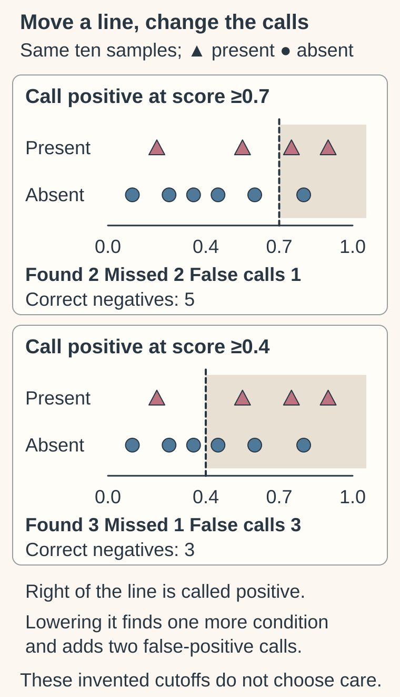

# Thresholds and cutpoints

## In one sentence

A threshold or cutpoint turns a continuous measurement or score into categories, so its meaning depends on the measurement, intended action and validation context.

## The intuition

A ruler measures a continuum; drawing a line on it creates categories. Moving the line changes who lands on each side without changing the measurements. The analogy cannot decide where a clinically useful line belongs: actions, harms and validation supply that context.

## How it works

A **threshold** or **cutpoint** applies a rule to a continuous measurement or score. These different thresholds answer different questions:

| Threshold | Question |
|---|---|
| Analytical | Can the assay detect or reliably quantify this signal? |
| Diagnostic | Does the result classify a defined condition? |
| Study eligibility | Does a person meet the protocol's entry criterion? |
| Treatment selection or decision | Does evidence support a particular action at this value? |

An assay's detection limit is not automatically a treatment threshold. A study entry cutoff is not proof of greater benefit above it.

If higher scores are called positive, lowering the threshold generally increases sensitivity and decreases specificity in the same fully assessed sample. Check equality at the boundary, units and handling of missing or indeterminate results. [FDA diagnostic reporting guidance](https://www.fda.gov/regulatory-information/search-fda-guidance-documents/statistical-guidance-reporting-results-studies-evaluating-diagnostic-tests-guidance-industry-and-fda).

Picking the “best” cutoff from the same outcomes used to report performance can exaggerate separation. Searching many cutpoints adds analytical choices; categories also discard information within each group. Lock the rule, then evaluate it in independent data. [Altman and colleagues](https://doi.org/10.1093/jnci/86.11.829); [Altman and Royston](https://pmc.ncbi.nlm.nih.gov/articles/PMC1458573/).

## Worked example

The invented reference-present scores are 0.20, 0.55, 0.75 and 0.90; reference-absent scores are 0.10, 0.25, 0.35, 0.45, 0.60 and 0.80. These same ten points give the existing table’s counts at ≥0.7 and ≥0.4. “Present” and “absent” are reference classes; positive and negative are score-based calls, with equality included.

Ten fictional samples have a defined condition in four and lack it in six. All have test and reference results. Higher scores are positive.

| Rule | True positives | False positives | Sensitivity | Specificity | PPV |
|---|---:|---:|---:|---:|---:|
| Positive at score ≥0.7 | 2 | 1 | `2/4 = 50%` | `5/6 ≈ 83.3%` | `2/3 ≈ 66.7%` |
| Positive at score ≥0.4 | 3 | 3 | `3/4 = 75%` | `3/6 = 50%` | `3/6 = 50%` |

Lowering the line finds one more affected sample and adds two false positives. It does not create a universally better test. These tiny invented counts illustrate tradeoffs, not a validated cutoff.

## What is measured

| Check | Information needed |
|---|---|
| Input | Continuous measurements, reference outcomes and intended action. |
| Rule | Exact value, units, assay/model version, direction, equality and missing-result handling. |
| Output | Classification counts and performance with uncertainty. |
| Validation | Independent population, locked rule and endpoint appropriate to the action. |
| Failure | Choosing a cutoff after seeing outcomes, then reporting the same data as independent validation. |
| Cannot tell | Clinical benefit merely from statistical separation. |

An optimization criterion can weight errors differently from the real decision. The harms of a missed condition and an unnecessary intervention need not be equal. A mathematical maximum therefore does not establish the best clinical threshold for every setting.

## Why it matters in cancer

Scores may be continuous even when reports use “high” and “low.” A value just across the line need not represent a sharp biological switch. Two platforms may report different scales; copying a cutoff without its assay and version can change the meaning. Follow [test performance and base rates](/wiki/education/concepts/evidence-and-statistics/tests-and-prediction/ppv-and-base-rates) through to the intended-use evidence.

## Common confusions

- Detectable, quantifiable, positive and actionable are distinct claims.
- A statistically optimized cutoff is not automatically clinically useful.
- An eligibility boundary is not a treatment-benefit boundary.
- Dichotomizing a score does not make underlying biology binary.
- A threshold from one platform cannot be assumed equivalent on another.

## Try it

Which fictional rule has fewer missed conditions? Does that establish the better treatment decision?

**Answer:** The ≥0.4 rule misses one rather than two, but produces three rather than one false positive. Choosing an action requires its evidence and consequences; sensitivity alone does not settle it.

## Explain it back

Explain why detecting a signal and deciding to act on it require different thresholds and evidence.

## Takeaway

Keep the exact rule, platform, validation population and intended action beside a cutoff.

## Related concepts

- [ROC area and concordance](/wiki/education/concepts/evidence-and-statistics/tests-and-prediction/auc-and-c-index)
- [Prognostic versus predictive biomarkers](/wiki/education/concepts/evidence-and-statistics/biomarkers/prognostic-vs-predictive)
- [Prespecified and exploratory analysis](/wiki/education/concepts/evidence-and-statistics/study-design/exploratory-vs-prespecified-analysis)

## Sources and scope

Source check: October 10, 2026. Fictional sample counts; expert and learner review remain pending.

- [FDA, 2007: reporting diagnostic test performance](https://www.fda.gov/regulatory-information/search-fda-guidance-documents/statistical-guidance-reporting-results-studies-evaluating-diagnostic-tests-guidance-industry-and-fda).
- [Altman et al., 1994: dangers of optimal cutpoints](https://doi.org/10.1093/jnci/86.11.829).

- [Altman and Royston, 2006: information loss and data-selected cutpoints](https://pmc.ncbi.nlm.nih.gov/articles/PMC1458573/).

<!-- BEGIN GENERATED USED IN -->
## Used in

- [Check applicability and uncertainty](/wiki/education/guides/reading-cancer-evidence/03-check-applicability-and-uncertainty)
<!-- END GENERATED USED IN -->
