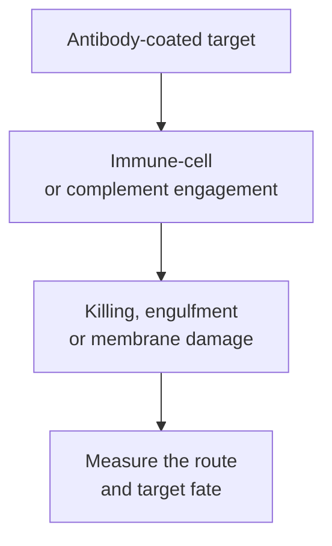

# ADCC, ADCP and CDC: antibody-guided effector mechanisms

## In one sentence

Antibodies can guide immune cells to kill or engulf a coated target, or recruit complement proteins that can damage its membrane.

## The intuition

Putting a recognizable flag on a target is different from deciding how to remove it. One responder can damage the target from outside. Another can swallow it. A protein cascade can attack its membrane.

The flag is not enough: the right responder, target access and suitable conditions must be present. A tissue stain for the address does not demonstrate any of these removal mechanisms.

## How it works

An [antibody's binding regions](/wiki/education/concepts/immunology/antibodies-and-b-cells/antibody-structure) recognize an accessible target. **Opsonization** means coating a target with molecules that help immune clearance. Antibody Fc, or **fragment crystallizable**, can connect that coating with effector cells or complement. Three related mechanisms name different downstream jobs:

| Mechanism | What acts? | What happens? |
|---|---|---|
| **Antibody-dependent cellular cytotoxicity (ADCC)** | An immune effector cell; a familiar example is a natural killer cell | The responder triggers damage or death in an antibody-coated target |
| **Antibody-dependent cellular phagocytosis (ADCP)** | A phagocytic cell, such as a macrophage | The responder engulfs a coated target and can digest it |
| **Complement-dependent cytotoxicity (CDC)** | Complement proteins | A cascade can assemble membrane attack complexes that damage the target membrane |

In the familiar natural killer-cell ADCC route, **CD16**, an Fc gamma receptor, engages target-bound IgG, or **immunoglobulin G**. Receptor clustering can trigger release of damaging granule contents. Other immune populations can contribute antibody-dependent cytotoxicity; ADCC is not an exclusive cell-identity label.

For ADCP, Fc-receptor engagement helps a phagocyte surround and internalize a coated target. Gül and colleagues directly imaged macrophage uptake and degradation of circulating tumor cells in a mouse model. Contact or uptake of a small fragment is not automatically engulfment and elimination of an entire viable cancer cell.

In antibody-triggered complement activation, C1q recognizes a suitable arrangement of Fc regions. Diebolder and colleagues showed how surface-bound IgG assemblies can support this step. Downstream complement can promote coating and inflammation as well as membrane damage. Complement deposition therefore does not prove completed CDC.

These routes can overlap or influence one another. [Isotype and Fc design](/wiki/education/concepts/immunology/antibodies-and-b-cells/isotypes-and-fc-silencing), target density, inhibitory signals and effector availability shape the result. There is no universal ranking of the three mechanisms.

*The output names a mechanism only when the corresponding route is demonstrated.*

## Why it matters in cancer

Some antibody treatments recruit these routes; others principally block signaling, deliver a payload as an [antibody-drug conjugate (ADC)](/wiki/education/concepts/therapeutics/antibody-based/antibody-drug-conjugate) or redirect T cells. A target's presence does not tell you which route dominates in a tumor. Nor does stronger activity in a dish establish clinical benefit or healthy-tissue safety.

## How it is measured

Use viable targets, defined antibody concentrations and suitable effectors or complement. Cell-based experiments consume the sampled cells. Report exposure time and effector-to-target ratio where relevant.

ADCC assays can measure target death; ADCP assays can report the fraction of phagocytes with verified internalized targets; CDC assays can measure membrane damage with active complement. Include no-antibody, target-negative and route-perturbation controls. Heat-inactivated or depleted complement helps test complement dependence. Binding or reporter activation alone is an earlier readout, not demonstrated killing. See [functional cytotoxicity assays](/wiki/education/concepts/measurement/immune-monitoring/functional-cytotoxicity-assays).

## Common confusions

- Fc-receptor binding is not completed ADCC or ADCP.
- A phagocyte attached to a target is not proof of internalization.
- Complement coating is not the same as membrane lysis.
- Antibody-guided target recognition differs from a native T-cell receptor's peptide recognition.

## Try it

A fictional antibody recruits complement proteins to a target, but measured target viability is unchanged. Has CDC been demonstrated?

**Answer:** No. Recruitment is evidence of a preceding step. The test has not demonstrated complement-dependent target damage or death.

## Related concepts

- [Natural killer cells and missing self](/wiki/education/concepts/immunology/innate-and-unconventional-cells/nk-cell-and-missing-self)
- [Isotypes and Fc silencing](/wiki/education/concepts/immunology/antibodies-and-b-cells/isotypes-and-fc-silencing)

## Sources and scope

Source check: October 9, 2026. Mechanisms and assay interpretation; the exercise is fictional. Expert and learner review remain pending.

- [Immunobiology: clearance through Fc receptors](https://www.ncbi.nlm.nih.gov/books/NBK27171/) — Fc-dependent cellular routes.
- [Clynes et al., 2000](https://pubmed.ncbi.nlm.nih.gov/10742152/) — activating and inhibitory Fc-receptor effects in mouse tumor models.
- [Gül et al., 2014](https://www.jci.org/articles/view/66776) — primary imaging of macrophage phagocytosis in a mouse circulating-tumor-cell model.
- [Diebolder et al., 2014](https://pubmed.ncbi.nlm.nih.gov/24626930/) — primary study of surface IgG assembly and complement activation.

<!-- BEGIN GENERATED USED IN -->
## Used in

- [Understand how the immune system recognizes cancer](/wiki/education/guides/how-the-immune-system-fights-cancer/index)
<!-- END GENERATED USED IN -->
