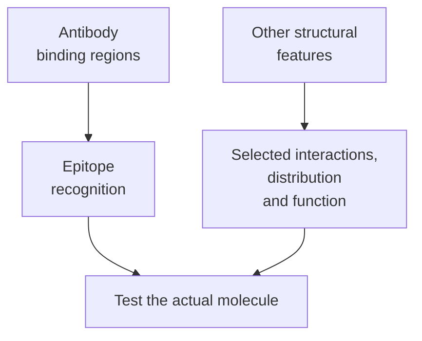

# Antibody structure

## In one sentence

An antibody is an immune protein whose binding regions recognize a molecular feature and whose remaining structure helps determine its biological functions.

## The intuition

Imagine a tool with a gripping end and a handle that can connect to other machinery. The gripping end determines what it catches. The rest affects what can happen after the catch. The common Y-shaped drawing is useful for a typical antibody, but engineered treatments can use fragments or rearranged parts.

## How it works

A typical **immunoglobulin G (IgG)** antibody has two heavy and two light protein chains. Variable regions from a heavy and a light chain form each binding site. Each site recognizes an [**epitope**](/wiki/education/concepts/immunology/antigen-presentation/antigen-and-epitope), a particular molecular feature. The target may be a folded protein or another accessible structure; it need not be a short peptide displayed to a T cell. [The antibody-structure chapter](https://www.ncbi.nlm.nih.gov/books/NBK27144/) explains this architecture.

The two arms are often called **Fab**, for fragment antigen-binding. The base is **Fc**, for fragment crystallizable. Fc can interact with receptors on immune cells and with complement, a collection of immune proteins. Those interactions can help recruit other cells or clear a target. [Antibody isotype and Fc silencing](/wiki/education/concepts/immunology/antibodies-and-b-cells/isotypes-and-fc-silencing) explain how class and engineering affect selected interactions. [Antibody-guided effector mechanisms](/wiki/education/concepts/immunology/antibodies-and-b-cells/adcc-adcp-cdc) distinguish target killing, engulfment and complement-mediated damage. Fc recruitment does not automatically establish any of those completed effects.

Binding and recruitment are separate jobs. An antibody can block a receptor interaction. Another can recruit an immune cell. An antibody–drug conjugate carries an attached payload. An engineered engager can bind two different partners. These formats reuse binding parts without necessarily sharing the same Fc behavior. [NCI’s antibody overview](https://www.cancer.gov/about-cancer/treatment/types/immunotherapy/monoclonal-antibodies) separates these uses.

[B cells and plasma cells](/wiki/education/concepts/immunology/antibodies-and-b-cells/b-cells-and-plasma-cells) explain the cells that generate and secrete antibodies. Antibody structure alone does not identify its producing cell or antigen specificity.

*Recognition regions and other structural features make different contributions.*

## Why it matters in cancer

“Antibody treatment” names a broad family, not one killing mechanism. Understanding the parts helps a reader ask whether a drug blocks signaling, recruits an effector or delivers a payload. It also explains why two drugs binding the same protein may behave differently.

## Worked example

Two fictional antibodies bind the same surface target. One blocks a growth signal. The other carries a toxic payload but leaves signaling unchanged. A shared address does not make their mechanisms or safety profiles identical. Testing must evaluate each finished molecule.

## Common confusions

- Fab describes a structural part, not a specific tumor target.
- Fc does not automatically cause killing in every format.
- An antibody binding site and a conventional [T-cell receptor](/wiki/education/concepts/immunology/t-cells/t-cell-receptor) have different recognition rules.
- A Y-shaped diagram does not represent every engineered antibody-based drug.

## Related concepts

- [Ligands and receptors](/wiki/education/concepts/biology-basics/signaling/ligand-and-receptor)
- [Natural killer cells](/wiki/education/concepts/immunology/innate-and-unconventional-cells/nk-cell-and-missing-self)
- [Immune checkpoints](/wiki/education/concepts/immunology/immune-regulation/immune-checkpoint)

## Sources and scope

Source check: October 9, 2026. Typical antibody architecture and general therapeutic uses; product-specific function requires its own evidence. Expert and learner review remain pending.

- [Immunobiology: the structure of a typical antibody molecule](https://www.ncbi.nlm.nih.gov/books/NBK27144/).
- [Immunobiology: antigen recognition by B-cell and T-cell receptors](https://www.ncbi.nlm.nih.gov/books/NBK10770/).
- [NCI: monoclonal antibodies](https://www.cancer.gov/about-cancer/treatment/types/immunotherapy/monoclonal-antibodies).

<!-- BEGIN GENERATED USED IN -->
## Used in

- [Aiming a drug at a surface target](/wiki/education/guides/aiming-a-drug-at-a-surface-target/index)
- [Understand how the immune system recognizes cancer](/wiki/education/guides/how-the-immune-system-fights-cancer/index)
- [Ask what happens after binding](/wiki/education/oncology-101/1-ligands)
- [Oncology 101: immune foundations](/wiki/education/oncology-101/index)
- [Separate the address from the killing mechanism](/wiki/education/targeted-therapy-modalities/01-mechanism)
- [Targeted therapy mechanisms and comparisons](/wiki/education/targeted-therapy-modalities/index)
<!-- END GENERATED USED IN -->
