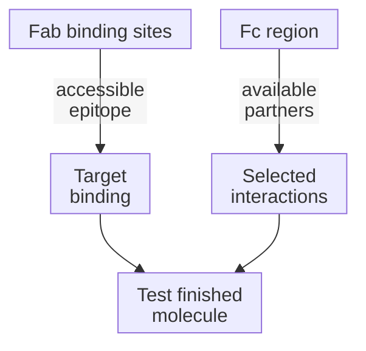

# Antibody structure

## In one sentence

An antibody is an immune protein whose binding regions recognize a molecular feature and whose remaining structure helps determine its biological functions.

## The intuition

Picture a tool with a grip and connections for other machinery. The grip finds an address; the connections influence what can happen there. Two tools can reach the same address and do different jobs.

This analogy is limited: an antibody is a flexible molecular structure, not a rigid Y. Binding does not guarantee action, and some natural or engineered formats omit familiar parts.

## How it works

A typical **immunoglobulin G (IgG)** antibody has two heavy chains and two light chains. They associate through molecular interactions and disulfide bonds. At each arm's tip, variable regions from a heavy and light chain together form a binding site. Sequence and three-dimensional shape influence what that site recognizes.

An **[epitope](/wiki/education/concepts/immunology/antigen-presentation/antigen-and-epitope)** is the molecular feature recognized. It can involve a folded protein surface or another accessible feature; it need not be a short protein fragment displayed by [human leukocyte antigen (HLA)](/wiki/education/concepts/immunology/antigen-presentation/hla). Antibody recognition differs from a conventional [T-cell receptor's peptide–human leukocyte antigen recognition](/wiki/education/concepts/immunology/t-cells/t-cell-receptor).

**Fab**, or **fragment antigen-binding**, names an arm containing the binding site and associated constant domains. Fab is not simply another word for “variable region.” **Fc**, or **fragment crystallizable**, names the remaining stem region in this familiar IgG description; its name comes from an experimental property, not “fragment constant.” Hinge flexibility changes the arrangement of the arms.

Fc can interact with immune-cell receptors and **complement**, a protein network involved in clearance, inflammation and membrane damage. Compatible effectors, target arrangement and other conditions determine whether [antibody-guided killing, engulfment or complement damage](/wiki/education/concepts/immunology/antibodies-and-b-cells/adcc-adcp-cdc) occurs. Fc is not an automatic kill command.

An **[isotype](/wiki/education/concepts/immunology/antibodies-and-b-cells/isotypes-and-fc-silencing)** is a heavy-chain class. Class and Fc engineering can change selected interactions without necessarily changing the intended target. Nimmerjahn and Ravetch demonstrated subclass-dependent activating/inhibitory receptor interactions in mouse experiments; that is not a universal ranking of human antibody performance.

[B cells and plasma cells](/wiki/education/concepts/immunology/antibodies-and-b-cells/b-cells-and-plasma-cells) connect this molecule to its producing lineage. Structure alone does not identify the producing cell or establish antigen specificity. The typical IgG map also does not describe every class, heavy-chain antibody or [engineered binding fragment](/wiki/education/concepts/engineering-and-manufacturing/binders/scfv-and-vhh-nanobodies).

*Binding and effector interactions are separate contributions. The finished molecule's function still needs testing.*

## Why it matters in cancer

A blocking antibody may interfere with a signal. An [antibody-drug conjugate](/wiki/education/concepts/therapeutics/antibody-based/antibody-drug-conjugate) can carry a payload. Another antibody format can bring partners together. Sharing a target or binding strongly does not make these mechanisms equivalent. Target access, downstream effects and healthy-tissue consequences remain separate questions.

## How it is measured

Binding experiments use defined antigen preparations and antibody concentrations, sometimes expressed in nanomoles per liter. State whether binding was tested against purified protein or intact cells: folding, accessibility and multiple binding sites can change the result. A concentration or fluorescence signal alone is not an affinity measurement.

Test Fc-receptor or complement interactions separately from target binding. Functional assays can report percent targets killed or engulfed under defined exposure and effector conditions. Use no-antibody and target-negative controls where relevant. Neither binding nor a laboratory effector result establishes clinical benefit or safety.

## Try it: one address, different actions

Two fictional molecules use the same binder for surface protein A. One blocks a measured signal; the other carries a damaging payload. Both bind A, but their actions differ. Now a matched Fc variant retains target binding while showing less receptor engagement. Has it necessarily lost target binding, shortened its circulation time or become harmless?

**Answer:** None follows. The measurements support retained binding and reduced interaction with that tested receptor. Other effector partners, recycling, exposure and the finished molecule's effects need separate evidence.

## Common confusions

- Fab is a structural fragment, not the antigen's name.
- Fc does not determine the antigen-binding site or guarantee killing.
- Isotype and target specificity are different attributes.
- A typical IgG drawing is not every antibody's architecture.

## Explain it back

Explain how two molecules can bind the same epitope but produce different effects.

## Takeaway

**Ask what binds, what connects next and what the finished molecule actually does.**

## Related concepts

- [Ligands and receptors](/wiki/education/concepts/biology-basics/signaling/ligand-and-receptor)
- [Isotypes and Fc silencing](/wiki/education/concepts/immunology/antibodies-and-b-cells/isotypes-and-fc-silencing)

## Sources and scope

Source-checked October 10, 2026. Typical IgG architecture and format limits; fictional comparisons, no product ranking. Expert and learner review remain pending.

- [Janeway et al.: a typical antibody molecule](https://www.ncbi.nlm.nih.gov/sites/books/NBK27144/) — chains, Fab, Fc, classes and flexibility.
- [Janeway et al.: interaction with specific antigen](https://www.ncbi.nlm.nih.gov/sites/books/NBK27160/) — binding-site structure and linear/conformational epitopes.
- [Nimmerjahn and Ravetch, 2005](https://pubmed.ncbi.nlm.nih.gov/16322460/) — subclass/receptor-dependent effects in mouse experiments.
- [NCI: monoclonal antibodies](https://www.cancer.gov/about-cancer/treatment/types/immunotherapy/monoclonal-antibodies) — different actions after binding and clinical safety context.

<!-- BEGIN GENERATED USED IN -->
## Used in

- [Aiming a drug at a surface target](/wiki/education/guides/aiming-a-drug-at-a-surface-target/index)
- [Understand how the immune system recognizes cancer](/wiki/education/guides/how-the-immune-system-fights-cancer/index)
- [Separate immune presence from tumor recognition](/wiki/education/multi-omics-foundations/06-immune-presence-and-recognition)
- [Ask what happens after binding](/wiki/education/oncology-101/1-ligands)
- [Oncology 101: immune foundations](/wiki/education/oncology-101/index)
- [Separate the address from the killing mechanism](/wiki/education/targeted-therapy-modalities/01-mechanism)
- [Targeted therapy mechanisms and comparisons](/wiki/education/targeted-therapy-modalities/index)
<!-- END GENERATED USED IN -->
