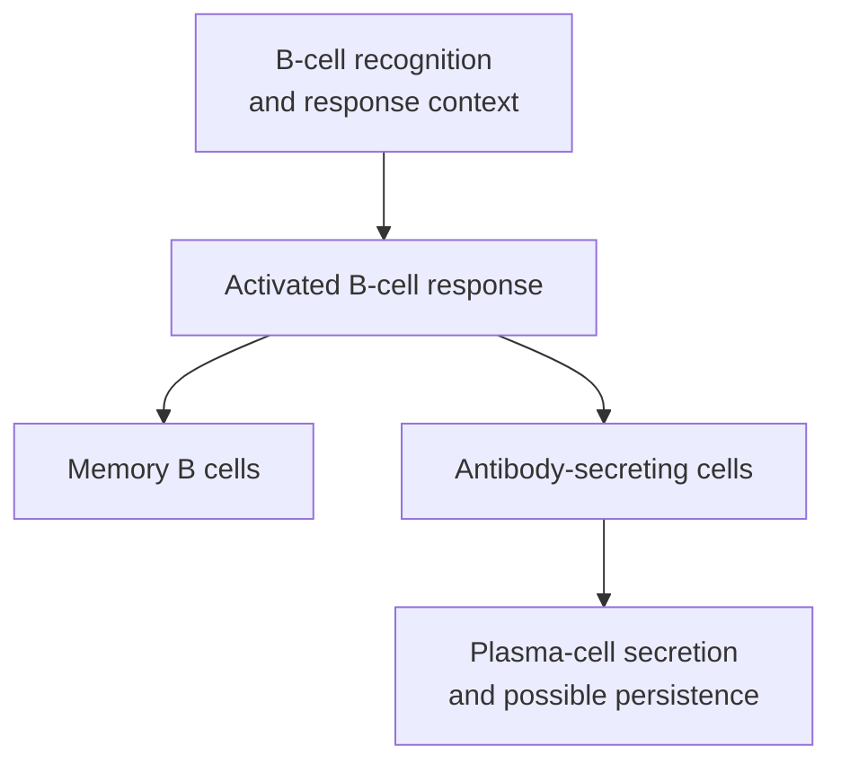

# B cells and plasma cells

## In one sentence

B cells participate in antigen recognition and immune responses, while plasma cells are differentiated members of the B-cell lineage specialized for antibody secretion.

## The intuition

A B-cell response is like a workshop that can recognize an order, develop a better tool and produce many copies. Plasma cells specialize in production. Other B cells can retain memory or participate in immune conversations.

The analogy stops before a guaranteed product: a cell's presence does not reveal what its antibody recognizes or whether that response helps control cancer.

## How it works

A developing B cell assembles an antigen-receptor sequence through [V(D)J recombination](/wiki/education/concepts/biology-basics/genetics/vdj-recombination). Its **B-cell receptor (BCR)** includes membrane-bound immunoglobulin, another name for antibody. Recognition involves an accessible molecular feature, unlike a conventional [T-cell receptor's peptide–human leukocyte antigen recognition](/wiki/education/concepts/immunology/t-cells/t-cell-receptor).

Recognition and activation are separate. For many protein antigens, B cells receive help from suitable CD4 T cells. B cells can internalize recognized material and present fragments to these helpers. Other antigen contexts can support responses with less direct T-cell help. “All B cells require the same help” would erase that distinction.

An activated response can produce **memory B cells** and antibody-secreting cells. A **plasmablast** is an early antibody-secreting stage that can still divide. **Plasma cells** specialize further in secretion. Some are short-lived; others persist in supportive tissue niches. Memory B cells and persistent plasma cells are different ways a response can leave a lasting trace.

Differentiation changes the cell's gene program and machinery. Shapiro-Shelef and colleagues showed that deleting the gene for the regulator Blimp-1 in mouse B cells strongly impaired plasma-cell formation and antibody secretion. Having B cells that respond to antigen was not enough to establish normal secretion. This is a mechanistic mouse experiment, not a human tumor biomarker rule.

Some responses pass through **germinal centers**, organized areas where B-cell variants undergo selection. [Class switching](/wiki/education/concepts/immunology/antibodies-and-b-cells/isotypes-and-fc-silencing) changes antibody class; sequence changes and selection can alter binding quality. These are different processes, and not every secreting cell comes from the same developmental route.

*This is a simplified response map, not a compulsory path for every B cell.*

## Why it matters in cancer

B cells can present material, supply signals and generate antibodies. Plasma cells can contribute substantial antibody RNA to a tumor sample. A high immunoglobulin signal therefore does not automatically originate from cancer cells.

B cells may occur in [tertiary lymphoid structures](/wiki/education/concepts/immunology/antibodies-and-b-cells/tertiary-lymphoid-structures), organized immune gatherings outside native lymphoid organs. Architecture, specificity and local function matter alongside abundance. Neither “more B cells” nor “more antibodies” is a universal benefit rule.

## How it is measured

[Flow cytometry](/wiki/education/concepts/measurement/immune-monitoring/flow-cytometry) and spatial staining use marker combinations to distinguish populations. Marker patterns change during differentiation; a panel identifying ordinary B cells may miss some plasma cells. Preserve the phenotype definition and denominator.

RNA can reveal an antibody-production program or receptor sequence. Serum assays can measure antibody concentrations and classes. To ask what an antibody recognizes, use antigen-specific binding and suitable functional experiments. Total concentration or class alone cannot answer that question.

## Common confusions

- Plasma cells are cells; blood plasma is the fluid portion of blood.
- Memory B cells are not simply plasma cells waiting to secrete.
- Antibody-class RNA does not identify the antibody's antigen.
- A lymphocyte cluster is not automatically a mature germinal center.

## Try it

A fictional tumor's RNA report contains many immunoglobulin A messages. Can the team conclude that cancer cells make a cancer-specific antibody?

**Answer:** No. Antibody-secreting immune cells may supply the messages. Cell attribution and antigen specificity require different evidence.

## Related concepts

- [Antibody-guided effector mechanisms](/wiki/education/concepts/immunology/antibodies-and-b-cells/adcc-adcp-cdc)
- [Lymph nodes and lymphatics](/wiki/education/concepts/immunology/the-immune-system/lymph-nodes-and-lymphatics)

## Sources and scope

Source check: October 9, 2026. Lineage, differentiation and interpretation; fictional practice, no tumor-response cutoff. Expert and learner review remain pending.

- [Molecular Biology of the Cell: B cells and antibodies](https://www.ncbi.nlm.nih.gov/books/NBK26884/) — receptor, secreting-cell and memory distinctions.
- [Immunobiology: helper-dependent B-cell activation](https://www.ncbi.nlm.nih.gov/books/NBK27142/) — response context, germinal centers and class switching.
- [Shapiro-Shelef et al., 2003](https://pubmed.ncbi.nlm.nih.gov/14563324/) — primary mouse experiment separating B-cell activation from plasma-cell differentiation.

<!-- BEGIN GENERATED USED IN -->
## Used in

- [Understand how the immune system recognizes cancer](/wiki/education/guides/how-the-immune-system-fights-cancer/index)
- [See what is inside a tissue sample](/wiki/education/multi-omics-foundations/01-epithelial-and-breast-tissue)
<!-- END GENERATED USED IN -->
