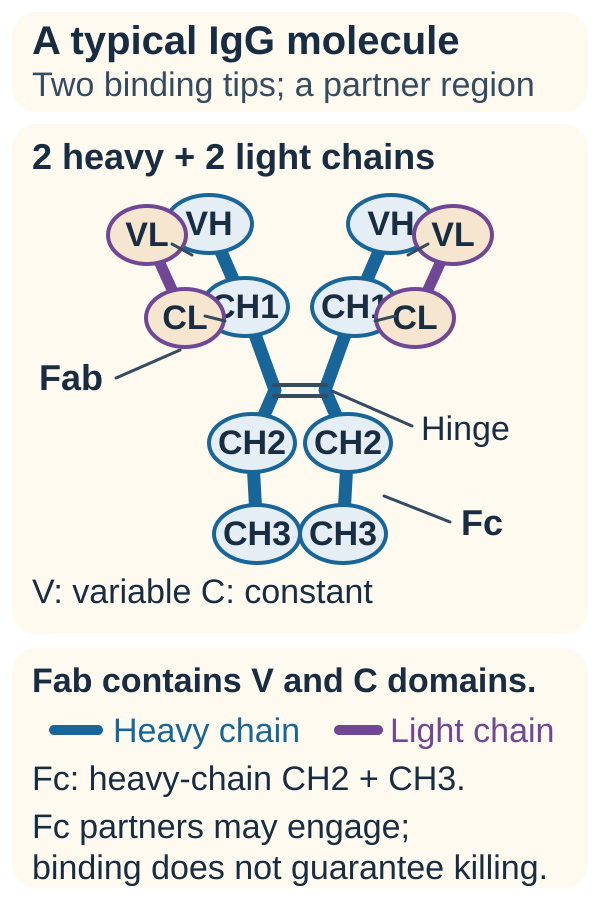
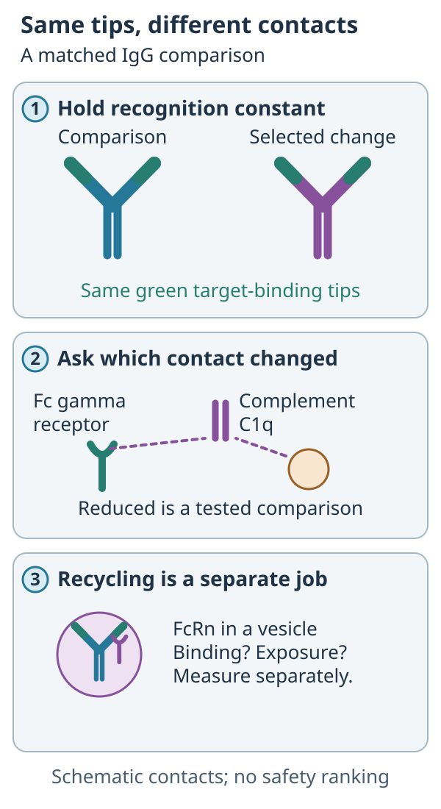
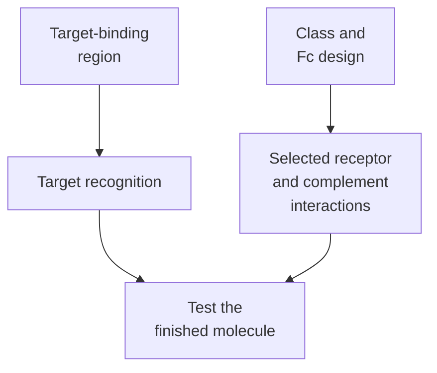

# Antibody isotypes and Fc silencing

## In one sentence

An antibody's isotype is its heavy-chain class, while Fc (fragment crystallizable) silencing reduces selected interactions that recruit immune effectors.

## The intuition

Think of a tool with a gripping end and a connector for other machinery. The grip finds a target. The connector helps determine what happens next. Antibody classes provide different connector designs; engineering can change particular connections.

The analogy breaks at “off.” Fc silencing is not one universal switch. A molecule may lose one interaction while retaining another, and the finished product still needs testing.

## How it works

*Reference anatomy from the shared concept. The focused comparison below asks a different question.*

*Matched recognition regions can stay the same while selected Fc interactions change; FcRn recycling needs its own evidence.*

**Read the picture:** Point to the part held constant. Does weaker Fc receptor binding tell you the half-life? **Answer:** The tips are held constant; half-life needs separate evidence.

[Antibody structure](/wiki/education/concepts/immunology/antibodies-and-b-cells/antibody-structure) separates recognition regions from the constant regions. An **isotype** is a heavy-chain class: immunoglobulin M, D, G, A or E, abbreviated **IgM, IgD, IgG, IgA and IgE**. Human IgG also has the subclasses IgG1, IgG2, IgG3 and IgG4. These categories help describe architecture, distribution and potential effector interactions.

A B-cell lineage can undergo **class switching**, changing its heavy-chain constant region while retaining the rearranged variable-region sequence. This is different from the mutations that can change antibody affinity during a response. Neither the class name nor a switch establishes what antigen an antibody recognizes.

For IgG, **Fc gamma receptors (FcγRs)** on immune cells bind Fc. Some promote activation; others inhibit it. **Complement** is a network of proteins that can help clear targets or damage membranes. Its C1q component can recognize appropriately arranged antibody Fc regions. Subclass, sugars attached to Fc, target geometry and available cells all affect these interactions. IgG1 and IgG4 are therefore not interchangeable, but neither name completely predicts a molecule's behavior.

**Fc silencing** uses design changes to reduce selected receptor or complement interactions. Lo and colleagues tested amino-acid substitutions in human and mouse antibody systems, including reduced effector activity in a mouse safety model. This supports engineering a particular interaction; it does not prove universal human safety or silence in every assay.

The **neonatal Fc receptor (FcRn)** has a distinct role in IgG transport and recycling. Reduced FcγR recruitment does not, by itself, establish reduced FcRn binding or a shorter circulation time. Binding, effector recruitment and [pharmacokinetics](/wiki/education/concepts/therapeutics/how-drugs-work/pharmacokinetics-and-half-life) need separate measurements.

*The address and the recruited response are different design questions.*

## Why it matters in cancer

An antibody intended to remove a target-bearing cell may benefit from effector recruitment. An antibody intended to block an immune receptor may instead need to avoid removing useful receptor-bearing cells. Those goals do not determine which design is safe or effective without product-specific evidence.

A silenced Fc does not prevent target binding, payload toxicity or every source of inflammation. Read the intended mechanism before interpreting “stronger” or “quieter.”

## How it is measured

Compare matched molecules with the same binding regions. Measure target binding, FcγR and C1q binding, and [cell killing, engulfment or complement-mediated damage](/wiki/education/concepts/immunology/antibodies-and-b-cells/adcc-adcp-cdc) under specified conditions. State species, receptor variants, antibody concentrations and effector cells. FcRn binding and exposure are additional questions, not conclusions from a killing assay.

## Common confusions

- An isotype is a class, not an antigen specificity.
- IgG4 is not a universal synonym for a fully silent Fc.
- Lower receptor binding in one assay does not establish silence everywhere.
- Reduced effector activity does not make a finished product harmless.

## Try it

Two fictional antibodies bind the same receptor equally well. One has reduced FcγR binding in a human-cell assay. Can you conclude that it has a shorter half-life or no toxicity?

**Answer:** No. You have evidence about one interaction under those conditions. Recycling, exposure, receptor blockade, other interactions and clinical safety remain separate.

## Related concepts

- [B cells and plasma cells](/wiki/education/concepts/immunology/antibodies-and-b-cells/b-cells-and-plasma-cells)
- [Immune checkpoints](/wiki/education/concepts/immunology/immune-regulation/immune-checkpoint)

## Sources and scope

Source check: October 9, 2026. General classes and selective engineering; fictional practice, no product ranking. Expert and learner review remain pending.

- [Immunobiology: B-cell activation and class switching](https://www.ncbi.nlm.nih.gov/books/NBK27142/) — the distinction between class switching and variable-region changes.
- [Vidarsson et al., 2014](https://pubmed.ncbi.nlm.nih.gov/25368619/) — authoritative review of human IgG subclasses, Fc receptors and FcRn.
- [Lo et al., 2017](https://pubmed.ncbi.nlm.nih.gov/28077575/) — primary engineering and mouse-model study of effector attenuation.

<!-- BEGIN GENERATED USED IN -->
## Used in

- [Understand how the immune system recognizes cancer](/wiki/education/guides/how-the-immune-system-fights-cancer/index)
<!-- END GENERATED USED IN -->
