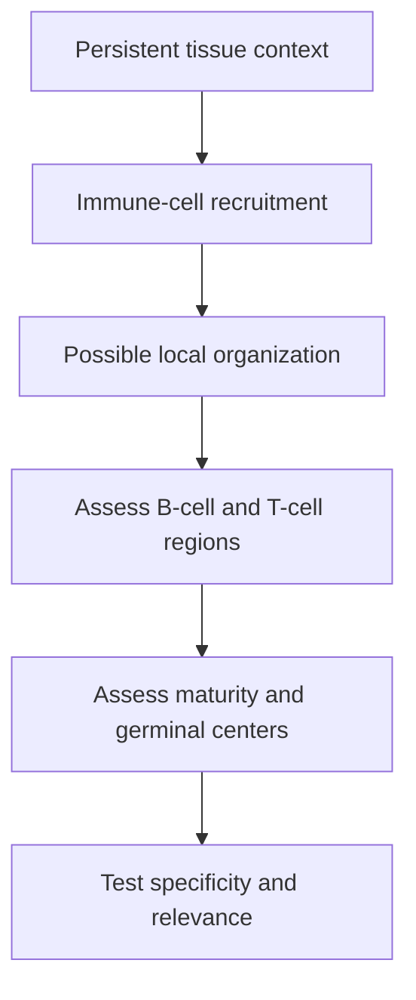

# Tertiary lymphoid structures

## In one sentence

Tertiary lymphoid structures are organized immune-cell gatherings that develop in tissues outside native lymphoid organs, with variable architecture and maturity.

## The intuition

A neighborhood can develop a local meeting place during a long-running problem. Tertiary lymphoid structures, or **TLS**, are somewhat like that: immune cells organize within affected tissue. The analogy ends before calling every crowd a meeting place. Organization matters, and a developing structure can differ from one with mature internal regions.

## How it works

Native [lymph nodes](/wiki/education/concepts/immunology/the-immune-system/lymph-nodes-and-lymphatics) are established organs connected to lymphatic drainage. TLS arise elsewhere, often during persistent inflammation. They can occur within or beside tumors. The word **tertiary** distinguishes this tissue-associated organization from the usual lymphoid-organ categories; it is not a tumor stage.

TLS can contain B-cell and T-cell areas, supporting stromal cells and specialized vascular features. The exact arrangement varies. [Chemokines](/wiki/education/concepts/immunology/immune-regulation/cytokine-and-chemokine), signaling proteins that help position cells, can support recruitment and organization. Seeing a related transcript in mixed tissue does not show that a structure formed.

Mature structures can contain a **germinal center**, a region where B cells undergo selection and refinement of their antibody response. **Follicular dendritic cells** help organize B-cell follicles and retain antigen. Despite their name, they are distinct from conventional [dendritic cells](/wiki/education/concepts/immunology/innate-and-unconventional-cells/dendritic-cells), which present processed peptides to T cells. Naming both prevents an easy mix-up.

A loose lymphocyte aggregate, an organized but immature TLS and a mature germinal-center-containing TLS are not interchangeable observations. Studies use specified staining panels and criteria to distinguish them. “TLS present” needs the definition used by that study or laboratory beside it.

These arrangements can support local immune interactions. Which antigens are recognized remains a separate question. B cells may recognize several kinds of material, and not every response in tumor-associated tissue is directed against cancer. Architecture creates opportunities; it does not certify specificity or useful function.

*This is an assessment sequence, not a promise that every aggregate matures or protects against cancer.*

## Why it matters in cancer

Gu-Trantien and colleagues identified follicular helper T-cell features and organized immune infiltrates in breast cancer, with outcome-associated signatures. Cabrita and colleagues linked B-cell/T-cell organization and TLS-associated features with outcomes in melanoma. These studies help explain why organization can add information beyond a total lymphocyte count.

Vanhersecke and colleagues found mature TLS associated with outcomes in retrospective cohorts receiving immune checkpoint inhibitors across cancer types. Association in those settings does not prove that creating a TLS causes benefit, establish a universal clinical cutoff or select a treatment for an individual. Keep cancer type, therapy, specimen and scoring definition attached to the result.

## Common confusions

- Many lymphocytes do not automatically form a TLS.
- A native lymph node is not a TLS, even when the sample contains cancer.
- TLS density and TLS maturity describe different properties.
- A prognostic association does not by itself establish benefit from a particular treatment.

## How it is measured

Tissue review and [multiplex immunofluorescence](/wiki/education/concepts/measurement/proteins-and-spatial/multiplex-immunofluorescence) can identify cell regions and supporting markers. Sections consume sampled tissue and reveal only the examined planes. Counts, density per area and maturity categories need explicit definitions. A gene signature can support a related pattern but cannot directly recover its spatial architecture.

## Try it

A fictional image has a cluster of B cells beside T cells. The report calls it a mature TLS without showing follicular organization or germinal-center criteria. What should you ask?

**Answer:** Ask which markers and architectural criteria establish maturity, and whether the specimen is native lymph-node tissue. The image may support an aggregate; the stronger label needs stronger evidence.

## Related concepts

- [Hot, excluded and cold tumor patterns](/wiki/education/concepts/immunology/tumor-immunology/hot-excluded-cold-tumor)
- [Antibody structure](/wiki/education/concepts/immunology/antibodies-and-b-cells/antibody-structure)

## Sources and scope

Source check: October 9, 2026. Tissue organization and study-specific associations; the exercise is fictional. Expert and learner review remain pending.

- [Gu-Trantien et al., 2013](https://pubmed.ncbi.nlm.nih.gov/23778140/) — follicular helper T cells and organized infiltrates in breast cancer.
- [Cabrita et al., 2020](https://pubmed.ncbi.nlm.nih.gov/31942071/) — B-cell/T-cell organization and TLS-associated features in melanoma.
- [Vanhersecke et al., 2021](https://pubmed.ncbi.nlm.nih.gov/35118423/) — mature TLS and outcomes in retrospective immunotherapy cohorts.

<!-- BEGIN GENERATED USED IN -->
## Used in

- [Understand how the immune system recognizes cancer](/wiki/education/guides/how-the-immune-system-fights-cancer/index)
- [Read an immune map without overreading it](/wiki/education/reading-a-tumor/immune-hot-vs-cold)
<!-- END GENERATED USED IN -->
