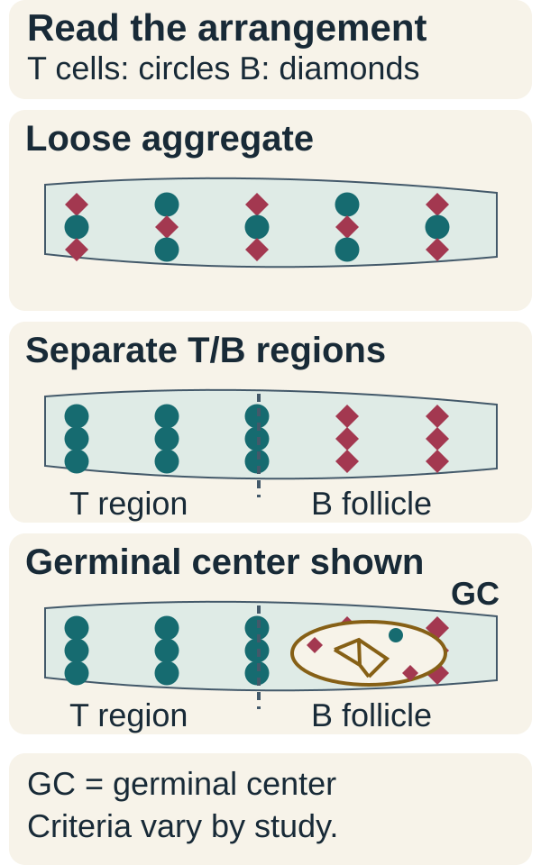
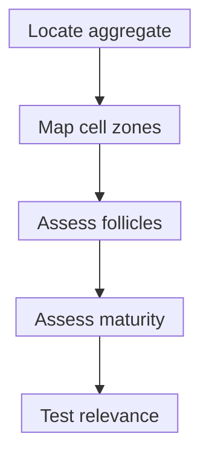

# Tertiary lymphoid structures

## In one sentence

Tertiary lymphoid structures are organized immune-cell gatherings that develop in tissues outside native lymphoid organs, with variable architecture and maturity.

## The intuition

Think of a temporary neighborhood workshop rather than a crowd in a square. Organization creates places for different jobs. A workshop may be developing or well equipped; its presence does not prove it makes a useful product. Likewise, architecture helps distinguish a tertiary lymphoid structure from a loose immune-cell cluster, while its function still needs evidence.

**Before you start:** [Lymph nodes](/wiki/education/concepts/immunology/the-immune-system/lymph-nodes-and-lymphatics) are native immune-organizing sites. [B cells and plasma cells](/wiki/education/concepts/immunology/antibodies-and-b-cells/b-cells-and-plasma-cells) have different response and secretion roles.

## How it works

*Three tissue arrangements, not a required developmental sequence: a loose aggregate, organized T/B regions, and a follicle with a demonstrated germinal center. Study-specific architecture and marker criteria determine maturity; counts alone establish neither maturity nor treatment benefit.*

**Tertiary lymphoid structures (TLS)** can form in inflamed tissues, including around or within tumors. “Tertiary” describes their location outside native lymphoid organs; it does not mean a third cancer stage.

Organization can include distinct B-cell and T-cell regions, supporting stromal cells and specialized vessels. Not every observed structure has all features or the same maturity. A **lymphoid aggregate** describes a gathering; an organized **B-cell follicle** is a further architectural feature; a **germinal center** is a specialized site of B-cell proliferation and selection within a follicle. These labels are not interchangeable.

**Follicular dendritic cells** support B-cell organization and antigen retention. Despite their name, they are different from conventional dendritic cells that help prime T cells. In Vanhersecke's research method, cluster of differentiation 23 (CD23)-positive follicular dendritic cells within a B-cell follicle supported the mature-TLS classification; a dense network was not required in every structure. A CD23-positive cell anywhere in tissue does not establish that architecture. [Vanhersecke et al.](https://pubmed.ncbi.nlm.nih.gov/35118423/).

*This is an assessment sequence, not a compulsory developmental path or proof of useful tumor immunity.*

## Why it matters in cancer

TLS can provide sites for local immune interactions. Breast-cancer and melanoma studies associated organized immune responses with outcomes; those findings retain their own specimens, methods and settings. [Gu-Trantien 2013](https://pubmed.ncbi.nlm.nih.gov/23778140/), [Cabrita 2020](https://pubmed.ncbi.nlm.nih.gov/31942071/).

Vanhersecke's retrospective cohorts associated mature TLS with outcomes among patients receiving immune checkpoint treatment. An association in treated cohorts does not alone establish the extra benefit caused by that treatment compared with another treatment. A [prognostic association and a treatment-predictive claim](/wiki/education/concepts/evidence-and-statistics/biomarkers/prognostic-vs-predictive) need different evidence. No universal maturity or abundance rule selects a cancer therapy.

## Assay card

| Field | Keep with the result |
|---|---|
| Measures | Cell organization, follicular features and maturity under an explicit definition |
| How | Tissue morphology plus selected identity/architecture stains; document the region examined |
| Input and tissue cost | Fixed tissue sections; sectioning and staining consume finite material |
| Output and units | Presence, count, structures/mm² or maturity category; specify area and criteria |
| Thresholds | Method- and study-specific; no universal treatment-selection threshold |
| Failure modes | Small section, disrupted architecture, incomplete marker panel or native lymph-node tissue mistaken for TLS |
| What it cannot tell you | Antigen specificity, effective killing or treatment benefit for an individual |
| Validation tier | Research classification and cohort association unless the intended clinical use has separate validation |

[Immunohistochemistry](/wiki/education/concepts/measurement/pathology-readouts/immunohistochemistry) and [multiplex imaging](/wiki/education/concepts/measurement/proteins-and-spatial/multiplex-immunofluorescence) can show selected identities and locations. An immune [ribonucleic acid (RNA)](/wiki/education/concepts/biology-basics/molecules/rna-and-mrna) signature alone cannot demonstrate a germinal center's architecture.

## Common confusions

- A dense lymphocyte cluster is not automatically an organized or mature TLS.
- Abundance and maturity are different quantities.
- Follicular dendritic cells are not conventional dendritic cells.
- A favorable association is not proof that adding a treatment will help.

## Try it

A fictional section contains two organized structures in 4 mm² of eligible tissue. B-cell follicles are visible, but the study's germinal-center criteria are not met. What can you report?

**Answer:** The measured density is 2/4 = 0.5 structures/mm² under the counting definition. Describe the observed follicles; do not label the structures mature under criteria they fail. Neither count nor architecture alone establishes useful cancer recognition.

## Explain it back

“TLS assessment asks about ___ as well as ___.” One answer: “organization and maturity; abundance and location.”

## Takeaway

**Read the architecture and the study definition before interpreting the association.**

## Related concepts

- [Tumor-infiltrating lymphocytes](/wiki/education/concepts/immunology/tumor-immunology/tumor-infiltrating-lymphocytes)
- [Hot, excluded and cold patterns](/wiki/education/concepts/immunology/tumor-immunology/hot-excluded-cold-tumor)

## Sources and scope

Source-checked October 10, 2026. Architecture and bounded cohort associations; fictional practice. Expert and learner review remain pending.

- [Gu-Trantien et al., 2013: follicular-helper T cells and organized immune responses in breast cancer](https://pubmed.ncbi.nlm.nih.gov/23778140/).
- [Cabrita et al., 2020: B cells, TLS and outcomes in melanoma](https://pubmed.ncbi.nlm.nih.gov/31942071/).
- [Vanhersecke et al., 2021: method-defined mature TLS in retrospective treated cohorts](https://pubmed.ncbi.nlm.nih.gov/35118423/).

<!-- BEGIN GENERATED USED IN -->
## Used in

- [Understand how the immune system recognizes cancer](/wiki/education/guides/how-the-immune-system-fights-cancer/index)
- [Read an immune map without overreading it](/wiki/education/reading-a-tumor/immune-hot-vs-cold)
<!-- END GENERATED USED IN -->
