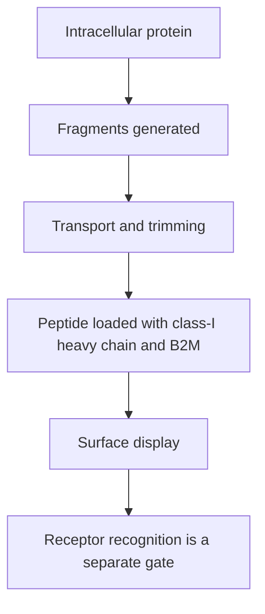

# Antigen-processing machinery

## In one sentence

Antigen-processing machinery generates protein fragments and loads them onto display molecules for T-cell inspection.

## The intuition

A display case needs a supply chain. Producing a protein is only the first step; fragments must be generated, loaded and transported. This is an analogy for linked biochemical processes. There is no single factory switch that every antigen uses.

## How it works

In a common class-I route, proteasomes cut intracellular proteins. The transporter associated with antigen processing (TAP) moves fragments into the endoplasmic reticulum, a cellular processing compartment. Aminopeptidases can trim fragments further.

A class-I human leukocyte antigen ([HLA](/wiki/education/concepts/immunology/antigen-presentation/hla)) heavy chain assembles with beta-2 microglobulin ([Beta-2 microglobulin (B2M)](/wiki/education/concepts/immunology/antigen-presentation/b2m)) and a peptide. Supporting proteins assist loading and quality control. Suitable complexes then reach the surface, where conventional CD8 T cells may recognize them.

Class-II presentation uses a different route, often involving proteins taken into endosomal compartments. Cross-presentation also allows externally acquired material to reach class I. Individual targets can have different dependencies; the common class-I chain is a teaching model, not an exhaustive map.

*The common class-I pathway has shared bottlenecks; expression alone does not prove display.*

## Why it matters in cancer

A tumor may retain an antigen’s sequence but lose useful presentation. More candidate peptides cannot bypass a shared broken step. RNA measurements of machinery describe expression, rather than assembled surface complexes.

## Worked example

A hypothetical cell makes an altered protein but lacks functional TAP. A TAP-dependent peptide may no longer reach class I efficiently. Measuring the altered transcript would miss this bottleneck. A target-specific presentation experiment would address a different question.

## Common confusions

- Binding prediction does not test the whole processing pathway.
- Class I and class II do not use identical machinery.
- Low expression, gene loss and an experimentally demonstrated functional defect are different findings.

## Related concepts

- [HLA](/wiki/education/concepts/immunology/antigen-presentation/hla)
- [Beta-2 microglobulin (B2M)](/wiki/education/concepts/immunology/antigen-presentation/b2m)
- [cross presentation](/wiki/education/concepts/immunology/antigen-presentation/cross-presentation)

## Sources and scope

Source check: October 8, 2026. This is a mechanism explanation, not a treatment recommendation. Expert and learner review remain pending.

- [Primary human TAP transport experiments](https://pmc.ncbi.nlm.nih.gov/articles/PMC2195672/).
- [Antigen processing pathways](https://pmc.ncbi.nlm.nih.gov/articles/PMC4026165/).

<!-- BEGIN GENERATED USED IN -->
## Used in

- [Immunopeptidomics: measuring peptide display](/wiki/education/designing-a-vaccine/03-immunopeptidomics)
- [Read a neoantigen design board](/wiki/education/designing-a-vaccine/04-how-to-read-a-neoantigen-design-board)
- [Why a personalized cancer vaccine can help](/wiki/education/designing-a-vaccine/index)
- [Understand how the immune system recognizes cancer](/wiki/education/guides/how-the-immune-system-fights-cancer/index)
- [Turn selected targets into an mRNA message](/wiki/education/guides/personalized-cancer-vaccine/06-writing-the-message)
- [How a personalized cancer vaccine is designed](/wiki/education/guides/personalized-cancer-vaccine/index)
<!-- END GENERATED USED IN -->
