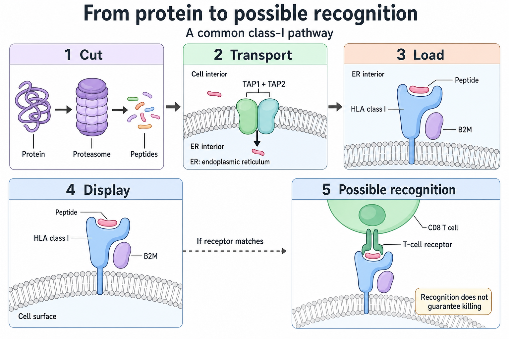
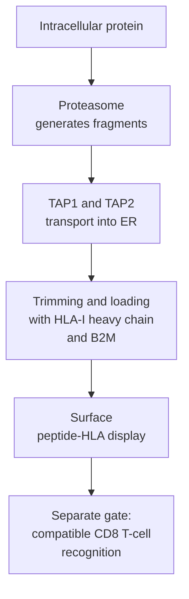

# Antigen-processing machinery

## In one sentence

Antigen-processing machinery generates protein fragments and loads them onto display molecules for T-cell inspection.

## The intuition

A display case needs a supply chain. A cell makes proteins, cuts some into fragments, then places selected fragments on its surface. A T cell can inspect those displays. Having the protein inside the cell does not guarantee that its fragment reaches the display case. This analogy describes linked biochemical steps; there is no single factory switch that every antigen uses.

*Making a protein, displaying its fragments and recognizing them are separate steps.*

## How it works

**Antigen-processing machinery (APM)** includes proteins that generate, transport and load **peptides**, short protein fragments. A common class-I pathway proceeds through these steps:

1. **Cut.** The [proteasome](/wiki/education/concepts/cancer-biology/cell-death-and-survival/ubiquitin-and-proteasome), a protein-degrading complex, cuts intracellular proteins into fragments. Cutting can create a useful peptide or destroy its sequence.
2. **Transport.** The **transporter associated with antigen processing (TAP)** has two subunits, TAP1 and TAP2. Together they move peptides into the **endoplasmic reticulum (ER)**, a compartment where proteins assemble. [Primary transport experiments](https://pubmed.ncbi.nlm.nih.gov/8348620/) established that transport uses cellular energy and selects among peptides.
3. **Trim and load.** **Endoplasmic reticulum aminopeptidases (ERAP1 and ERAP2)** remove amino acids from a fragment's front end. [Human experiments](https://pubmed.ncbi.nlm.nih.gov/15908954/) found complementary trimming by the two enzymes; more expression does not universally improve display. Trimming can create or destroy a candidate peptide, as [ERAP1 experiments](https://www.nature.com/articles/ni860) demonstrate. A class-I [human leukocyte antigen (HLA)](/wiki/education/concepts/immunology/antigen-presentation/hla) heavy chain assembles with [beta-2 microglobulin (B2M)](/wiki/education/concepts/immunology/antigen-presentation/b2m) and a peptide. Helper proteins, including tapasin, support loading and quality control.
4. **Display.** Stable peptide–HLA complexes travel to the cell surface. The peptide remains held by HLA; it is not a free label floating outside the cell.
5. **Recognize.** A compatible [T-cell receptor](/wiki/education/concepts/immunology/t-cells/t-cell-receptor) on a conventional **CD8 T cell** may recognize the peptide–HLA pair. Recognition is a separate gate. Display alone does not establish killing.

Class-II HLA commonly loads peptides in vesicles that process acquired proteins. An **invariant chain** protects the new groove and directs it there. After it is cut, a remaining fragment is exchanged for other peptides with help from **HLA-DM**, a loading helper. Conventional **CD4 T cells** inspect these displays and can provide immune help. [Class-II teaching](https://www.ncbi.nlm.nih.gov/books/NBK26926/) explains why this differs from the TAP/ERAP/B2M chain.

[Cross-presentation](/wiki/education/concepts/immunology/antigen-presentation/cross-presentation) lets externally acquired material reach class I. The diagram is a common route, not a rule for every peptide.

## Why it matters in cancer

A cancer cell may retain an altered protein yet display little of its peptide. A shared processing defect can affect several targets together. Adding more candidate peptides does not automatically bypass that bottleneck.

**Low expression, gene loss and a functional defect are different findings.** A weak [ribonucleic acid (RNA)](/wiki/education/concepts/biology-basics/genetics/central-dogma) signal does not prove that the gene is deleted or that the pathway is irreversibly broken. [Interferon-gamma](/wiki/education/concepts/immunology/the-immune-system/interferons), an immune signaling protein, can increase presentation machinery when the response pathway works and the required genes remain intact. It cannot replace a deleted B2M or HLA gene. [Melanoma experiments](https://www.nature.com/articles/ncomms15440) show that defects in that signaling pathway can prevent induction. Demonstrating inducibility requires a controlled stimulation experiment; baseline RNA cannot establish it. This is a biological distinction, not evidence that interferon treatment will help a patient.

## How it is measured

Ask which part of the chain an assay actually observes:

| Evidence | What it establishes | What it leaves open |
|---|---|---|
| Deoxyribonucleic acid (DNA) sequence and copy number | Gene retention or a supported alteration | Expression and function |
| RNA transcripts | Sampled gene activity | Protein abundance, assembly and display |
| Protein staining or flow cytometry | Detected protein, with location depending on method | Which specific peptide is displayed |
| HLA-associated peptide measurement | A peptide was recovered with HLA in that preparation | Cell of origin, receptor recognition and clinical benefit |
| Controlled T-cell recognition or killing | Function against tested targets | Coverage across cancer cells and benefit in patients |

[Single-cell RNA sequencing](/wiki/education/concepts/measurement/transcriptomics/single-cell-and-single-nucleus-rna-seq) can locate machinery transcripts within inferred cell populations. [Immunohistochemistry](/wiki/education/concepts/measurement/pathology-readouts/immunohistochemistry) and [flow cytometry](/wiki/education/concepts/measurement/immune-monitoring/flow-cytometry) address protein questions. [Immunopeptidomics](/wiki/education/concepts/measurement/proteins-and-spatial/immunopeptidomics) measures HLA-associated peptides, as illustrated by a [primary peptidome dataset](https://www.nature.com/articles/s41587-019-0322-9). Non-detection needs sampling and sensitivity context. RNA, protein, peptide display and recognition require separate evidence.

Researchers can compare recognition after intact source protein versus minimal synthetic peptide loading on matched cells. Peptide loading may bypass processing. Check viability, HLA and responder competence. Rescue supports a bottleneck under those conditions, rather than identifying every defect.

## Worked example

A fictional tumor has RNA for an altered protein and little TAP1 RNA. This identifies a possible transport bottleneck. It does not establish TAP1 gene loss, absence of TAP protein or failure to display the proposed peptide. Those are distinct follow-up questions.

## Common confusions

- **Binding prediction is not presentation:** it does not test the full processing chain.
- **Peptide-stimulated recognition is not natural tumor recognition:** adding peptide can bypass processing.
- **CD4 help is not proof of CD8 tumor recognition:** the display routes and responding cells differ.

## Try it

A tumor's B2M RNA is low. Can you conclude that class-I display is permanently lost?

**Answer:** No. Check measurement adequacy, the gene, protein and functional display. Low RNA alone cannot establish permanence.

A fictional trimming experiment increases peptide A but reduces peptide B. **Must one be wrong?** No. Trimming can create one useful sequence while destroying another; check the peptide identities and controls.

## Explain it back

Why do protein presence and peptide display answer different questions?

## Takeaway

**Generate, trim, load, display and recognize are distinct steps, each with its own evidence.**

## Related concepts

- [HLA](/wiki/education/concepts/immunology/antigen-presentation/hla)
- [Beta-2 microglobulin (B2M)](/wiki/education/concepts/immunology/antigen-presentation/b2m)
- [Immune escape](/wiki/education/concepts/immunology/tumor-immunology/immune-escape)

## Sources and scope

Source-checked October 10, 2026. The example and exercise are fictional. This explains mechanisms and measurements, not treatment selection. Expert and learner review remain pending.

- [NCBI Bookshelf: T cells and major histocompatibility complex (MHC) proteins](https://www.ncbi.nlm.nih.gov/books/NBK26926/), for class-II assembly and peptide exchange.
- [Shepherd et al., 1993: TAP-dependent peptide transport](https://pubmed.ncbi.nlm.nih.gov/8348620/), primary transport experiments.
- [York et al., 2002: ERAP1 can enhance or limit presentation](https://www.nature.com/articles/ni860) and [Saveanu et al., 2005: complementary ERAP1/ERAP2 activity](https://pubmed.ncbi.nlm.nih.gov/15908954/), primary trimming experiments.
- [Sucker et al., 2017: acquired interferon-gamma resistance in melanoma](https://www.nature.com/articles/ncomms15440), primary signaling and induction experiments; findings do not establish treatment benefit in another cancer.
- [Sarkizova et al., 2020: measured HLA class-I peptidomes](https://www.nature.com/articles/s41587-019-0322-9), primary peptide measurements and prediction development.

<!-- BEGIN GENERATED USED IN -->
## Used in

- [HLA and antigen presentation in vaccine design](/wiki/education/designing-a-vaccine/02-hla-and-antigen-presentation)
- [Read a neoantigen design board](/wiki/education/designing-a-vaccine/04-how-to-read-a-neoantigen-design-board)
- [Why a personalized cancer vaccine can help](/wiki/education/designing-a-vaccine/index)
- [Understand how the immune system recognizes cancer](/wiki/education/guides/how-the-immune-system-fights-cancer/index)
- [Turn selected targets into an mRNA message](/wiki/education/guides/personalized-cancer-vaccine/06-writing-the-message)
- [How a personalized cancer vaccine is designed](/wiki/education/guides/personalized-cancer-vaccine/index)
- [Read single-cell data after treatment](/wiki/education/molecular-profiling/08-profile-residual-tumor)
- [Separate immune presence from tumor recognition](/wiki/education/multi-omics-foundations/06-immune-presence-and-recognition)
<!-- END GENERATED USED IN -->
