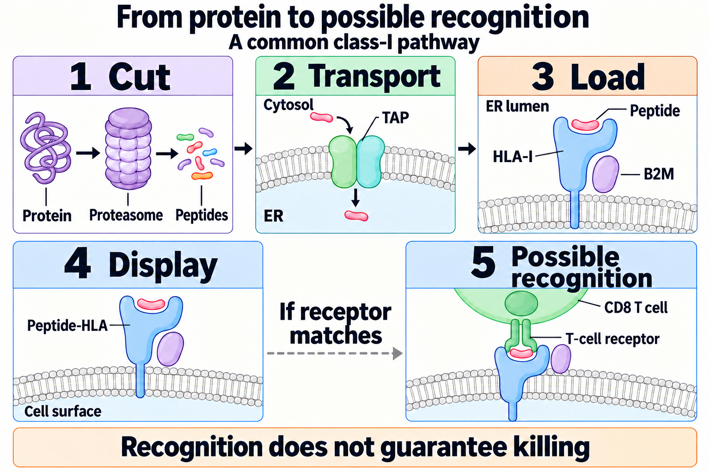
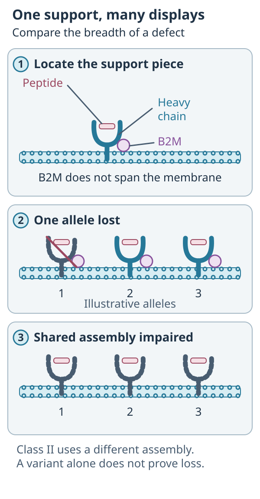

# B2M (beta-2 microglobulin)

## In one sentence

Beta-2 microglobulin supports the assembly and stable surface expression of classical human leukocyte antigen class-I complexes.

## The intuition

A shared support piece can affect many display cases. B2M is not the antigen being selected for a vaccine; it helps the class-I system display antigens. The analogy breaks if we treat every presentation pathway as the same structure.

## How it works

*Reference anatomy from the shared concept. The focused comparison below asks a different question.*

*Losing one allele and losing a shared class-I assembly function can affect different sets of targets.*

**Read the picture:** Which panel affects a shared support? **Answer:** The lower comparison does. A B2M variant alone does not establish that functional defect.

Classical [human leukocyte antigen (HLA)](/wiki/education/concepts/immunology/antigen-presentation/hla) class I contains a heavy chain, a peptide and beta-2 microglobulin (B2M). Functional B2M supports normal assembly and surface expression. Many conventional CD8 T-cell responses depend on this display system.

Loss of functional B2M can impair many class-I targets at once. That differs from losing a single HLA allele, which may leave other presenting alleles usable. Class II HLA is a different heterodimer, an alpha and a beta chain, and contains no B2M.

B2M is also the light chain of several nonclassical class I-like molecules: HLA-E (the ligand for the natural killer cell inhibitory receptor NKG2A), HLA-G, MR1 (which shows microbial metabolites to MAIT cells), CD1 molecules (which show lipids, including CD1d to NKT cells) and the neonatal Fc receptor FcRn (which recycles antibodies) ([UniProt P61769](https://www.uniprot.org/uniprotkb/P61769/entry); [Wani et al., 2006](https://pubmed.ncbi.nlm.nih.gov/16549777/)). Complete B2M loss can therefore remove more than classical class I.

A reported [deoxyribonucleic acid (DNA)](/wiki/education/concepts/biology-basics/molecules/dna) variant, low [ribonucleic acid (RNA)](/wiki/education/concepts/biology-basics/molecules/rna-and-mrna) level and absent surface class-I protein are different observations. Variant interpretation, copy number, protein assessment and functional experiments help establish whether presentation is actually impaired. A blood concentration of B2M is also a different measurement from tumor-cell presentation.

## Why it matters in cancer

Vaccines and engineered T-cell receptors can share a class-I dependency. A surface-antigen receptor may avoid that recognition requirement, but still needs a suitable target, access, function and acceptable safety.

## Worked example

A fictional design uses several peptides presented by different class-I alleles. If all depend on class-I assembly impaired by the same B2M defect, the number of peptides does not create independent escape protection. If only one allele is lost instead, retained alleles may still present other targets.

## Common confusions

- B2M loss is not identical to losing one HLA allele.
- A B2M variant is not automatically complete functional loss.
- Reduced class-I display does not guarantee natural killer-cell killing. B2M loss removes ligands for both KIR and NKG2A inhibitory receptors, but activating signals are still needed.
- B2M loss is not class II loss: class II contains no B2M, so CD4 T-cell recognition can remain.

## Read the evidence in layers

A change in one gene copy does not establish loss of all B2M function. Check the other copy, cell population and functional consequences. Low RNA, absent tissue staining and loss of assembled surface class I are also different observations. A blood B2M concentration measures a circulating protein pool; it does not count tumor-cell peptide–HLA complexes.

A primary acquired-resistance study in metastatic melanoma connected a truncating B2M alteration with lost surface class-I expression in one studied relapse. It demonstrates a possible mechanism in that setting, not a universal consequence of any B2M variant or a frequency for breast cancer.

## Try it

A fictional tumor has a one-copy B2M variant but retains detectable surface class I. Can its peptide-directed targets all be declared unusable?

**Answer:** No. The variant does not establish complete functional loss. Its other copy and measured display matter; a controlled test of the intended peptide–HLA target would address the specific dependency.

## Explain it back

Explain why one lost HLA allele and a shared class-I assembly defect can affect different numbers of targets.

## Takeaway

**Treat B2M sequence, protein and functional display as separate evidence.**

## Related concepts

- [HLA](/wiki/education/concepts/immunology/antigen-presentation/hla)
- [Antigen-processing machinery](/wiki/education/concepts/immunology/antigen-presentation/antigen-processing-machinery)
- [immune escape](/wiki/education/concepts/immunology/tumor-immunology/immune-escape)

## Sources and scope

Source check: November 7, 2026. This is a mechanism explanation, not a treatment recommendation. Expert and learner review remain pending.

- [Class-I assembly and processing](https://www.ncbi.nlm.nih.gov/books/NBK459467/).
- [Primary B2M/HLA mutation analysis](https://pubmed.ncbi.nlm.nih.gov/31345234/), associations in cancer datasets rather than proof that every variant abolishes display.
- [UniProt P61769: B2M partners](https://www.uniprot.org/uniprotkb/P61769/entry), including HLA-E, HLA-G and MR1.
- [Wani et al., 2006](https://pubmed.ncbi.nlm.nih.gov/16549777/), a B2M mutation causing FcRn deficiency in people.
- [Zaretsky et al., 2016](https://pubmed.ncbi.nlm.nih.gov/27433843/), acquired-resistance biopsies in metastatic melanoma, including a B2M truncation and lost surface class I.

<!-- BEGIN GENERATED USED IN -->
## Used in

- [Separate the address from the killing mechanism](/wiki/education/guides/aiming-a-drug-at-a-surface-target/01-mechanism)
- [Compare immune-cell recognition systems](/wiki/education/guides/engineered-cell-therapy/09-car-tcr-til-comparison)
- [How engineered immune cells can attack a solid tumor](/wiki/education/guides/engineered-cell-therapy/index)
- [How a T cell sees a cancer cell](/wiki/education/guides/how-the-immune-system-fights-cancer/01-how-a-t-cell-sees-a-cancer-cell)
- [Find the step an immune response can lose](/wiki/education/guides/how-the-immune-system-fights-cancer/06-find-the-failed-step)
- [What checkpoint inhibitors change](/wiki/education/guides/how-the-immune-system-fights-cancer/07-what-checkpoint-inhibitors-change)
- [Why the immune system doesn't just kill a tumor, and what checkpoint inhibitors change](/wiki/education/guides/how-the-immune-system-fights-cancer/index)
- [HLA and antigen presentation in vaccine design](/wiki/education/guides/personalized-cancer-vaccine/03-hla-and-presentation)
- [Read a neoantigen design board](/wiki/education/guides/personalized-cancer-vaccine/04-reading-a-design-board)
- [How a personalized cancer vaccine is designed](/wiki/education/guides/personalized-cancer-vaccine/index)
- [Add geography and immune context](/wiki/education/guides/what-multi-omics-tells-us/07-map-cells-and-immune-context)
- [Read single-cell data after treatment](/wiki/education/guides/what-multi-omics-tells-us/12-profile-residual-tumor)
<!-- END GENERATED USED IN -->
