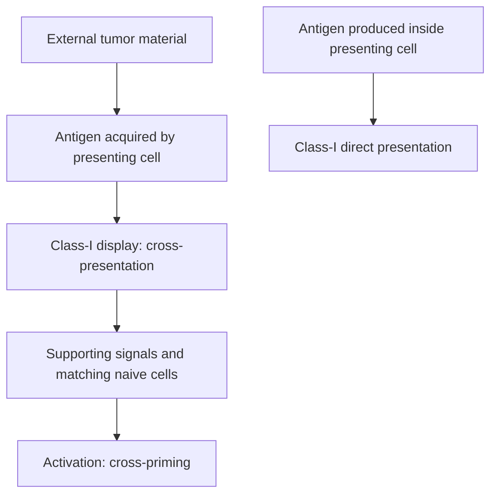

# Cross-presentation

## In one sentence

Cross-presentation occurs when a cell displays externally acquired antigen on class-I human leukocyte antigen molecules.

## The intuition

A collector can show material made by another cell. This lets immune cells display fragments from a tumor they did not become. The analogy explains the antigen’s origin; it does not establish that the display activates a useful response.

## How it works

Class-I [human leukocyte antigen (HLA)](/wiki/education/concepts/immunology/antigen-presentation/hla) commonly displays fragments from proteins made within the presenting cell. Cross-presentation instead routes material acquired from outside that cell onto class I. Dendritic cells can obtain tumor-derived material through this route.

Conventional type-1 dendritic cells are important cross-presenters in many settings. The underlying processing routes and contributions of other cells vary. Cross-presentation names a display process. Cross-priming names activation of naive CD8 T cells through that process, which requires supporting signals.

If a dendritic cell receives vaccine messenger RNA and makes the encoded protein itself, class-I display can be direct presentation. Antigen may also transfer between cells. It is inaccurate to assign every RNA vaccine exclusively to cross-presentation.

*Antigen origin distinguishes presentation routes; display and priming remain separate.*

## Why it matters in cancer

Cross-presentation can connect tumor-derived material to an adaptive response. It helps explain why the cells that initiate a response and the cells later attacked by that response are different.

## Worked example

In a fictional experiment, a dendritic cell engulfs tumor debris and displays a tumor-derived peptide on class I. Cross-presentation is supported. If the experiment measures no naive T-cell activation, it has not yet established cross-priming. Display and activation require different readouts.

## Common confusions

- External antigen on class II is not cross-presentation merely because it came from outside.
- Cross-presentation does not guarantee productive priming.
- Direct presentation by a vaccine-transfected cell remains possible.

## Related concepts

- [HLA](/wiki/education/concepts/immunology/antigen-presentation/hla)
- [Antigen-processing machinery](/wiki/education/concepts/immunology/antigen-presentation/antigen-processing-machinery)
- [T-cell priming](/wiki/education/concepts/immunology/t-cells/t-cell-priming-three-signals)

## Sources and scope

Source check: October 8, 2026. This is a mechanism explanation, not a treatment recommendation. Expert and learner review remain pending.

- [Primary dendritic-cell cross-priming experiments in mice](https://pubmed.ncbi.nlm.nih.gov/11120766/).
- [Primary RNA delivery and dendritic-cell experiments](https://pubmed.ncbi.nlm.nih.gov/27281205/).

<!-- BEGIN GENERATED USED IN -->
## Used in

- [Why a personalized cancer vaccine can help](/wiki/education/designing-a-vaccine/index)
- [Understand how the immune system recognizes cancer](/wiki/education/guides/how-the-immune-system-fights-cancer/index)
- [How a personalized cancer vaccine is designed](/wiki/education/guides/personalized-cancer-vaccine/index)
<!-- END GENERATED USED IN -->
