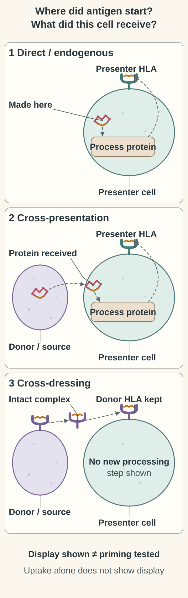
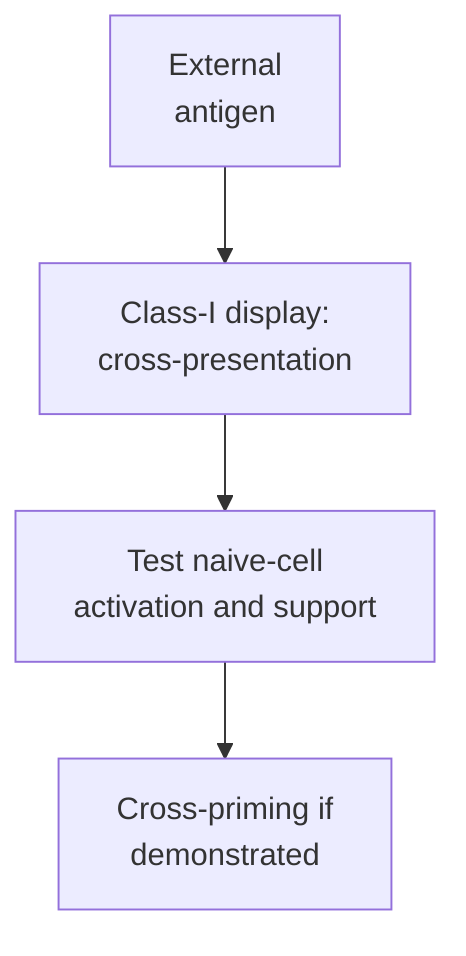

# Cross-presentation

## In one sentence

Cross-presentation occurs when a cell displays externally acquired antigen on class-I human leukocyte antigen molecules.

## The intuition

A collector can show material made by another cell. This lets immune cells display fragments from a tumor they did not become. The analogy explains the antigen’s origin; it does not establish that the display activates a useful response.

## How it works

Class-I [human leukocyte antigen (HLA)](/wiki/education/concepts/immunology/antigen-presentation/hla) commonly displays fragments from proteins made within the presenting cell. Cross-presentation instead routes material acquired from outside that cell onto class I. Dendritic cells can obtain tumor-derived material through this route.

[Conventional type-1 dendritic cells](/wiki/education/concepts/immunology/innate-and-unconventional-cells/dendritic-cells) are important cross-presenters in many settings. The underlying processing routes and contributions of other cells vary. Cross-presentation names a display process. [Cross-priming](/wiki/education/concepts/immunology/t-cells/t-cell-priming-three-signals) names activation of naive CD8 T cells through that process, which requires supporting signals. Naive means not yet initially activated by antigen; [CD8](/wiki/education/concepts/immunology/t-cells/cd4-vs-cd8) describes a usual class-I recognition partner.

If a dendritic cell receives vaccine [messenger ribonucleic acid (mRNA)](/wiki/education/concepts/biology-basics/molecules/rna-and-mrna) and makes the encoded protein itself, class-I display can be direct presentation. Antigen may also transfer between cells. It is inaccurate to assign every RNA vaccine exclusively to cross-presentation.

  
  
Follow what moves: direct presentation uses protein made by that cell; cross-presentation uses acquired protein processed by the recipient; cross-dressing transfers an intact donor peptide–HLA complex. HLA means human leukocyte antigen. Shapes and arrows track origin, not molecular scale or one intracellular pathway. Display alone does not demonstrate priming, and a vaccine-transfected cell can directly present protein it makes.

*Antigen origin distinguishes presentation routes; display and priming remain separate.*

## Why it matters in cancer

Cross-presentation can connect tumor-derived material to an adaptive response. It helps explain why the cells that initiate a response and the cells later attacked by that response are different.

## Worked example

In a fictional experiment, a dendritic cell engulfs tumor debris and displays a tumor-derived peptide on class I. Cross-presentation is supported. If the experiment measures no naive T-cell activation, it has not yet established cross-priming. Display and activation require different readouts.

## Common confusions

- External antigen on class II is not cross-presentation merely because it came from outside.
- Cross-presentation does not guarantee productive priming.
- Direct presentation by a vaccine-transfected cell remains possible.

## Readout and controls

Human CD141-positive dendritic-cell experiments demonstrated cross-presentation of defined acquired proteins and necrotic-cell material under specified stimulation conditions. That finding does not make one surface marker a universal functional test.

Ask whether antigen was acquired as protein and processed by the recipient, rather than merely supplied as ready-made peptide. A cell can also acquire already assembled peptide–HLA complexes from another cell, sometimes called **cross-dressing**; that is not proof of recipient processing. Donor/recipient HLA controls, target-specific display or responder tests, and suitable background controls help distinguish these possibilities. Measuring material uptake alone answers none of them.

## Try it

A fictional dendritic cell acquires external protein, generates a peptide and displays it on class I, but no naive-cell response is measured. What can be named?

**Answer:** Cross-presentation is supported. Cross-priming remains untested; downstream tumor recognition and benefit are further questions.

## Explain it back

Explain why the antigen source and the responding cell's activation are two different axes.

## Takeaway

**Cross-presentation describes display; cross-priming requires an activation result.**

## Related concepts

- [HLA](/wiki/education/concepts/immunology/antigen-presentation/hla)
- [Antigen-processing machinery](/wiki/education/concepts/immunology/antigen-presentation/antigen-processing-machinery)
- [T-cell priming](/wiki/education/concepts/immunology/t-cells/t-cell-priming-three-signals)

## Sources and scope

Source check: October 10, 2026. This is a mechanism explanation, not a treatment recommendation. Expert and learner review remain pending.

- [Primary dendritic-cell cross-priming experiments in mice](https://pubmed.ncbi.nlm.nih.gov/11120766/).
- [Jongbloed et al., 2010](https://pubmed.ncbi.nlm.nih.gov/20479116/), human CD141-positive DC experiments with defined antigen and activation conditions.
- [Primary RNA delivery and dendritic-cell experiments](https://pubmed.ncbi.nlm.nih.gov/27281205/), a particular delivery platform; not every vaccine uses the same route.
- [Wakim and Bevan, 2011](https://pubmed.ncbi.nlm.nih.gov/21455179/), mouse viral-infection experiments demonstrating transfer of preassembled complexes without recipient processing; not a universal human priming rule.

<!-- BEGIN GENERATED USED IN -->
## Used in

- [Why a personalized cancer vaccine can help](/wiki/education/designing-a-vaccine/index)
- [Understand how the immune system recognizes cancer](/wiki/education/guides/how-the-immune-system-fights-cancer/index)
- [Understand local therapy and the immune system](/wiki/education/guides/local-therapy-and-the-immune-system/index)
- [How a personalized cancer vaccine is designed](/wiki/education/guides/personalized-cancer-vaccine/index)
- [Separate local injury from immune learning](/wiki/education/local-treatment-modalities/01-mechanism)
- [How dendritic cells help start a T-cell response](/wiki/education/oncology-101/2-dendritic-cells)
- [Oncology 101: immune foundations](/wiki/education/oncology-101/index)
<!-- END GENERATED USED IN -->
