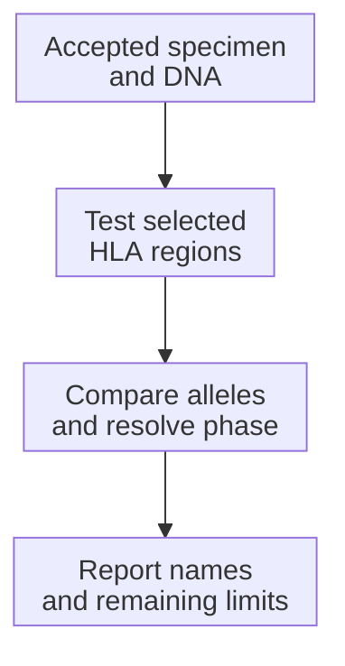

# HLA typing and nomenclature

## In one sentence

Human leukocyte antigen typing identifies inherited alleles, whose standardized names describe progressively more detailed sequence differences.

## The intuition

A [human leukocyte antigen (HLA)](/wiki/education/concepts/immunology/antigen-presentation/hla) name resembles a part number. “HLA-A” names a peptide-display gene; “`HLA-A*02:01`” specifies a protein version. Results for a predictor or receptor tested with one version cannot automatically transfer to another.

Typing identifies inherited versions. It does not tell us whether a particular tumor still makes those parts, displays the proposed peptide, or is recognized by a T cell.

## How it works

In an allele name such as `HLA-A*02:01:01:01`, the fields have distinct meanings:

| Part of the name | Meaning |
| --- | --- |
| `HLA-A` | The HLA gene |
| `02` | An allele group, often related to a serological antigen grouping |
| `01` after the first colon | Distinguishes protein sequences within that group |
| The third field | Distinguishes synonymous coding-sequence differences |
| The fourth field | Distinguishes differences in noncoding sequence |

An optional suffix carries additional information: for example, `N` indicates a null allele and `L` indicates low expression. A name without a suffix is not a measurement of how much HLA a particular cancer cell expresses. Read the laboratory's resolution, ambiguity notes and methods as well as the printed name. A two-field result does not necessarily settle every sequence or expression question.

People generally inherit one copy of each HLA gene from each parent. A report can therefore list two alleles at a locus; identical inherited alleles can appear as the same name. Class I and class II typing describe different display molecules and do not substitute for one another.

For a tumor-targeting project, keep four separate observations: inherited typing, retention and expression in the tumor, peptide display, and receptor recognition. [Tumor loss of an allele](/wiki/education/concepts/measurement/sequencing-basics/hla-loh) or changes in [antigen-processing machinery](/wiki/education/concepts/immunology/antigen-presentation/antigen-processing-machinery) can interrupt that chain after an accurate typing result.

## Why it matters in cancer

Peptide prediction and many T-cell receptor approaches require a particular HLA context. Matching starts the assessment. A trial may specify an allele and accepted method; neither a similar name nor correct typing demonstrates targetability.

## Worked example

A fictional report lists `HLA-A*02:01` and `HLA-A*24:02`. A candidate is predicted to bind `A*02:01`. A second laboratory tests a receptor against the same peptide on `A*24:02`.

Those results concern different peptide–HLA pairs. Before combining them, ask whether the receptor was tested on `A*02:01` and whether the tumor displays that pair. The report does not make the two HLA molecules interchangeable.

## Common confusions

- A shared first field, such as `02`, does not establish identical proteins.
- Typing is not a tumor-expression or peptide-display assay.
- A negative display assay does not by itself prove the inherited typing was wrong.
- A typing result cannot establish clinical benefit from an HLA-restricted therapy.

## From specimen to report

Laboratory typing starts with an accepted specimen and extracted [deoxyribonucleic acid (DNA)](/wiki/education/concepts/biology-basics/molecules/dna). Methods can test sequence patterns with primers or probes, or read selected regions using Sanger or next-generation sequencing. **Polymerase chain reaction (PCR)** can amplify regions first. No platform name guarantees complete HLA coverage.

The measured patterns or sequences are compared with an HLA reference database. **Phasing** connects differences on the same inherited copy. Missing distinguishing regions or unresolved phase can leave alternative allele pairs despite good-quality bases. Suitable additional coverage or phase-resolving evidence can help; no method resolves every ambiguity.

This is an assignment workflow, not a measurement of tumor HLA abundance or peptide display.

| Report question | What to look for |
| --- | --- |
| Input/method | Specimen, tested loci/regions, method |
| Output | Names or alternative pairs, resolution/ambiguity; not protein counts |
| Quality | Coverage, missed-allele checks, database version, validation |
| Resources | Protocol-specific consumption, turnaround and cost |

Software can infer HLA from genome, exome or [ribonucleic acid (RNA)](/wiki/education/concepts/biology-basics/molecules/rna-and-mrna) sequencing. OptiType's primary study evaluated class-I inference in specified datasets. Capture, coverage and expression affect the evidence. Retain the dataset, algorithm/version and validation context: inference is not automatically a laboratory result accepted for a clinical use.

## Try it

A fictional report says `HLA-A*02` at group-level resolution. A study requires `A*02:01`. Can you silently fill in the missing field?

**Answer:** No. The group contains different protein variants. More resolving evidence is needed before claiming the exact allele, and eligibility still belongs to the study team.

## Try it: an ambiguous assignment

In a **fictional** assay, two different allele pairs fit every region tested. An untested region would distinguish them. Can extra reads of only the same tested regions settle the assignment?

**Answer:** Not in this example: the distinguishing information is missing. Preserve both alternatives and ask about validated testing of that region. Resolving the inherited assignment would still leave tumor display unmeasured.

## Explain it back

Explain why “more sequencing” needs to mean useful distinguishing evidence, rather than simply more copies of the same information.

## Takeaway

**Read the name and the laboratory resolution together.**

## Related concepts

- [Antigen and epitope](/wiki/education/concepts/immunology/antigen-presentation/antigen-and-epitope)
- [Binding prediction](/wiki/education/concepts/measurement/computational-analysis/binding-prediction)
- [HLA](/wiki/education/concepts/immunology/antigen-presentation/hla)

## Sources and scope

Source-checked October 10, 2026. The report is fictional. This page teaches how to read a name, rather than how to interpret an individual laboratory result or establish trial eligibility. Expert and learner review remain pending.

- [Official HLA nomenclature](https://hla.alleles.org/pages/nomenclature/naming_alleles/): fields and suffixes.
- [IPD-IMGT/HLA database](https://www.ebi.ac.uk/ipd/imgt/hla/): curated reference sequences.
- [Hosomichi et al., 2013](https://link.springer.com/article/10.1186/1471-2164-14-355): targeted sequencing, phasing and coverage limits.
- [Szolek et al., 2014: OptiType](https://pubmed.ncbi.nlm.nih.gov/25143287/): class-I inference in specified datasets.
- [Sarkizova et al.](https://www.nature.com/articles/s41587-019-0322-9): allele-specific presentation modeling.

<!-- BEGIN GENERATED USED IN -->
## Used in

- [HLA and antigen presentation in vaccine design](/wiki/education/designing-a-vaccine/02-hla-and-antigen-presentation)
<!-- END GENERATED USED IN -->
