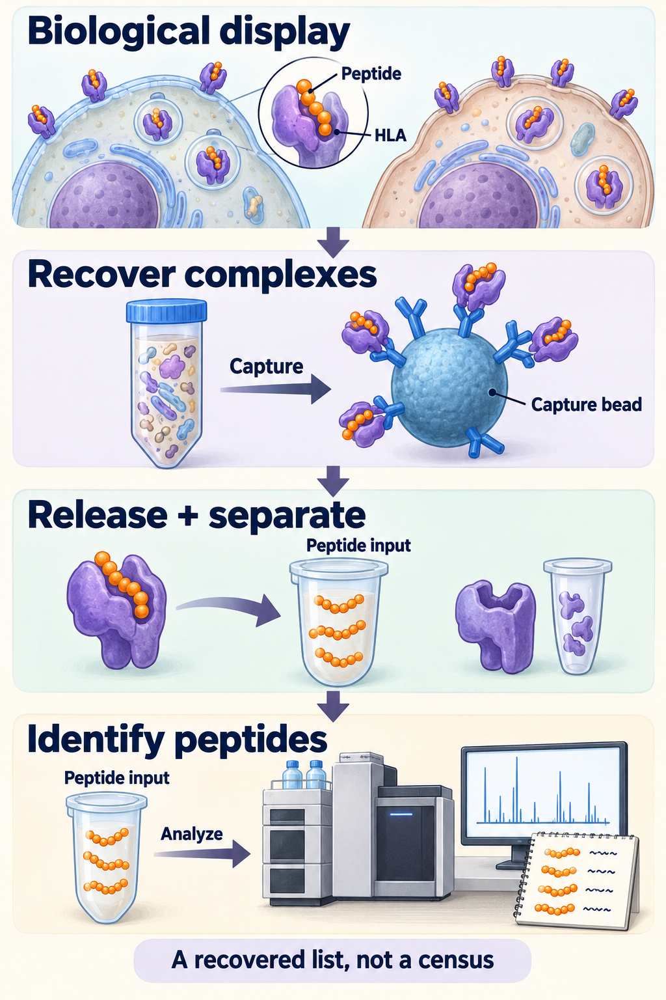

# Immunopeptidome: the biological display repertoire

## In one sentence

The immunopeptidome is the repertoire of peptides associated with human leukocyte antigen molecules in a defined cell population and biological context.

## The intuition

Think of a changing exhibition. The collection is what is displayed in that particular place and time. A visitor's notebook records only what they noticed. Likewise, a cell's peptide repertoire and a laboratory's recovered list are related but different objects.

The analogy has limits: peptides are generated, loaded and removed continuously, and laboratory recovery has chemical and computational biases. A notebook's omissions cannot tell us how many exhibits were truly absent.

## How it works

[Human leukocyte antigen (HLA)](/wiki/education/concepts/immunology/antigen-presentation/hla) molecules carry short [protein fragments, or peptides](/wiki/education/concepts/biology-basics/molecules/protein-and-peptide). Different alleles favor different sequences. [Antigen-processing machinery](/wiki/education/concepts/immunology/antigen-presentation/antigen-processing-machinery), source-protein supply, loading and turnover shape which complexes exist.

Class I and class II have distinct common processing routes. A class-I repertoire is not a census of class-II display. Nor is it a list of all cellular proteins: a protein can be abundant while a particular derived peptide is poorly generated, loaded or retained.

The repertoire depends on cell identity and state. In ovarian- and lung-cancer cell-line experiments, inflammatory signals changed HLA-associated peptide patterns. That demonstrates context-dependent remodeling; it does not mean inflammation always adds useful tumor targets. One specimen's repertoire need not represent another site, time or treatment condition.

For recognition at a living cell's surface, the relevant object is the surface peptide–HLA complex. An assay that captures HLA from whole-cell lysate can also recover intracellular complexes. The biological claim must therefore say which compartment was examined.

*Recovered HLA–peptide complexes are dissociated; separated peptides enter the identification workflow. Whole-cell recovery can include intracellular and surface complexes; the identified list is method-dependent, not a census. Molecular shapes and quantities are schematic.*

## Why it matters in cancer

A vaccine board starts with candidate sequences. The immunopeptidome concerns the subsequent presentation layer. A [T-cell receptor](/wiki/education/concepts/immunology/t-cells/t-cell-receptor) must still recognize a suitable peptide–HLA pair; presentation alone does not establish activation, killing, safety or patient benefit.

Mixed tumor tissue adds a source question. Cancer, immune and stromal cells can contribute peptides. An identified target in that mixture is not automatically cancer-cell-specific or present on every cancer cell.

## How it is measured

[Immunopeptidomics](/wiki/education/concepts/measurement/proteins-and-spatial/immunopeptidomics) captures HLA-associated material and identifies recovered peptides, commonly by liquid chromatography and tandem mass spectrometry. The method page owns the input, capture and identification details. Confidence matters too: a reported sequence can be incorrectly assigned.

| Field | Keep attached to the repertoire claim |
|---|---|
| Biological scope | Cell population, specimen site, time, state and HLA class/alleles |
| Readout | Identified peptide sequences and their evidence; unique counts depend on the workflow |
| Abundance | Relative instrument intensity is not automatically surface copies per cell |
| Coverage | Capture reagent, recovery, search database and identification threshold |
| Material and cost | Method-specific consumed tissue/cells and analysis requirements |
| Validation limit | Non-detection is not universal absence; recovery is not recognition or clinical utility |

## Common confusions

- **Biological repertoire versus recovered subset:** the reported list is shaped by sampling and measurement.
- **Protein expression versus peptide display:** the source and the displayed fragment have different dependencies.
- **More identified peptides versus better immunity:** a larger list can reflect recovery or ordinary self peptides.
- **Mixed specimen versus cancer-cell surface:** cell origin and compartment need evidence.

## Try it

Two fictional laboratories analyze comparable portions of one specimen. Method A identifies 800 peptides and method B identifies 1,200. Has B shown that those cells biologically displayed 50% more peptides?

**Answer:** No. The counts describe identified sets under two workflows. Capture, sensitivity and analysis could account for the difference. These invented numbers supply no recovery fraction or clinical threshold.

## Explain it back

“The immunopeptidome is ___; an immunopeptidomics list is ___.” One answer: “a biological repertoire in context; a method-dependent set recovered and identified from a sample.”

## Takeaway

**Name the biological set and the measurement's subset separately.**

## Related concepts

- [HLA](/wiki/education/concepts/immunology/antigen-presentation/hla)
- [Antigen-processing machinery](/wiki/education/concepts/immunology/antigen-presentation/antigen-processing-machinery)
- [Immunopeptidomics](/wiki/education/concepts/measurement/proteins-and-spatial/immunopeptidomics)

## Sources and scope

Source check: October 10, 2026. General repertoire biology and a fictional comparison; expert and learner review remain pending.

- [Sarkizova et al., 2020](https://pubmed.ncbi.nlm.nih.gov/31844290/), allele-dependent peptide repertoires in monoallelic cell lines and tumor-line validation.
- [Chong et al., 2018](https://pubmed.ncbi.nlm.nih.gov/29242379/), ovarian-cancer cell experiments and interferon-associated repertoire changes.
- [Javitt et al., 2019](https://pubmed.ncbi.nlm.nih.gov/30833945/), inflammatory signals, HLA-B expression and peptide patterns in lung-cancer cell experiments.
- [Purcell et al., 2019](https://pubmed.ncbi.nlm.nih.gov/31092913/), HLA-associated peptide isolation and identification protocol.
- [Wilhelm et al., 2021](https://pubmed.ncbi.nlm.nih.gov/34099720/), analytical sensitivity and identification limits.

<!-- BEGIN GENERATED USED IN -->
## Used in

- [Measure presentation, binding and response](/wiki/education/designing-a-vaccine/03-immunopeptidomics)
- [Read a neoantigen design board](/wiki/education/designing-a-vaccine/04-how-to-read-a-neoantigen-design-board)
- [Understand how the immune system recognizes cancer](/wiki/education/guides/how-the-immune-system-fights-cancer/index)
<!-- END GENERATED USED IN -->
