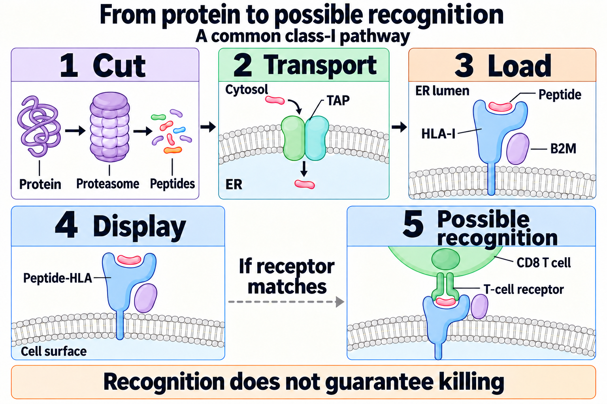
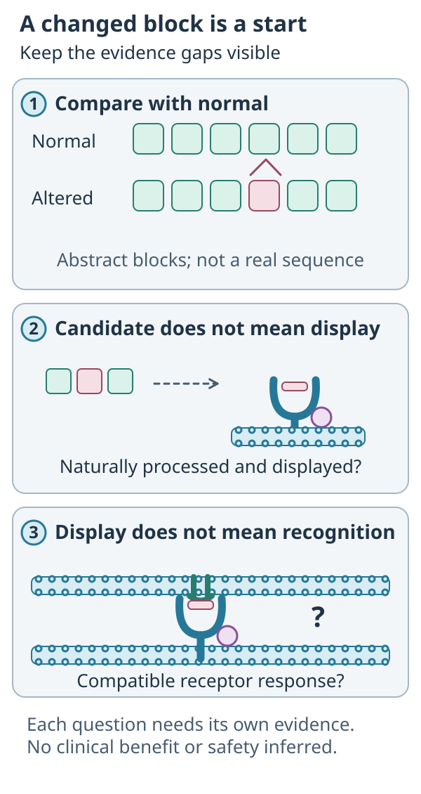

# Neoantigen

## In one sentence

A neoantigen is an immune-recognition target arising from a tumor-specific sequence alteration.

## The intuition

A changed sentence may create a new fragment a reader can notice. The tumor alteration is the source; the displayed fragment is the potential target. A real spelling change does not guarantee that anyone sees it. Likewise, a mutation alone does not demonstrate immune recognition.

## How it works

*Reference anatomy from the shared concept. The focused comparison below asks a different question.*

*A sequence change can create a candidate fragment; natural display and receptor recognition remain separate questions.*

**Read the picture:** Does the changed block prove recognition? **Answer:** No. The candidate must be naturally displayed and recognized in the claimed system.

A [deoxyribonucleic acid (DNA)](/wiki/education/concepts/biology-basics/molecules/dna) substitution, insertion, deletion or rearrangement can change a protein sequence. Altered [ribonucleic acid (RNA) splicing](/wiki/education/concepts/biology-basics/genetics/splicing) can also create candidate sequences. Compare the actual altered sequence with its normal counterpart: a mutation label alone does not specify a peptide, and not every unusual transcript is tumor-exclusive. A candidate must be expressed and processed before a conventional T cell can inspect it as a peptide displayed by human leukocyte antigen ([HLA](/wiki/education/concepts/immunology/antigen-presentation/hla)).

The [T-cell receptor](/wiki/education/concepts/immunology/t-cells/t-cell-receptor) recognizes the combined peptide–HLA surface. Different HLA alleles can present different fragments from the same altered sequence. One tumor alteration can therefore yield several candidate targets, or none that are useful.

Studies sometimes call predicted candidates “neoantigens” before recognition has been measured. Record whether the claim is sequence prediction, binding, measured presentation or an antigen-specific functional response. These are distinct evidence levels.

## Why it matters in cancer

Personalized vaccines and some engineered receptors pursue tumor-specific targets. Candidate selection must consider expression, tumor coverage, presentation, recognition and healthy-tissue cross-reactivity.

## Worked example

A fictional mutation has strong RNA support and predicted HLA binding. It is a plausible candidate. A negative tumor-recognition experiment could reflect poor display, the tested receptor or assay conditions. The sequence finding remains real while the therapeutic claim remains unproved.

## Common confusions

- Tumor-specific sequence does not guarantee immune recognition or safety.
- A [tumor-associated antigen](/wiki/education/concepts/immunology/antigen-presentation/tumor-associated-antigen) can also occur in normal tissue.
- More predicted targets do not necessarily mean broader effective coverage.

## Read the candidate's evidence

| Evidence | A supported claim | Remaining question |
|---|---|---|
| Tumor/normal sequence comparison | A sampled tumor-specific alteration | Is the altered message expressed? |
| Matched binding prediction | A model favors this peptide–HLA pair | Is it naturally processed and displayed? |
| Recovered HLA-associated peptide | That peptide was identified in this preparation | Which cells supplied it, and does a receptor recognize it? |
| Controlled response to naturally presenting tumor | Recognition or function in the tested system | Healthy-tissue specificity and patient benefit |

The primary consortium benchmark tested predicted candidates against patient-matched T cells; prediction and measured recognition did not collapse into one result. Do not transfer its performance numbers to every model, cancer or vaccine.

## Try it

Two fictional peptides come from the same alteration. A has a favorable model score; B is recognized on naturally presenting tumor cells in a controlled experiment. Which has more direct recognition evidence?

**Answer:** B, for those tested cells and conditions. A remains a prediction-supported candidate. Neither result alone shows comprehensive safety or patient benefit.

## Explain it back

Name one biological step between a changed sequence and a recognized target.

## Takeaway

**Keep “candidate” visible until the claimed step has been tested.**

## Related concepts

- [HLA](/wiki/education/concepts/immunology/antigen-presentation/hla)
- [Antigen-processing machinery](/wiki/education/concepts/immunology/antigen-presentation/antigen-processing-machinery)
- [TCR](/wiki/education/concepts/immunology/t-cells/t-cell-receptor)
- [Antigen and epitope](/wiki/education/concepts/immunology/antigen-presentation/antigen-and-epitope)
- [Self-similarity and tolerance](/wiki/education/concepts/immunology/antigen-presentation/self-similarity-and-tolerance)

## Sources and scope

Source check: October 10, 2026. This is a mechanism explanation, not a treatment recommendation. Expert and learner review remain pending.

- [NCI neoantigen definition](https://www.cancer.gov/publications/dictionaries/cancer-terms/def/neoantigen).
- [Primary HLA presentation dataset](https://www.nature.com/articles/s41587-019-0322-9), allele-dependent recovered peptides and prediction.
- [Wells et al., 2020](https://pubmed.ncbi.nlm.nih.gov/33038342/), a primary candidate-prediction and patient-matched recognition benchmark.
- [Litchfield et al., 2020](https://pubmed.ncbi.nlm.nih.gov/32733040/), frameshift expression and functional recognition evidence in specified datasets; not all transcript alterations or a universal benefit rule.

<!-- BEGIN GENERATED USED IN -->
## Used in

- [Read a neoantigen design board](/wiki/education/designing-a-vaccine/04-how-to-read-a-neoantigen-design-board)
- [Read tumor and normal data before choosing targets](/wiki/education/guides/personalized-cancer-vaccine/02-reading-tumor-and-normal-data)
- [How a personalized cancer vaccine is designed](/wiki/education/guides/personalized-cancer-vaccine/index)
- [Separate immune presence from tumor recognition](/wiki/education/multi-omics-foundations/06-immune-presence-and-recognition)
<!-- END GENERATED USED IN -->
