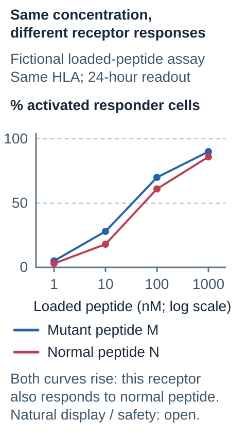

# Self-similarity and tolerance

## In one sentence

Immune tolerance restrains responses to self, while a candidate target's resemblance to healthy molecules is one factor in recognition and safety.

## The intuition

The immune system needs both recognition and restraint. A receptor that can recognize something is not automatically a receptor that should attack it. Several layers of education and regulation reduce harmful responses to healthy tissue.

Sequence comparison is useful, but a molecular “looks familiar” score is not a complete safety inspection.

## How it works

During [T-cell](/wiki/education/concepts/immunology/t-cells/t-cell) development, **central tolerance** removes many cells that react strongly to self targets and supports the development of regulatory populations. [Peripheral tolerance](/wiki/education/concepts/immunology/immune-regulation/peripheral-tolerance) restrains mature cells through mechanisms such as limited activation signals, functional unresponsiveness and regulatory T cells. These mechanisms differ from having no receptor capable of binding a self molecule.

A tumor-specific mutation may make a peptide distinguishable from its normal counterpart. That can create an opportunity for recognition, but the altered peptide still needs suitable human leukocyte antigen ([HLA](/wiki/education/concepts/immunology/antigen-presentation/hla)) display and a responsive T-cell receptor ([TCR](/wiki/education/concepts/immunology/t-cells/t-cell-receptor)). A large sequence change does not guarantee either step.

Conversely, a small change can matter if it alters peptide binding or a receptor-contact surface. There is no universal percentage of sequence identity that turns a candidate into a safe or effective treatment. Receptors can cross-react with different peptides, including peptides from unrelated proteins. Molecular shape and the presenting HLA molecule contribute alongside sequence.

Engineering receptor [affinity](/wiki/education/concepts/biology-basics/molecules/enzymes-and-binding) can change the balance. Stronger binding is not automatically more selective. Evaluation therefore includes the normal counterpart, other plausible cross-reactive peptides and relevant healthy-cell systems, with controls that test the actual recognition route.

## Why it matters in cancer

Vaccine selection asks whether a response can distinguish tumor from healthy tissue. Engineered-receptor development also asks whether the introduced receptor recognizes an unintended target. These questions overlap, but a computational comparison and a functional safety experiment provide different evidence.

## Worked example

Fictional mutant peptide M differs by one amino acid from normal peptide N. A binding model favors M. In a functional assay, a receptor responds strongly to both M and N when each is experimentally loaded onto matching HLA cells.

The prediction did not establish mutant-specific recognition. The next questions concern naturally processed display, response thresholds and healthy tissues. A second receptor that responds to M but not N in this assay is more discriminating under the tested conditions; it still needs broader cross-reactivity testing.

## Common confusions

- Tolerance is a collection of biological mechanisms, rather than a single sequence filter.
- Tumor-specific sequence does not establish tumor-exclusive receptor recognition.
- A stronger receptor can increase unwanted recognition as well as intended recognition.
- A negative result in one healthy-cell model does not cover every tissue or experimental condition.

## Read the specificity experiment

*A sequence difference does not guarantee a selective receptor response.*

Read each pair of points at the **same loaded-peptide concentration**. These curves are invented: mutant M gives 5%, 28%, 70% and 90% activated responder cells; normal N gives 3%, 18%, 61% and 86% at 1, 10, 100 and 1,000 nanomolar. Both use the same responder and matching HLA, a 24-hour activation readout, and an invented no-peptide background of 2%. Percent means activated cells divided by viable responder cells in each assay condition. The horizontal axis is logarithmic; the lines only connect example points. This receptor responds to both sequences under artificial loading, so tumor-specific sequence has not produced tumor-exclusive response. Neither curve is a safety threshold or evidence of natural processing. A broader cross-reactivity problem is documented in the primary [Cameron study](https://pubmed.ncbi.nlm.nih.gov/23926201/); its results are not the invented numbers here.

A peptide-concentration series can compare responses to mutant and normal sequences using the same HLA and responder. Keep concentration units, background and activation endpoint attached: a response threshold in this experiment is not a patient safety threshold. Artificial peptide loading also leaves natural processing open. Similarity models can identify candidates for these tests; they cannot certify an entire healthy proteome as safe.

## Try it

The fictional receptor responds to M and N after artificial loading. A writer calls it “tumor-exclusive” because only M's sequence was found in tumor [deoxyribonucleic acid (DNA)](/wiki/education/concepts/biology-basics/molecules/dna). What is missing?

**Answer:** The sequence distinction did not produce exclusive receptor recognition in that assay. Natural display and broader healthy-target tests are still needed; the existing normal-peptide response is a relevant warning.

## Explain it back

Explain how sequence specificity and receptor specificity can disagree.

## Takeaway

**Use similarity to ask better questions, not to certify safety.**

## Related concepts

- [Tumor-associated antigen](/wiki/education/concepts/immunology/antigen-presentation/tumor-associated-antigen)
- [Neoantigen](/wiki/education/concepts/immunology/antigen-presentation/neoantigen)
- [Binding prediction](/wiki/education/concepts/measurement/computational-analysis/binding-prediction)

## Sources and scope

Source-checked October 10, 2026. The example is fictional and supplies no clinical selection threshold. Expert and learner review remain pending.

- [Janeway's Immunobiology: self-tolerance and its loss](https://www.ncbi.nlm.nih.gov/books/NBK27174/), for central and peripheral tolerance mechanisms.
- [Cameron and colleagues: a titin-derived cross-reactive target](https://pubmed.ncbi.nlm.nih.gov/23926201/), a primary demonstration that an engineered MAGE-A3-directed TCR recognized another peptide.
- [Łuksza and colleagues: neoantigen quality and immunoediting](https://www.nature.com/articles/s41586-022-04735-9), a primary pancreatic-cancer study modeling similarity and recognition; its model is not a universal clinical safety rule.

<!-- BEGIN GENERATED USED IN -->
## Used in

- [Read a neoantigen design board](/wiki/education/designing-a-vaccine/04-how-to-read-a-neoantigen-design-board)
<!-- END GENERATED USED IN -->
