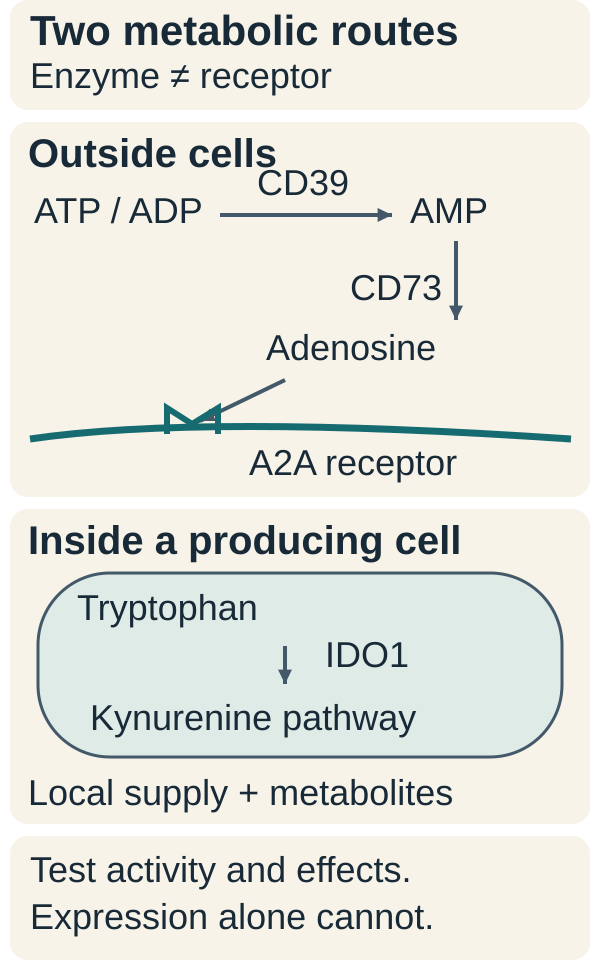
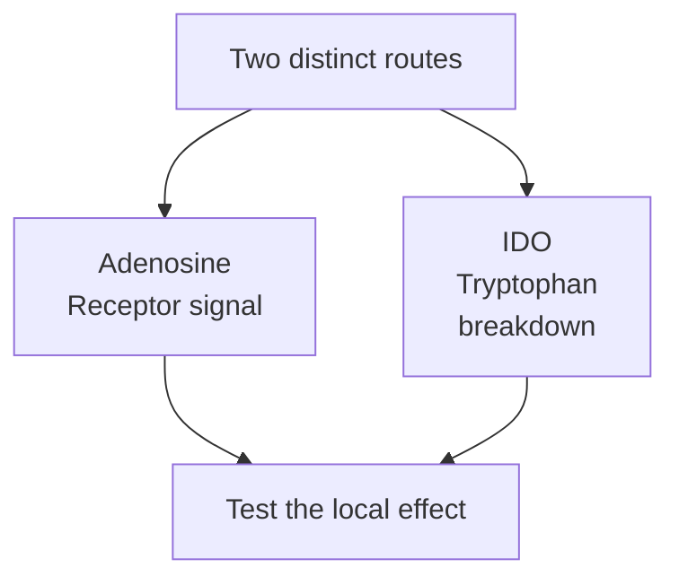

# Adenosine and IDO: two metabolic immune-regulation routes

## In one sentence

Adenosine signaling and IDO-mediated tryptophan breakdown are distinct metabolic processes that can limit immune responses in particular tissue settings.

## The intuition

Imagine two different ways a workshop slows down: one message tells workers to reduce activity; another process changes the materials available and produces new by-products. Adenosine and IDO are similarly different routes to immune regulation.

The analogy ends at the chemistry. Cells have several receptors and metabolic pathways, and the effects depend on which cells and conditions are present. Neither route is a universal master switch for tumor immunity.

## How it works

*Follow the chemistry and the location: surface enzymes generate extracellular adenosine for a receptor, while intracellular IDO1 starts tryptophan breakdown. The kynurenine-pathway arrow summarizes several downstream steps. Component expression does not establish local activity or inhibitor benefit.*

**Adenosine** is a small molecule that can signal through cell-surface receptors. Outside cells, enzymes including **CD39** and **CD73** can help generate it: CD39 converts extracellular [adenosine triphosphate (ATP)](/wiki/education/concepts/cancer-biology/metabolism-and-stress/oxidative-phosphorylation) and adenosine diphosphate (ADP) to adenosine monophosphate (AMP), and CD73 converts AMP to adenosine. These enzymes can be expressed by immune, cancer or other tissue cells; the relevant source must be measured rather than assumed.

**A2A** is one adenosine receptor through which signals can restrain T-cell activity. Adenosine signaling also helps limit inflammatory tissue damage. Mouse studies of CD39/CD73-dependent regulatory T-cell function and A2A-dependent antitumor responses support those mechanisms under their tested conditions. [Deaglio et al., 2007](https://pubmed.ncbi.nlm.nih.gov/17502665/), [Ohta et al., 2006](https://pubmed.ncbi.nlm.nih.gov/16916931/).

**Indoleamine 2,3-dioxygenase (IDO)** names enzymes involved in tryptophan breakdown; tumor-immunology discussions commonly focus on **IDO1**. Tryptophan is an amino acid used by cells. IDO1 catalyzes an early step in its conversion along the kynurenine pathway. Reduced local tryptophan and downstream metabolites can alter T-cell responses, with effects depending on the experimental setting. IDO is not an adenosine receptor or an ATP-degrading enzyme.

The arrows show routes being investigated, not proof of suppression in every sample.

Munn and colleagues demonstrated IDO-dependent suppression by selected dendritic cells from tumor-draining lymph nodes in mouse experiments. Expression in a human tissue section alone is a different evidence layer. [Munn et al., 2004](https://www.jci.org/articles/view/21583).

## Why it matters in cancer

A tumor can contain immune cells that encounter restraining metabolic signals. This helps explain why immune presence and activity must be assessed separately. It does not show that either mechanism explains a particular person's treatment course.

A receptor or enzyme perturbation in a mouse model can test causation under that model's conditions. It does not establish clinical benefit from the corresponding inhibitor in people. Normal tissue protection and adverse effects also belong in that assessment.

Clinical testing can challenge a promising mechanism. In ECHO-301/KEYNOTE-252, adding the IDO1 inhibitor epacadostat to pembrolizumab did not improve progression-free or overall survival in the tested unresectable/metastatic melanoma population. This result bounds that regimen; it neither proves all IDO research futile nor validates another inhibitor or cancer setting. [Long et al., 2019](https://pubmed.ncbi.nlm.nih.gov/31221619/).

## Common confusions

- **Adenosine versus IDO:** a receptor ligand and an enzyme-mediated pathway are different mechanisms.
- **RNA or staining versus activity:** expression does not quantify local metabolite production or immune suppression.
- **A blood metabolite versus a tumor mechanism:** circulating measurements do not locate the producing cells or establish one enzyme's contribution.
- **Mechanism versus inhibitor benefit:** biological plausibility does not guarantee a useful or safe treatment.

## How it is measured

Protein or RNA assays locate selected pathway components. Biochemical assays measure enzyme activity or metabolites under defined conditions. Functional experiments assess immune responses with suitable stimulation, viability, comparator and perturbation controls.

Keep site, sample handling, timing and units beside a result. Adenosine can change during blood collection and processing; sampling experiments directly demonstrated that handling affected recovery. [Shryock et al., 1990](https://pubmed.ncbi.nlm.nih.gov/2331011/). A circulating metabolite result does not by itself locate producing cells or demonstrate local T-cell suppression. Local concentrations and responding-cell receptors matter. A single expression cutoff does not universally select a pathway inhibitor.

## Try it

A fictional tumor section stains for CD73 and IDO1. Does it establish one dominant suppressive mechanism and the best inhibitor?

**Answer:** no. It identifies measured proteins in the sampled cells. The two pathways still require distinct activity and functional questions. Neither expression result establishes clinical treatment benefit.

**Explain it back:** how would an enzyme measurement differ from a receptor-signaling measurement?

**Takeaway:** separate the metabolic route, the measured immune effect and the clinical intervention result.

## Related concepts

- [Regulatory T cells](/wiki/education/concepts/immunology/t-cells/regulatory-t-cells)
- [Hypoxia](/wiki/education/concepts/cancer-biology/tumor-microenvironment/hypoxia)

## Sources and scope

Source check: October 10, 2026. Selected mouse mechanisms and one melanoma randomized trial; no individual treatment rule. Expert and learner review remain pending.

- [Deaglio et al., 2007](https://pubmed.ncbi.nlm.nih.gov/17502665/) — CD39/CD73-dependent adenosine generation and regulatory T-cell function in studied mouse systems.
- [Ohta et al., 2006](https://pubmed.ncbi.nlm.nih.gov/16916931/) — A2A receptor perturbation and antitumor T-cell responses in mouse models.
- [Munn et al., 2004](https://www.jci.org/articles/view/21583) — IDO-dependent suppression in mouse tumor-draining-node experiments, with a separate human observational component.
- [Shryock et al., 1990](https://pubmed.ncbi.nlm.nih.gov/2331011/) — primary human-blood sampling experiments on adenosine recovery.
- [Long et al., 2019](https://pubmed.ncbi.nlm.nih.gov/31221619/) — randomized ECHO-301/KEYNOTE-252 regimen-specific melanoma results.

<!-- BEGIN GENERATED USED IN -->
## Used in

- [The journey through a solid tumor](/wiki/education/cellular-therapies/08-solid-tumor-barriers)
- [Understand how the immune system recognizes cancer](/wiki/education/guides/how-the-immune-system-fights-cancer/index)
- [Find the step an immune response can lose](/wiki/education/oncology-101/4-escape-mechanisms)
<!-- END GENERATED USED IN -->
