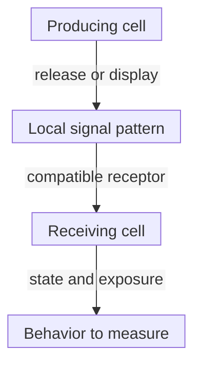

# Cytokines and chemokines

## In one sentence

Cytokines are signaling proteins that change cell behavior; chemokines are a cytokine family best known for helping direct cell movement.

## The intuition

Think of messages and directions. A message can change what a cell does; a directional pattern can help a cell navigate. The same tissue can contain many senders and receivers.

Cells do not read literal orders. A message only matters when a suitable [receptor](/wiki/education/concepts/biology-basics/signaling/ligand-and-receptor) and response machinery are present. Chemokines can affect activation as well as movement, so the analogy is a starting point rather than two sealed job descriptions.

## How it works

Immune and nonimmune cells produce cytokines. A signal can act on its producer, nearby cells or, if it reaches circulation and remains available, distant cells. Receptor engagement can alter survival, division, differentiation, inflammatory activity or movement. Cytokines supply information, not nutritional fuel.

**Pleiotropy** means one cytokine can produce different effects in different receiving cells or settings. **Redundancy** means different signals can contribute to overlapping outputs. Receptor availability, concentration, exposure duration, cell state and accompanying signals all shape the response. One cytokine name therefore does not specify one outcome.

**Interleukin-2 (IL-2)** illustrates this. It can support effector T cells and [regulatory T cells](/wiki/education/concepts/immunology/t-cells/regulatory-t-cells). Boyman and colleagues used different IL-2–antibody complexes to favor different subsets in mice. The formulation and receiving cells mattered; this was not a universal instruction to raise or lower IL-2 in cancer.

Chemokines help create **gradients**, spatial patterns of availability. Some bind tissue matrix or vessel surfaces, where cells encounter them. Movement also requires compatible receptors, adhesion and a traversable route. A chemokine is not a magnet that pulls every immune cell through every barrier.

Weber and colleagues demonstrated an immobilized **C-C motif chemokine ligand 21 (CCL21)** gradient guiding dendritic cells toward lymphatic vessels in mouse skin. Disrupting that pattern impaired directed migration. This is evidence about a particular ligand, tissue and cell pair, not proof that any high chemokine concentration improves tumor entry.

*Amount, location and the receiver are separate parts of the mechanism. A bulk average omits the pattern.*

## Why it matters in cancer

Cytokines can shape priming, recruitment and local regulation. The same signal can act on several populations with different consequences. A tumor-associated signal, or increased cytokine production by a cell product, does not identify a safe target or demonstrate cancer-cell killing. [Interferons](/wiki/education/concepts/immunology/the-immune-system/interferons) are one cytokine group with particularly important timing and receiver effects.

## How it is measured

Protein assays can report picograms per milliliter (pg/mL) in a specified fluid. [Intracellular cytokine staining](/wiki/education/concepts/measurement/immune-monitoring/intracellular-cytokine-staining) can report the percentage of a defined cell gate producing a measured protein after stimulation. [Ribonucleic acid (RNA)](/wiki/education/concepts/measurement/transcriptomics/bulk-rna-seq) expression is another layer; it does not establish released protein concentration.

Specify fluid or tissue, collection time, stimulation, assay calibration and detection limit. A blood concentration does not reconstruct a tumor gradient. Migration or downstream signaling requires a functional experiment, with viability, background and receptor-related controls appropriate to the hypothesis.

## Try it: an average is not a gradient

Two fictional preparations have equal-sized compartments. In A, chemokine concentrations are 0 and 20 pg/mL; in B, both are 10 pg/mL. Each average is (0 + 20)/2 or (10 + 10)/2 = 10 pg/mL. Does that make the spatial information or movement equivalent?

**Answer:** No. A has a concentration difference; B does not. This simplified two-compartment example is not a physiological gradient or an optimal-dose claim. Whether cells move depends on the actual spatial pattern, receptor system and other conditions. Equal averages do not establish equal function.

## Common confusions

- Chemokines are cytokines, not an unrelated category.
- A growth-support signal does not choose the antigen a T cell recognizes.
- A gene-expression increase is not a measured secreted-protein increase.
- More signal is not automatically more useful or safer immunity.

## Explain it back

Why can the same cytokine produce different responses, and why can two equal concentrations hide different spatial patterns?

## Takeaway

**Read the message together with its receiver, distribution and measured effect.**

## Related concepts

- [Lymph nodes and lymphatics](/wiki/education/concepts/immunology/the-immune-system/lymph-nodes-and-lymphatics)
- [T-cell priming](/wiki/education/concepts/immunology/t-cells/t-cell-priming-three-signals)

## Sources and scope

Source-checked October 10, 2026. Signaling and migration foundations; invented concentrations, no dose or clinical cutoff. Expert and learner review remain pending.

- [Janeway et al.: induced innate responses, sections 2-19 and 2-20](https://www.ncbi.nlm.nih.gov/sites/books/NBK27122/) — cytokine actions, chemokines, receptors and spatial presentation.
- [Weber et al., 2013](https://pubmed.ncbi.nlm.nih.gov/23329049/) — immobilized chemokine gradients and DC movement in mouse skin.
- [Boyman et al., 2006](https://pubmed.ncbi.nlm.nih.gov/16484453/) — different IL-2–antibody complexes supporting different T-cell subsets in mouse experiments.

<!-- BEGIN GENERATED USED IN -->
## Used in

- [Cytokines and programmable receptors](/wiki/education/cellular-therapies/07-cytokines-and-programmable-receptors)
- [Understand how the immune system recognizes cancer](/wiki/education/guides/how-the-immune-system-fights-cancer/index)
- [Separate immune presence from tumor recognition](/wiki/education/multi-omics-foundations/06-immune-presence-and-recognition)
- [How dendritic cells help start a T-cell response](/wiki/education/oncology-101/2-dendritic-cells)
- [Oncology 101: immune foundations](/wiki/education/oncology-101/index)
<!-- END GENERATED USED IN -->
