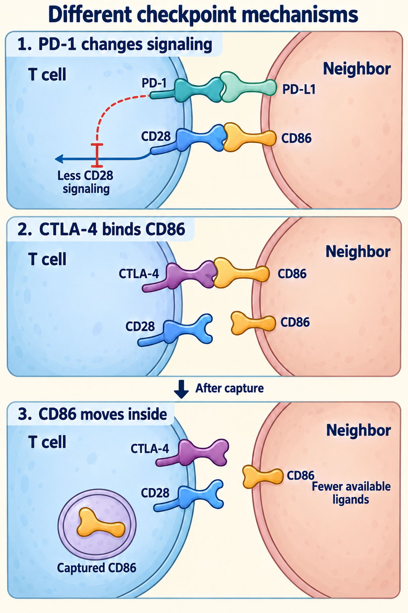

# Immune checkpoints

## In one sentence

Immune checkpoints are regulatory interactions that adjust immune-cell responses, including inhibitory pathways that help protect healthy tissue.

## The intuition

A useful response needs controls as well as an accelerator. The familiar “brake” analogy describes inhibition, but several brakes have different wiring. Releasing one does not supply a missing target, build a road into a tumor or repair every dysfunctional cell. Real cells integrate several signals at once.

## How it works

[Receptors and their ligands](/wiki/education/concepts/biology-basics/signaling/ligand-and-receptor) make contacts that change cell signaling. **Programmed cell death protein 1 (PD-1)** is an inhibitory receptor expressed by activated immune cells. Its partners are **programmed death-ligand 1 (PD-L1)** and **programmed death-ligand 2 (PD-L2)**. PD-L1 can occur on cancer cells and noncancer cells. In biochemical and cell experiments, PD-1 signaling preferentially reduced signaling through CD28, a receptor supplying [costimulation](/wiki/education/concepts/immunology/t-cells/costimulation). That finding does not make CD28 its only possible signaling target in every context.

**Cytotoxic T-lymphocyte-associated protein 4 (CTLA-4)** shares CD80 and CD86 binding partners with CD28. It can limit costimulation by competing for these partners and by capturing and removing them from another cell. The latter mechanism is called *trans-endocytosis*. It changes what supporting signals the neighboring cell can offer.

*PD-1 can reduce signaling within a responding cell; CTLA-4 can remove supporting ligands from its neighbor. Selected experimental mechanisms; illustrated molecule counts are schematic.*

Source scope beside the visual: the illustration uses PD-L1 and CD86 as examples. Other partners and regulatory mechanisms remain in the surrounding text. The PD-1/CD28 relationship is a symbolic summary of biochemical and cell experiments, not proof of a universal CD28-only effect. The capture sequence is not a drug-blockade diagram or a clinical prediction.

Mechanism sources: [Hui et al., 2017](https://pubmed.ncbi.nlm.nih.gov/28280247/) for PD-1/CD28 signaling and [Qureshi et al., 2011](https://pmc.ncbi.nlm.nih.gov/articles/PMC3198051/) for CTLA-4 ligand capture.

[Human leukocyte antigen (HLA)](/wiki/education/concepts/immunology/antigen-presentation/hla) is the human name for major histocompatibility complex molecules.

Other named checkpoints are not interchangeable versions of PD-1:

| Receptor | A source-backed mechanism | Keep this boundary beside it |
|---|---|---|
| **Lymphocyte activation gene 3 (LAG-3)** | In the cited experiments, recognition of stable peptide–major histocompatibility complex class II complexes triggered inhibitory signals | It did not recognize every class-II complex equally or simply block receptor contact with the peptide |
| **T-cell immunoglobulin and mucin domain-containing protein 3 (TIM-3)** | Its intracellular partner Bat3 (HLA-B-associated transcript 3) restrained inhibitory effects; galectin-9 stimulation disrupted that association in tested helper-T-cell systems | Ligand, cell type and intracellular partners matter; staining is not a universal “off” switch |
| **T-cell immunoreceptor with immunoglobulin and immunoreceptor tyrosine-based inhibitory motif domains (TIGIT)** | Direct interaction with the costimulatory receptor CD226 on the same cell disrupted CD226 pairing in the cited models | That controlled mechanism and model response do not establish benefit from a clinical combination |

These examples explain different regulatory contacts, not an exhaustive ligand list or a ranking of drug targets.

## Checkpoint sites of action

[Priming](/wiki/education/concepts/immunology/t-cells/t-cell-priming-three-signals) prepares a response; an effector response carries out activity. CTLA-4 is often emphasized during priming, when cells receive CD28 support from antigen-presenting cells. PD-1 is often emphasized during ongoing responses in tissues.

These are **nonexclusive emphases**. Antigen-presenting cells and responding T cells interact in more than one location and stage. CTLA-4 also regulates ongoing contacts; PD-1 can regulate contacts involving costimulation. LAG-3, TIM-3 and TIGIT cannot be assigned to one exclusive box merely because a diagram places them there. Ask which cells, partners, tissue and experimental condition were tested.

## Why it matters in cancer

Checkpoint pathways can restrain cancer-reactive responses. A [checkpoint inhibitor](/wiki/education/concepts/therapeutics/immunotherapy/immune-checkpoint-inhibitor) interrupts a particular pathway. It does not teach every T cell a new target. Recognition, access and useful function remain requirements; changing normal regulation can also harm healthy organs. Clinical benefit needs evidence for the drug, population and setting.

## How it is measured

Protein staining measures selected components in sampled cells. [Gene expression](/wiki/education/concepts/measurement/transcriptomics/bulk-rna-seq) measures another layer. Neither alone establishes ligand contact or causal inhibition. A controlled functional experiment can compare the same stimulus with and without a specific perturbation, alongside viability and specificity controls. Its result remains bounded to that model.

## Common confusions

- Checkpoints are normal regulation, not proteins reserved for cancer.
- PD-1-positive cells need not all be exhausted or cancer-reactive; [T-cell states](/wiki/education/concepts/immunology/t-cells/t-cell-states) require context.
- More receptor staining does not prove more inhibition or greater drug benefit.
- Priming versus effector is a useful comparison, not a two-address sorting rule.

## Try it

A fictional tissue sample contains TIM-3-positive T cells. Does that select TIM-3 blockade over PD-1 blockade?

**Answer:** No. It shows measured expression. Their targets, regulatory partners, function and response to perturbation remain open. Choosing a therapy also requires clinical evidence and safety assessment.

## Explain it back

“Checkpoint expression tells me ___; pathway dependence would require ___.” One answer: “which component was detected; appropriate functional evidence in a defined context.”

## Takeaway

**Name the regulatory contact and tested context before turning a checkpoint label into a mechanism claim.**

## Related concepts

- [T-cell priming](/wiki/education/concepts/immunology/t-cells/t-cell-priming-three-signals)
- [Immune escape](/wiki/education/concepts/immunology/tumor-immunology/immune-escape)

## Sources and scope

Source check: October 10, 2026. These primary studies support scoped mechanisms, not an approval inventory or a clinical combination recommendation. Expert and learner review remain pending.

- [Qureshi et al., 2011: CTLA-4 removes CD80/CD86](https://pubmed.ncbi.nlm.nih.gov/21474713/). Cell and animal experiments.
- [Hui et al., 2017: CD28 as a preferential target of PD-1 inhibition](https://pubmed.ncbi.nlm.nih.gov/28280247/). Reconstitution and cell experiments.
- [Maruhashi et al., 2018: LAG-3 selectivity for stable peptide–class-II complexes](https://pubmed.ncbi.nlm.nih.gov/30349037/). Mechanism statement checked at primary abstract depth.
- [Rangachari et al., 2012: Bat3 regulates TIM-3-associated effects](https://pmc.ncbi.nlm.nih.gov/articles/PMC3491118/). Defined helper-cell and mouse models.
- [Johnston et al., 2014: TIGIT and CD226-dependent responses](https://pubmed.ncbi.nlm.nih.gov/25465800/). Primary abstract supports the same-cell interaction and preclinical response boundary.

<!-- BEGIN GENERATED USED IN -->
## Used in

- [The journey through a solid tumor](/wiki/education/cellular-therapies/08-solid-tumor-barriers)
- [Understand how the immune system recognizes cancer](/wiki/education/guides/how-the-immune-system-fights-cancer/index)
- [Read an injected-treatment study](/wiki/education/guides/local-therapy-and-the-immune-system/07-read-an-injected-treatment-study)
- [Follow the route to immune recognition](/wiki/education/guides/start-here/02-follow-immune-recognition)
- [Ask what happens after binding](/wiki/education/oncology-101/1-ligands)
- [Why a T-cell count does not tell the whole story](/wiki/education/oncology-101/3-t-cell-states)
- [Find the step an immune response can lose](/wiki/education/oncology-101/4-escape-mechanisms)
- [Oncology 101: immune foundations](/wiki/education/oncology-101/index)
<!-- END GENERATED USED IN -->
