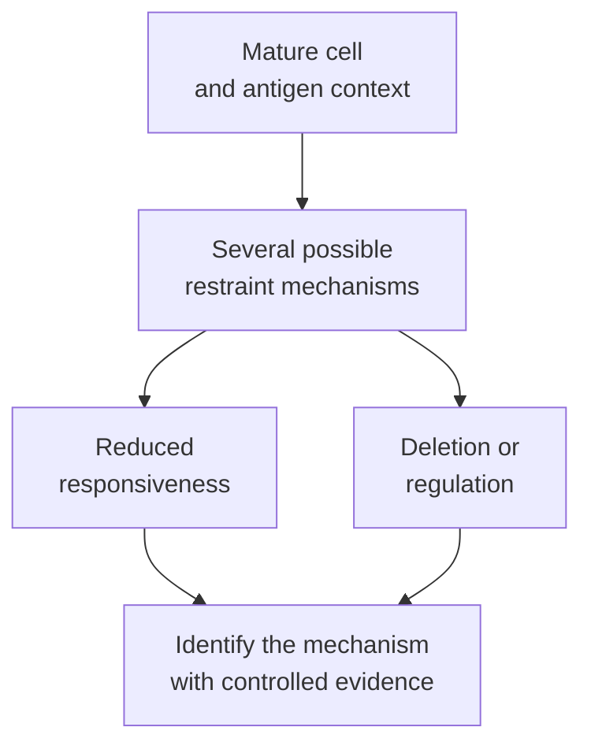

# Peripheral tolerance

## In one sentence

Peripheral tolerance is the collection of mechanisms that restrain mature immune cells after development, helping prevent harmful responses to self and other tolerated material.

## The intuition

Training new members of a team is not enough to keep every later action appropriate. Ongoing rules and local supervision also matter. Immune tolerance likewise operates during development and after cells enter mature populations.

This is an analogy about layered restraint, not perfect supervision. Developmental selection leaves some potentially self-reactive cells, and peripheral regulation can fail or be exploited by a tumor.

## How it works

**Central tolerance** acts during lymphocyte development, including T-cell selection in the thymus and B-cell development in bone marrow. **Peripheral tolerance** acts on mature cells across tissues and lymphoid organs. These categories name when and where restraint operates; they are not two equally complete filters that remove every self-reactive receptor.

Several mechanisms can contribute. [Anergy](/wiki/education/concepts/immunology/t-cells/anergy) reduces antigen-driven responsiveness in defined contexts. **Deletion** removes cells through cell death. [Regulatory T cells](/wiki/education/concepts/immunology/t-cells/regulatory-t-cells) can suppress other responses. Inhibitory pathways and restricted availability of supporting signals also shape activation. Tolerance is the combined outcome, not a synonym for any one mechanism.

Deletion and restraint are different. A deleted clone is no longer present; a restrained clone may remain alive but respond differently under specified conditions. Kurts and colleagues studied self-antigen cross-presentation in transgenic mice. They found that CD4 T-cell help altered the deletion of autoreactive CD8 T cells and favored autoimmunity. This illustrates context changing a mature cell's fate, not a general instruction to add or remove help in people.

Regulation can also occur between cells. Sakaguchi and colleagues demonstrated a protective regulatory-cell population in mouse transfer/depletion experiments. Qureshi and colleagues later showed **cytotoxic T-lymphocyte-associated protein 4 (CTLA-4)** removing supporting CD80/CD86 molecules from presenting cells. That is a specific mechanism regulating ligand availability, rather than simply putting a brake inside every responder.

The absence of a response has other explanations. **Immune ignorance** describes a setting where the relevant cells have not effectively encountered the antigen. Missing access or display is different from demonstrated tolerance after an encounter. Likewise, antibody concentration alone cannot show that self-reactive B cells were deleted or restrained.

*The same quiet response can arise through different mechanisms; missing encounter is another possibility.*

## Why it matters in cancer

Many tumor-associated targets are also found in healthy tissue. Normal tolerance helps explain why recognition and activation are not interchangeable. Tumors can exploit regulatory pathways, but a treatment releasing restraint can also harm normal organs.

A [neoantigen](/wiki/education/concepts/immunology/antigen-presentation/neoantigen) may differ from the normal molecule, yet that sequence difference alone does not demonstrate recognition, useful activation or safety. Keep candidate specificity, natural target display and healthy-tissue cross-reactivity as separate tests.

## How it is measured

Tolerance is inferred through mechanism-specific experiments, not a universal blood score. Measure controlled responses to a defined antigen; assess deletion with lineage/count evidence, and regulatory suppression with suitable coculture or pathway tests. State cell type, prior exposure and comparator.

A nonresponse may instead reflect absent receptors, poor viability or an unsuitable assay. A self-similarity calculation is a candidate-screening observation; it does not directly measure central or peripheral tolerance in a person.

## Common confusions

- Peripheral means after development, not merely outside a tumor.
- Peripheral tolerance includes more than anergy.
- No response does not establish deletion or ignorance by itself.
- Releasing one restraint does not supply a missing receptor or guarantee tumor killing.

## Try it

In a fictional assay, viable antigen-specific cells remain present but respond poorly. Has deletion been shown?

**Answer:** No. The cells remain present. Reduced responsiveness, suppression and assay limitations are possible; deletion needs evidence of cell loss under the defined conditions.

## Related concepts

- [Thymic output and aging](/wiki/education/concepts/immunology/t-cells/thymic-output-and-aging)
- [Immune-related adverse events](/wiki/education/concepts/therapeutics/toxicities-and-supportive-care/immune-related-adverse-event)

## Sources and scope

Source check: October 9, 2026. Layered restraint and defined mechanisms; fictional practice, no treatment rule. Expert and learner review remain pending.

- [Immunobiology: self-tolerance](https://www.ncbi.nlm.nih.gov/books/NBK27174/) — central/peripheral and T-cell/B-cell context.
- [Kurts et al., 1997](https://pubmed.ncbi.nlm.nih.gov/9396776/) — self-antigen, help and deletion in a transgenic mouse model.
- [Sakaguchi et al., 1995](https://pubmed.ncbi.nlm.nih.gov/7636184/) — regulatory-cell dependence of tolerance in mouse experiments.
- [Qureshi et al., 2011](https://pubmed.ncbi.nlm.nih.gov/21474713/) — primary CTLA-4 ligand-removal mechanism.

<!-- BEGIN GENERATED USED IN -->
## Used in

- [Understand how the immune system recognizes cancer](/wiki/education/guides/how-the-immune-system-fights-cancer/index)
- [Why a T-cell count does not tell the whole story](/wiki/education/oncology-101/3-t-cell-states)
<!-- END GENERATED USED IN -->
